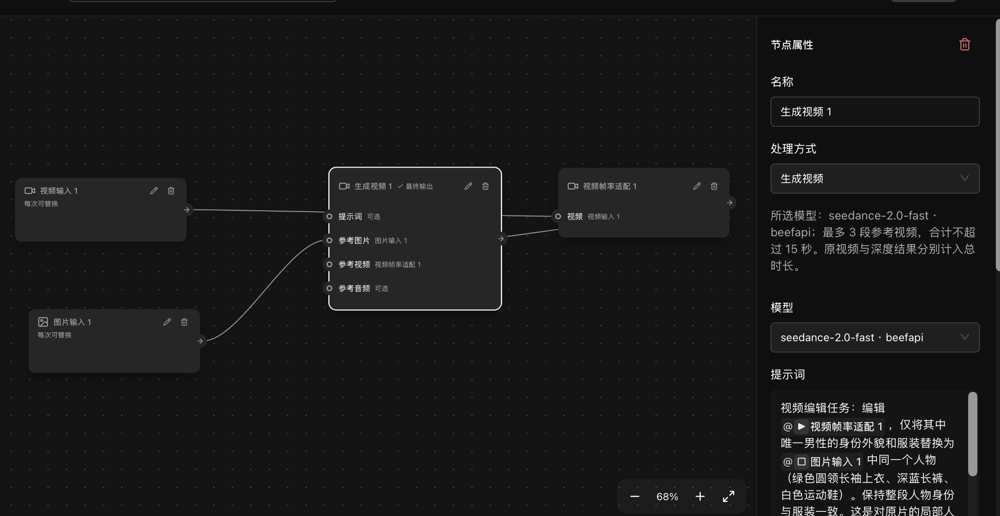
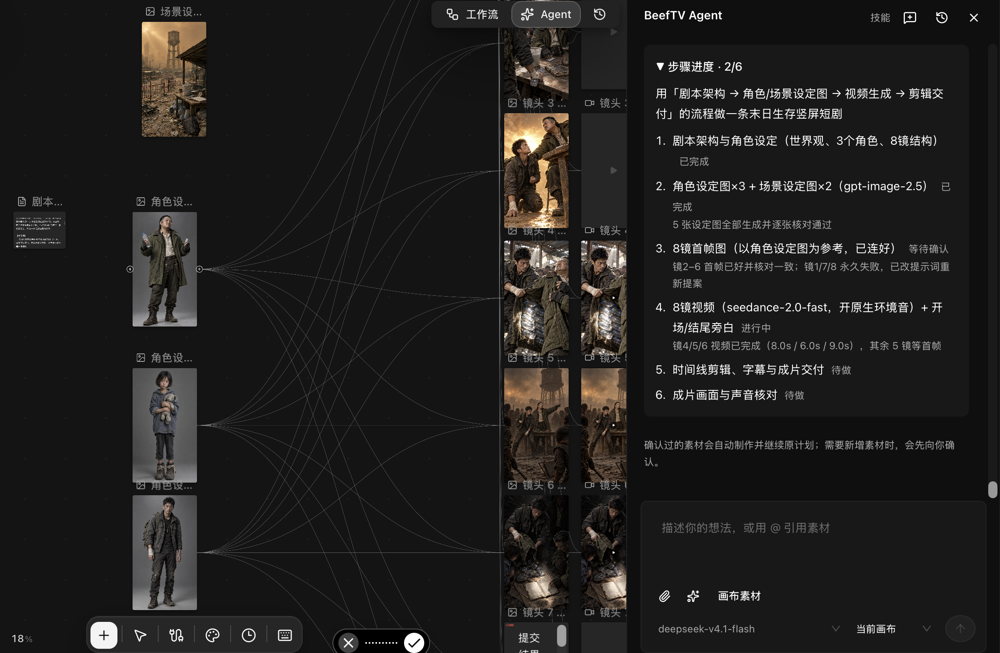
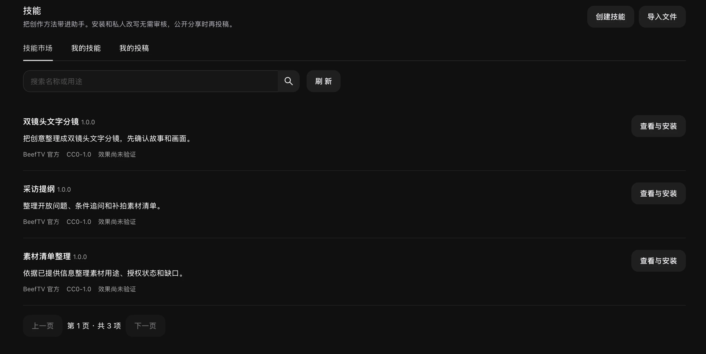

  

<strong>High-performance · Lightweight · AI Native</strong>

  An AI-native workspace for video creation. 
  Connect ideas, models, and media on one freeform canvas.

  Create with BeefTV Agent, extend your methods with Skills, and reuse your process with Workflows. 
  From storyboards and media to finished videos, keep your work editable and ready to build on.

  
  
  
  
  

  
  
  
  

  <a href="README.md">简体中文</a> ·
  <a href="#recent-updates">Recent updates</a> ·
  <a href="#product-demo">Product demo</a> ·
  <a href="#workflows">Workflows</a> ·
  <a href="#beeftv-agent">Agent</a> ·
  <a href="#skills">Skills</a> ·
  <a href="docs/content/docs/overview/features.mdx">Feature list</a> ·
  <a href="QUICKSTART.md">Get started</a> ·
  <a href="CONTRIBUTING.md">Contributing</a>

## Recent updates

- **[v2.0.3](https://github.com/glanderness/BeefTV/releases/tag/v2.0.3)** — Improve video prompt and reference validation, restore saved parameters on retry, and improve upscaling request reliability.
- **[v2.0.2](https://github.com/glanderness/BeefTV/releases/tag/v2.0.2)** — Add Seedream layer splitting and related image sets; improve Agent multi-image checks, task recovery, and reference uploads.
- **[v2.0.1](https://github.com/glanderness/BeefTV/releases/tag/v2.0.1)** — Add reusable workflows and Topaz upscaling, with fixed-version skill installation, rollback, and private adaptations.
- **[v2.0.0](https://github.com/glanderness/BeefTV/releases/tag/v2.0.0)** — Connect storyboard planning, production, and video export through the creative assistant, with audiovisual checks, a skill marketplace, and editable projects.
- **[v1.7.27](https://github.com/glanderness/BeefTV/releases/tag/v1.7.27)** — Standardize Music 3.0 output on MP3 and improve music generation connections and desktop update downloads.

[All releases and detailed notes](https://github.com/glanderness/BeefTV/releases)

## Product demo

<video src="https://github.com/user-attachments/assets/da4081e0-26bc-424e-b20c-124f92ce6538" controls preload="metadata" playsinline></video>

New product demo · About 45 seconds.

## Workflows

**Save the steps that work for your next creation.**

Connect media, local processing, and AI generation in an editable workflow. The **single-character replacement workflow** takes a motion video and a character reference image, adapts the video frame rate, then passes both references to Seedance 2.0 Fast.

| Source video · 12.0 seconds | Finished replacement example · 12.0 seconds |
| --- | --- |
|  |  |

<video src="https://github.com/user-attachments/assets/cadf1e3b-e1fa-4a45-83a0-c8cdacc4d1b1" controls preload="metadata" playsinline></video>

[Production record](docs/content/docs/overview/examples.mdx#工作流单人物替换) (Chinese)

- **Connect processing and generation:** Adapt frame rate locally; use the video and character image as separate generation references.
- **Keep the configuration editable:** Adjust nodes, connections, models, prompts, and output settings, then save a template revision.
- **Reuse the structure with new inputs:** Bind a different motion video or character image; adapt constraints and parameters to the new shots.

Template revisions 13 and 14 have successful runs in the local 2.0.1 app. The finished example also includes shot-level corrections, stitching, and restoration of the original audio. Those steps are not all encapsulated in the template; this does not demonstrate one-click completion for arbitrary media or frame-perfect preservation. Model generation is billed by your chosen provider.

## BeefTV Agent

**Turn a conversation into an editable creative project.**

> “Help me make a viral post-apocalyptic short drama.”

In the local example **The Last Bottle of Water**, the user specified the production order and confirmed generation plans. The Agent built **25 nodes and 48 connections**, covering the story outline, an eight-shot storyboard, characters, scenes, first frames, video, and Mandarin narration. The process and assets remain on the canvas.

<table>
  <tr><th width="33%">Character design · Shenmo</th><th width="33%">Scene design · Water ration point</th><th width="34%">Generated shot · Click to play</th></tr>
  <tr>
    <td></td>
    <td></td>
    <td><video src="https://github.com/user-attachments/assets/0c0e1174-479d-4394-a4b2-7c64a3367e0a" controls preload="metadata" playsinline></video></td>
  </tr>
</table>

- **Plan:** Define the world, characters, and storyboard, including shot duration, visuals, motion, and sound.
- **Execute:** Create nodes and reference connections, then generate characters, scenes, shots, and narration after confirmation.
- **Inspect and continue:** Read actual outputs, check designs and first frames, preserve successful assets and failure states, and continue refining.

Another shot · About 9 seconds:

<video src="https://github.com/user-attachments/assets/b304bdd1-5a3f-4e96-929b-46a9cbff29bf" controls preload="metadata" playsinline></video>

[Listen to the opening narration](assets/readme/beeftv-agent-drama-narration-opening.mp3) · [Production record](docs/content/docs/overview/examples.mdx#agent聊天驱动的短剧制作) (Chinese)

This example has 3 character images, 2 scene images, 5 shot first frames, 3 video clips, and 2 narration clips. Final editing, subtitles, and audiovisual acceptance remain unfinished. Generation requires configured model providers; audiovisual review also requires a supported multimodal model. Human review is still needed.

## Skills

**Keep your creative methods ready to use.**

Give the creative assistant methods, steps, and requirements for specific tasks. Browse the skill marketplace, review requirements and files, then install a specific version.

| Official skill | Actual deliverable in this session |
| --- | --- |
| Two-shot text storyboard | Coffee short: two 4-second shots, with visuals, sound, and items to confirm. |
| Interview outline | Community bookstore: three open questions, follow-ups, supporting footage, and permissions. |
| Media inventory | Coffee video + dawn photo: purposes, stated permissions, and duration and sound gaps. |

Captured from the installed 2.0.1 app. These runs used private local copies of the official 1.0.0 skill files. The marketplace still labels their results as unverified. [See all three inputs and results](docs/content/docs/overview/examples.mdx#skills三个文字任务) (Chinese).

- **Use what you need:** Enable or disable installed skills in your library.
- **Manage versions:** Check for updates or return to a previously installed version.
- **Make it yours:** Create a private adaptation. Authors can prepare submissions, with separate confirmations for upload and public review.

Text-only skills do not require a multimodal model. Skills involving images, video, or audio require the capabilities listed in their requirements.

## One canvas, a complete creative workflow

- **Generate:** Create text, images, video, and audio from prompts or reference media.
- **Organize:** Connect nodes to build relationships between assets, creative context, and generation steps.
- **Refine:** Crop, annotate, inpaint, split, reference, and combine results.
- **Iterate:** Keep your process and reuse assets, turning a single generation into an evolving workflow.

BeefTV also includes project and personal asset libraries, asynchronous tasks, model providers, and creative tools.

## Why BeefTV

| High Performance | Lightweight | AI Native |
| --- | --- | --- |
| Rendering, media previews, and task handling optimized for complex canvases. | Local-first, with one desktop workspace to get started and capabilities loaded as needed. | An Agent to advance your work, Skills to guide it, and Workflows to reuse the steps. |

## Open by design

- Configure text, image, video, and audio model providers freely, without being tied to a single provider.
- Manage projects, canvases, assets, and tasks in one workspace, with data that can be saved and migrated locally.
- Built for desktop with React, Go, and Wails, with extensible model protocols and workspace capabilities.

## Get started

1. [Download the desktop app](https://github.com/glanderness/BeefTV/releases/latest) and follow the [first-launch instructions](QUICKSTART.md#下载与首次打开). Enter your local workspace without signing up.
2. In model settings, connect your BeefTV account or add your own model provider.
3. Create a canvas, add reference media, and describe your goal to the creative assistant. You can also start creating directly with nodes.

See [Quick Start](QUICKSTART.md) for model setup and building from source, and the [desktop release guide](docs/desktop-release.md) for packaging requirements.

## Contributing and license

Issues and pull requests are welcome. See [`CONTRIBUTING.md`](CONTRIBUTING.md) for the development workflow and testing requirements.

The repository uses licenses with different scopes. Original content added under the new license, starting with the commit that first introduced it and subject to its terms, is covered by the [`BeefTV Source Available License 1.0`](LICENSE). Historical content released under MIT remains under the MIT terms retained in the same file. Upstream and third-party materials keep their respective licenses.

The new license permits self-hosting, internal customization, and creating and selling works with BeefTV. Written authorization is required for commercial resale, rebranding and resale, paid deployment or custom delivery of covered software, and providing hosted features to third parties, whether free or paid. Independent tutorials, training, and general technical consulting may be paid services, but must not be used to deliver the software system indirectly. Contact us about authorization at [lucas@bf-labs.cn](mailto:lucas@bf-labs.cn).

The new restrictions do not apply retroactively to historical MIT content or override independently licensed third-party materials. This is a source-available license; the entire repository should not be treated as standard MIT or as an open source project under the OSI definition. See the [license guide](docs/content/docs/overview/licensing.mdx) for covered scenarios and boundaries, and [`NOTICE`](NOTICE) for upstream sources and third-party attributions.

## ⭐ Star History

<a href="https://www.star-history.com/?repos=glanderness%2FBeefTV&amp;type=date&amp;legend=bottom-right">
  <picture>
    <source media="(prefers-color-scheme: dark)" srcset="https://api.star-history.com/chart?repos=glanderness/BeefTV&amp;type=date&amp;theme=dark&amp;legend=bottom-right" />
    <source media="(prefers-color-scheme: light)" srcset="https://api.star-history.com/chart?repos=glanderness/BeefTV&amp;type=date&amp;legend=bottom-right" />
    
  </picture>
</a>
