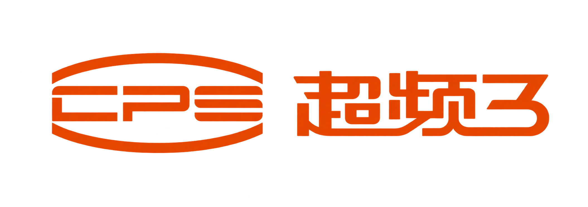
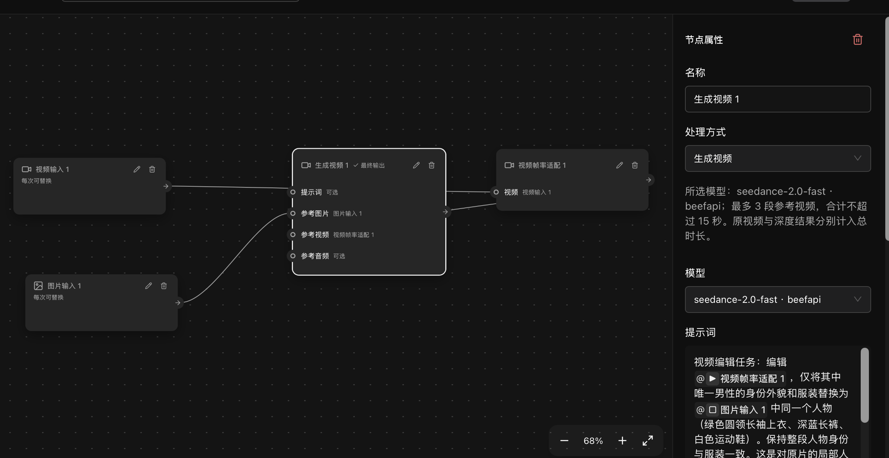
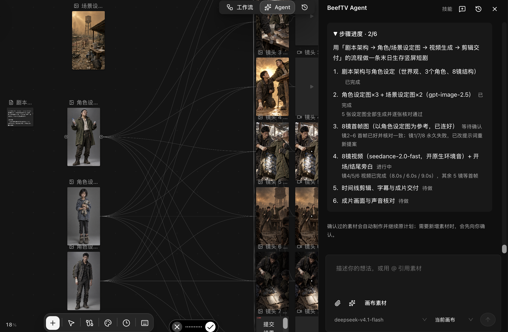
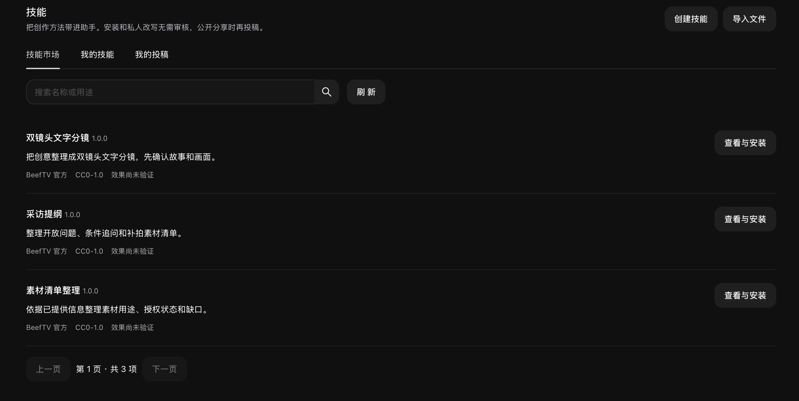

  

<strong>High-performance · Lightweight · AI Native</strong>

  面向 AI 时代的视频创作工作台。 
  在一个自由画布中连接创意、模型与素材。

  与 BeefTV Agent 一起推进创作，用 Skills 扩展方法，用工作流复用过程。 
  从分镜、素材到成片，让创作可以继续编辑、迭代和积累。

  
  
  
  
  

  
  
  
  

  <a href="README.en.md">English</a> ·
  <a href="#最近更新">最近更新</a> ·
  <a href="#产品演示">产品演示</a> ·
  <a href="#工作流">工作流</a> ·
  <a href="#beeftv-agent">Agent</a> ·
  <a href="#skills">Skills</a> ·
  <a href="docs/content/docs/overview/features.mdx">功能清单</a> ·
  <a href="QUICKSTART.md">开始使用</a> ·
  <a href="CONTRIBUTING.md">参与贡献</a>

## 最近更新

- **[v2.4.5](https://github.com/glanderness/BeefTV/releases/tag/v2.4.5)** — 内置创作助手可靠性全面加固并升级底层 `@earendil-works/pi-*`（`1.5.0 → 1.6.0`）：修复续跑提案确认 409 与冷启动「助手暂时用不了」/首秒 503，提案与续跑授权收归 `GenerationOrder` 单一来源（外部客户端不能直接提交内置助手生成单，需由界面或 `beeftv approve` 确认），修复 `media.overview` 多余版本校验、独立画布同回合产物审片误拒 `scope_denied`、`/assets/batch` 并发请求风暴、`/events` 体积上限提至 `256 KiB` 与确认接口放宽至 `1 MiB`、多条失败提示粘连及诊断库采集盲区；BeefTV 官方算力模型目录与价格改为 `ETag/304` 与内联价格无感热更新；声音克隆与音频全能参考按服务端能力放行参考音轨并补齐连线与直传；视频播放新增有声无画不可解码视频轨检测并自动回退 H.264 兼容转码；修复插件 OOM 隔离、自定义渠道确认卡死、切画布丢节点、大画布读超时与托管视频约束。
- **[v2.4.4](https://github.com/glanderness/BeefTV/releases/tag/v2.4.4)** — 修复大体积本地工作区冷启动阻塞与 `bootstrap_timeout`（启动期延后全库归档与孤儿清理并支持忙时自动退避重排、资源引用改走单源注册表主键分块扫描与不可伪造水印快路径、内置助手异步拉起并支持可取消关闭与超时强制回收、前端工作区引导与本地模型配置请求超时扩至 15 秒）；对象存储分片直传升级 4 并发上传，视频超分与智能擦除动态对齐最高 `1 GiB` 上传上限，桌面端上传与成片落盘上限提升至 `2 GiB` 并实现全链路磁盘流式下载与磁盘音轨补回；视频超分估价改纯元数据单路径并统一零拷贝预检、真实中文报错透传与 `ffprobe` 环境检测。
- **[v2.4.3](https://github.com/glanderness/BeefTV/releases/tag/v2.4.3)** — 局部重绘、表情与角度调整统一保留用户所选图片模型，无原生蒙版但支持参考图的模型自动在本地按蒙版融合（保留未选区域原像素且恢复不重复计费）；生成与取回期间统一隐藏图片/视频节点上方处理栏，画布右键新增「复制图片」与「复制视频」直接写入系统剪贴板；DeepSeek Harness 插件（`dsh-beeftv@0.2.0`）支持直连本机与免安装独立运行双模式，桌面端新增 Windows 私有命名管道控制面与 `beeftv --version`；修复 macOS 12.3–13.2 旧版 WKWebView 启动语法报错并补齐产物语法门禁与系统版本诊断。
- **[v2.4.2](https://github.com/glanderness/BeefTV/releases/tag/v2.4.2)** — 修复内置创作助手发起无参考图整片生成提案后打开画布报错异常的问题，并保证升级前保存的历史提案、授权与进行中任务正常打开、确认与续跑；修复 macOS 与 Windows 画布顶栏切换按钮长名称溢出叠字，并修正删除不存在素材时返回 404。
- **[v2.4.1](https://github.com/glanderness/BeefTV/releases/tag/v2.4.1)** — 修复 macOS 本地视频首帧不显示、移除「页面暂时无响应」定时看门狗弹窗并修复休眠唤醒任务租约，修复 Windows 模型配置损坏写死锁并解除「取回结果」4 秒短超时与下载断连重试问题；项目列表升级按需摘要加载与冷启动防清空，文件夹、画板、创作对话与素材库收敛为本地 SQLite 单源存储，支持画布标题原位编辑；已声明视频能力与估价改由服务端实时驱动（移除 H3 与人像档硬编码），并移除内置助手官方模型白名单限制。

[查看全部版本与详细说明](https://github.com/glanderness/BeefTV/releases)

## 特别鸣谢

感谢支持 BeefTV 持续发展的合作伙伴、赞助商与客户。

如果你也想赞助 BeefTV 开源项目，为 AIGC 开源社区做一份贡献，可以具体参考[商用授权和赞助](#商用授权和赞助)。

<table>
  <tr><th width="26%" align="center">鸣谢对象</th><th align="center">介绍</th></tr>
  <tr>
    <td align="center" valign="middle"> <strong>ll2.cn</strong></td>
    <td><a href="https://hub.ll2.cn?p=rw6t">ll2.cn</a>｜自营算力底座 · 官方直签批价。MiniMax-H3 0.05 元/秒（自部署 768P 满血）；deepseek-v4.1-flash 官方 4 折；Seedance 系列 7 折起；超分 0.018 元/秒；Vega系列 6折起。</td>
  </tr>
  <tr>
    <td align="center" valign="middle"> <strong>银盛·云枢壹算</strong></td>
    <td><a href="https://www.ysdui.cn/">银盛·云枢壹算</a>是银盛通信有限公司旗下的企业级一站式 AI 服务平台，为企业提供算力支持与 AI 产品解决方案。感谢银盛·云枢壹算为本项目提供的算力支持与生态扶持。</td>
  </tr>
  <tr>
    <td align="center" valign="middle"> <strong>Infistar.cc 无限星河</strong></td>
    <td>
      感谢 <a href="https://www.infistar.cc/register?aff=KBR9PG8Z&amp;ref_source=link">Infistar.cc 无限星河</a> 赞助 BeefTV！提供多模型 API 服务，适合 AI 图片、视频、短剧及多媒体创作工作流。 
      <strong>⚙ 一键接入：</strong>在 BeefTV「设置 → 模型服务 → 连接你的模型服务 → 合作伙伴」中直接选择 <strong>无限星河 AI</strong>，填写 API Key 即可使用内置的 38 款文本、图片与视频预置模型。 
      <strong>✨ 多模型选择：</strong>聚合 Claude、GPT、Gemini、DeepSeek 及多种图片、视频生成模型，满足剧本、分镜、素材和成片制作需求。 
      <strong>🏷 价格与服务：</strong>部分模型低至官方定价的 0.1 折，支持人民币结算及技术支持，具体模型和价格以平台页面为准。 
      <strong>🎁 BeefTV 专属福利：</strong>通过 <a href="https://www.infistar.cc/register?aff=KBR9PG8Z&amp;ref_source=link">专属推广链接注册</a> 可领取 5 元体验额度，领取条件以活动页面为准。
    </td>
  </tr>
  <tr>
    <td align="center" valign="middle"> <strong>腾讯云</strong></td>
    <td><a href="https://cloud.tencent.com/">腾讯云</a>提供云计算、人工智能与音视频服务，覆盖媒体存储、处理和分发等场景，服务开发者与企业的应用建设。感谢腾讯云为本项目提供的算力支持以及生态扶持。</td>
  </tr>
  <tr>
    <td align="center" valign="middle"> <strong>BytePlus</strong></td>
    <td><a href="https://www.byteplus.com/en">BytePlus</a> 源自字节跳动的企业技术服务品牌，面向全球企业提供生成式 AI、云基础设施与音视频解决方案。感谢 BytePlus 海外孵化器对本项目的算力支持与生态扶持。</td>
  </tr>
  <tr>
    <td align="center" valign="middle"> <strong>超频三</strong></td>
    <td><a href="https://www.cpspccooler.cn/">超频三</a>是深耕高性能计算硬件与散热系统的上市公司，提供 AI 模组化整机、AI 工作站等产品。结合超频三的硬件研发能力与 BeefTV 的 AIGC 软件生态，双方将共同探索软硬件一体化的本地 AI 创作解决方案。</td>
  </tr>
</table>

## 产品演示

  <video src="https://github.com/user-attachments/assets/da4081e0-26bc-424e-b20c-124f92ce6538" controls preload="metadata" playsinline></video>

## 工作流

**把跑通的步骤，留给下一次创作。**

将素材、媒体处理与 AI 生成连接成一套可编辑流程。以**单人物替换工作流**为例：输入动作视频和人物参考图，先适配视频帧率，再交给 Seedance 2.0 Fast 生成替换结果。

<table>
  <tr><th width="50%">原片</th><th width="50%">人物替换完整版</th></tr>
  <tr>
    <td><video src="https://github.com/user-attachments/assets/1d8e5c42-d6be-40f5-be55-504b7381bf90" controls preload="metadata" playsinline></video></td>
    <td><video src="https://github.com/user-attachments/assets/cadf1e3b-e1fa-4a45-83a0-c8cdacc4d1b1" controls preload="metadata" playsinline></video></td>
  </tr>
</table>

[制作记录](docs/content/docs/overview/examples.mdx#工作流单人物替换)

- **把处理与生成串起来**：帧率适配在本地完成，视频与角色图分别作为生成参考。
- **保留可编辑的配置**：调整节点、连线、模型、提示词和输出参数，保存为模板版本。
- **换素材，复用编排**：重新绑定动作视频或人物图，沿用处理链路；根据新镜头调整约束与参数。

本地 2.0.1 中的模板版本 13、14 已有成功运行记录。上方完整版还包含逐镜修正、拼接与原声回填，这些步骤尚未全部封装进模板；不代表任意素材一键完成或逐帧保真。模型生成按所用渠道计费。

## BeefTV Agent

**通过聊天，把故事搭成可编辑的创作工程。**

> 「帮我做一个末日生存题材的爆款短剧。」

在本地案例 **《最后一瓶水》** 中，用户说明创作顺序并确认生成方案，Agent 自行搭建了 **25 个节点、48 条连线**：从剧本架构、8 镜分镜表，到角色、场景、镜头首帧、视频与中文旁白，过程和素材都留在画布上。

<table>
  <tr><th width="25%">角色设定 · 沈默</th><th width="25%">场景设定 · 水塔配给点</th><th width="25%">生成镜头一</th><th width="25%">生成镜头二</th></tr>
  <tr>
    <td></td>
    <td></td>
    <td><video src="https://github.com/user-attachments/assets/0c0e1174-479d-4394-a4b2-7c64a3367e0a" controls preload="metadata" playsinline></video></td>
    <td><video src="https://github.com/user-attachments/assets/b304bdd1-5a3f-4e96-929b-46a9cbff29bf" controls preload="metadata" playsinline></video></td>
  </tr>
</table>

- **先规划**：确定世界观、角色与分镜，写入镜头时长、画面、动作和声音要求。
- **再执行**：创建节点与参考连线，确认后调用模型，生成角色图、场景图、镜头和旁白。
- **可检查、可继续**：读取实际产物，核对设定图与分镜首帧，保留成功素材和失败状态，继续调整与编辑。
- **支持外部 Agent / MCP 接入**：在侧栏「BeefTV MCP」页一键把 Claude Code、Codex 接入本地画布，并装好一份画布使用说明；Claude Desktop、Cursor 等客户端可生成连接配置接入。详见[外部 Agent 接入](docs/content/docs/backend/external-agents.mdx)。

## Skills

**把创作方法，变成随时可用的技能。**

为创作助手提供特定任务的方法、步骤与要求。浏览技能市场，查看使用条件与文件，再安装指定版本。

| 官方技能 | 本次实际交付 |
| --- | --- |
| 双镜头文字分镜 | 咖啡短片：两镜各 4 秒，列出画面、声音与待确认项。 |
| 采访提纲 | 社区书店：三个开放问题、条件追问、补拍与授权清单。 |
| 素材清单整理 | 咖啡视频＋清晨照片：用途分类、授权记录与时长、声音缺口。 |

- **按需使用**：启用或停用已安装技能，管理自己的技能库。
- **保留版本**：查看更新，也可回退到已安装的历史版本。
- **按习惯改写**：复制为私人版本；作者可准备投稿，分别确认上传与公开送审。

文字技能无需配置多模态模型；涉及图片、视频或音频的技能，按其使用条件配置相应能力。

## 一个画布，完整创作链路

- **生成**：从提示词或参考素材生成文字、图片、视频与音频。
- **组织**：用节点和连线建立素材关系、创作上下文与生成流程。
- **加工**：继续裁切、标注、局部重绘、拆分、引用和组合结果。
- **迭代**：保留过程、复用素材，让一次生成变成可持续演进的工作流。

BeefTV 同时提供项目库、个人资产库、异步任务、模型渠道与创作工具。

## 为什么选择BeefTV

| High Performance | Lightweight | AI Native |
| --- | --- | --- |
| 面向复杂画布优化渲染、媒体预览与任务处理。 | 本地优先，一个桌面工作区即可开始，能力按需加载。 | Agent 推进创作，Skills 提供方法，工作流复用步骤。 |

## 源码可用，支持自定义与扩展

- 可以自由配置文本、图片、视频与音频模型渠道，不绑定单一 Provider。
- 项目、画布、素材与任务由统一工作区管理，数据可以本地保存和迁移。
- 桌面端基于 React、Go 与 Wails，模型协议和工作台能力可继续自定义或者扩展。

## 开始使用

1. [下载桌面版](https://github.com/glanderness/BeefTV/releases/latest)，按[首次打开说明](QUICKSTART.md#下载与首次打开)进入本地工作区，无需注册。
2. 在「模型配置」中连接 BeefTV 官方账号，或添加自己的模型渠道。
3. 新建画布，添加参考素材，向创作助手描述目标；也可从节点开始自由创作。

模型配置与源码构建见 [快速开始](QUICKSTART.md)，打包要求见[桌面发布文档](docs/desktop-release.md)。

## 商用授权和赞助

如需基于BeefTV进行商用或二次开发，请取得BeefTV团队官方授权，想了解具体商用授权方案，请扫描下方二维码添加我的企业微信，并备注 **“BeefTV 授权”**。

同时 BeefTV 目前已经开放了赞助渠道。如果你也想让自己的算力渠道或者产品通过 BeefTV 被更多人看见并用上，可以扫描下方的企业微信二维码，并备注“BeefTV 赞助”。

目前 BeefTV 已经取得了超过 2.5K stars、480 个 Fork，社群人数超过 2000 人，团队也已经与多家赞助企业达成了深度合作。

  

## 贡献与许可

欢迎提交 Issue 和 Pull Request。开发流程与测试要求见 [`CONTRIBUTING.md`](CONTRIBUTING.md)。

仓库采用分范围许可：自首次引入新许可的提交起，符合授权条件的新增原创内容适用 [`BeefTV Source Available License 1.0`](LICENSE)；已按 MIT 发布的历史内容继续适用同文件保留的 MIT 条款，上游和第三方材料保留各自许可。

新许可允许自部署、内部二开及使用 BeefTV 制作并销售作品；对其覆盖的软件进行商业转售、套壳销售、收费部署或定制交付，以及免费或收费向第三方提供托管功能，均需事先书面授权。独立教程、培训和一般技术咨询可收费，不能借此变相交付软件系统。

新限制不追溯适用于历史 MIT 内容，也不覆盖第三方独立许可的材料。这是一份源码可用许可，不能将整个仓库视为标准 MIT 或 OSI 定义的开源项目。具体场景及覆盖边界见[许可说明](docs/content/docs/overview/licensing.mdx)，上游来源与第三方归属见 [`NOTICE`](NOTICE)。

## 开源参考

BeefTV 的开发基于并参考了以下开源项目与技术：

- **[影策 Open AI Canvas](https://github.com/ddcat-ai/open-ai-canvas)**：面向 AI 影视与短剧创作的工作台。BeefTV 是基于该项目进行二次开发，画布节点编排、模型渠道接入、任务与素材管理及社区内置插件等基础能力来自该项目，并在此基础上持续改进优化为本地应用版本。再次感谢 [ddcat](https://github.com/ddcat-ai) 及所有 Open AI Canvas 贡献者对开源 AIGC 社区作出的贡献。
  
- **[basketikun 的 infinite-canvas](https://github.com/basketikun/infinite-canvas)**：将无限画布与 AI 图片创作结合的开源工作台。BeefTV 参考了其无限画布整体架构，并沿用了部分画布代码与技术能力，包括节点拖拽与缩放、连线、撤销重做、画布导入导出等。感谢 [basketikun](https://github.com/basketikun) 及所有贡献者。
  
- **[Pi（Pi Agent）](https://github.com/earendil-works/pi)**：轻量、可扩展的 Agent 框架，提供 Agent 执行循环、工具调用与会话管理等能力。BeefTV 内置 Agent 基于 Pi 构建，并围绕视频创作场景进行适配与扩展，接入画布操作、创作计划与技能管理等能力。感谢 Pi 的作者、[维护团队](https://github.com/earendil-works)及所有贡献者。

感谢以上项目作者、维护者及所有贡献者提供的基础与启发。BeefTV 在这些成果之上持续进行独立开发和深度优化；上游与第三方代码、版权声明及许可仍按各自条款保留，具体归属与许可范围见 [`NOTICE`](NOTICE)、[`THIRD_PARTY_NOTICES.md`](THIRD_PARTY_NOTICES.md) 和 [`LICENSE`](LICENSE)。

## ⭐ Star History

<a href="https://www.star-history.com/?repos=glanderness%2FBeefTV&amp;type=date&amp;legend=bottom-right">
  <picture>
    <source media="(prefers-color-scheme: dark)" srcset="https://api.star-history.com/chart?repos=glanderness/BeefTV&amp;type=date&amp;theme=dark&amp;legend=bottom-right" />
    <source media="(prefers-color-scheme: light)" srcset="https://api.star-history.com/chart?repos=glanderness/BeefTV&amp;type=date&amp;legend=bottom-right" />
    
  </picture>
</a>
