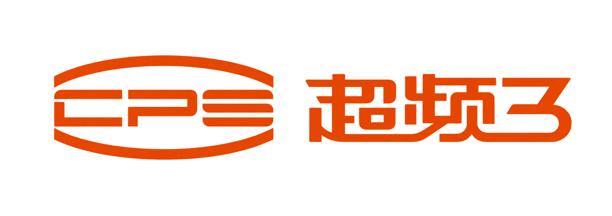

  

<strong>High-performance · Lightweight · AI Native</strong>

  面向 AI 时代的视频创作工作台。 
  在一个自由画布中连接创意、模型与素材。

  与 BeefTV Agent 一起推进创作，用 Skills 扩展方法，用工作流复用过程。 
  从分镜、素材到成片，让创作可以继续编辑、迭代和积累。

  
  
  
  
  

  
  
  
  

  <a href="README.en.md">English</a> ·
  <a href="#最近更新">最近更新</a> ·
  <a href="#产品演示">产品演示</a> ·
  <a href="#工作流">工作流</a> ·
  <a href="#beeftv-agent">Agent</a> ·
  <a href="#skills">Skills</a> ·
  <a href="docs/content/docs/overview/features.mdx">功能清单</a> ·
  <a href="QUICKSTART.md">开始使用</a> ·
  <a href="CONTRIBUTING.md">参与贡献</a>

## 最近更新

- **[v2.0.5](https://github.com/glanderness/BeefTV/releases/tag/v2.0.5)** — 新增助手思考折叠展示，提升 Mac 画布流畅度，修复视频取回并支持部分失败图片恢复。
- **[v2.0.4](https://github.com/glanderness/BeefTV/releases/tag/v2.0.4)** — 优化大画布缩放与拖动，完善参考素材校验、生成状态同步及助手操作的保存与授权检查。
- **[v2.0.3](https://github.com/glanderness/BeefTV/releases/tag/v2.0.3)** — 优化视频提示词与素材引用校验，修复重试参数恢复，并改善超分请求稳定性。
- **[v2.0.2](https://github.com/glanderness/BeefTV/releases/tag/v2.0.2)** — 新增 Seedream 图层拆分与关联组图，改进 Agent 多图检查、任务恢复与素材上传。
- **[v2.0.1](https://github.com/glanderness/BeefTV/releases/tag/v2.0.1)** — 新增可复用工作流与 Topaz 超分，完善技能的固定版本安装、回退和私人改写。

[查看全部版本与详细说明](https://github.com/glanderness/BeefTV/releases)

## 产品演示

  <video src="https://github.com/user-attachments/assets/da4081e0-26bc-424e-b20c-124f92ce6538" controls preload="metadata" playsinline></video>

## 工作流

**把跑通的步骤，留给下一次创作。**

将素材、媒体处理与 AI 生成连接成一套可编辑流程。以**单人物替换工作流**为例：输入动作视频和人物参考图，先适配视频帧率，再交给 Seedance 2.0 Fast 生成替换结果。

<table>
  <tr><th width="50%">原片</th><th width="50%">人物替换完整版</th></tr>
  <tr>
    <td><video src="https://github.com/user-attachments/assets/1d8e5c42-d6be-40f5-be55-504b7381bf90" controls preload="metadata" playsinline></video></td>
    <td><video src="https://github.com/user-attachments/assets/cadf1e3b-e1fa-4a45-83a0-c8cdacc4d1b1" controls preload="metadata" playsinline></video></td>
  </tr>
</table>

[制作记录](docs/content/docs/overview/examples.mdx#工作流单人物替换)

- **把处理与生成串起来**：帧率适配在本地完成，视频与角色图分别作为生成参考。
- **保留可编辑的配置**：调整节点、连线、模型、提示词和输出参数，保存为模板版本。
- **换素材，复用编排**：重新绑定动作视频或人物图，沿用处理链路；根据新镜头调整约束与参数。

本地 2.0.1 中的模板版本 13、14 已有成功运行记录。上方完整版还包含逐镜修正、拼接与原声回填，这些步骤尚未全部封装进模板；不代表任意素材一键完成或逐帧保真。模型生成按所用渠道计费。

## BeefTV Agent

**通过聊天，把故事搭成可编辑的创作工程。**

> 「帮我做一个末日生存题材的爆款短剧。」

在本地案例 **《最后一瓶水》** 中，用户说明创作顺序并确认生成方案，Agent 自行搭建了 **25 个节点、48 条连线**：从剧本架构、8 镜分镜表，到角色、场景、镜头首帧、视频与中文旁白，过程和素材都留在画布上。

<table>
  <tr><th width="25%">角色设定 · 沈默</th><th width="25%">场景设定 · 水塔配给点</th><th width="25%">生成镜头一</th><th width="25%">生成镜头二</th></tr>
  <tr>
    <td></td>
    <td></td>
    <td><video src="https://github.com/user-attachments/assets/0c0e1174-479d-4394-a4b2-7c64a3367e0a" controls preload="metadata" playsinline></video></td>
    <td><video src="https://github.com/user-attachments/assets/b304bdd1-5a3f-4e96-929b-46a9cbff29bf" controls preload="metadata" playsinline></video></td>
  </tr>
</table>

- **先规划**：确定世界观、角色与分镜，写入镜头时长、画面、动作和声音要求。
- **再执行**：创建节点与参考连线，确认后调用模型，生成角色图、场景图、镜头和旁白。
- **可检查、可继续**：读取实际产物，核对设定图与分镜首帧，保留成功素材和失败状态，继续调整与编辑。
- **支持外部 Agent / MCP 接入**：可在侧栏「BeefTV MCP」页一键生成连接配置，将 Codex、Claude Code、Claude Desktop、Cursor 等外部 Agent 接入本地工作区，详见[外部 Agent 接入](docs/content/docs/backend/external-agents.mdx)。

## Skills

**把创作方法，变成随时可用的技能。**

为创作助手提供特定任务的方法、步骤与要求。浏览技能市场，查看使用条件与文件，再安装指定版本。

| 官方技能 | 本次实际交付 |
| --- | --- |
| 双镜头文字分镜 | 咖啡短片：两镜各 4 秒，列出画面、声音与待确认项。 |
| 采访提纲 | 社区书店：三个开放问题、条件追问、补拍与授权清单。 |
| 素材清单整理 | 咖啡视频＋清晨照片：用途分类、授权记录与时长、声音缺口。 |

- **按需使用**：启用或停用已安装技能，管理自己的技能库。
- **保留版本**：查看更新，也可回退到已安装的历史版本。
- **按习惯改写**：复制为私人版本；作者可准备投稿，分别确认上传与公开送审。

文字技能无需配置多模态模型；涉及图片、视频或音频的技能，按其使用条件配置相应能力。

## 一个画布，完整创作链路

- **生成**：从提示词或参考素材生成文字、图片、视频与音频。
- **组织**：用节点和连线建立素材关系、创作上下文与生成流程。
- **加工**：继续裁切、标注、局部重绘、拆分、引用和组合结果。
- **迭代**：保留过程、复用素材，让一次生成变成可持续演进的工作流。

BeefTV 同时提供项目库、个人资产库、异步任务、模型渠道与创作工具。

## 为什么选择BeefTV

| High Performance | Lightweight | AI Native |
| --- | --- | --- |
| 面向复杂画布优化渲染、媒体预览与任务处理。 | 本地优先，一个桌面工作区即可开始，能力按需加载。 | Agent 推进创作，Skills 提供方法，工作流复用步骤。 |

## 源码可用，支持自定义与扩展

- 可以自由配置文本、图片、视频与音频模型渠道，不绑定单一 Provider。
- 项目、画布、素材与任务由统一工作区管理，数据可以本地保存和迁移。
- 桌面端基于 React、Go 与 Wails，模型协议和工作台能力可继续自定义或者扩展。

## 开始使用

1. [下载桌面版](https://github.com/glanderness/BeefTV/releases/latest)，按[首次打开说明](QUICKSTART.md#下载与首次打开)进入本地工作区，无需注册。
2. 在「模型配置」中连接 BeefTV 官方账号，或添加自己的模型渠道。
3. 新建画布，添加参考素材，向创作助手描述目标；也可从节点开始自由创作。

模型配置与源码构建见 [快速开始](QUICKSTART.md)，打包要求见[桌面发布文档](docs/desktop-release.md)。

## 贡献与许可

欢迎提交 Issue 和 Pull Request。开发流程与测试要求见 [`CONTRIBUTING.md`](CONTRIBUTING.md)。

仓库采用分范围许可：自首次引入新许可的提交起，符合授权条件的新增原创内容适用 [`BeefTV Source Available License 1.0`](LICENSE)；已按 MIT 发布的历史内容继续适用同文件保留的 MIT 条款，上游和第三方材料保留各自许可。

新许可允许自部署、内部二开及使用 BeefTV 制作并销售作品；对其覆盖的软件进行商业转售、套壳销售、收费部署或定制交付，以及免费或收费向第三方提供托管功能，均需事先书面授权。独立教程、培训和一般技术咨询可收费，不能借此变相交付软件系统。授权联系：[lucas@bf-labs.cn](mailto:lucas@bf-labs.cn)。

新限制不追溯适用于历史 MIT 内容，也不覆盖第三方独立许可的材料。这是一份源码可用许可，不能将整个仓库视为标准 MIT 或 OSI 定义的开源项目。具体场景及覆盖边界见[许可说明](docs/content/docs/overview/licensing.mdx)，上游来源与第三方归属见 [`NOTICE`](NOTICE)。

## 特别鸣谢

感谢支持 BeefTV 持续发展的合作伙伴、赞助商与客户。

<table>
  <tr><th width="26%" align="center">鸣谢对象</th><th align="center">介绍</th></tr>
  <tr>
    <td align="center" valign="middle"> <strong>腾讯云</strong></td>
    <td><a href="https://cloud.tencent.com/">腾讯云</a>提供云计算、人工智能与音视频服务，覆盖媒体存储、处理和分发等场景，服务开发者与企业的应用建设。感谢腾讯云为本项目提供的算力支持以及生态扶持。</td>
  </tr>
  <tr>
    <td align="center" valign="middle"> <strong>BytePlus</strong></td>
    <td><a href="https://www.byteplus.com/en">BytePlus</a> 源自字节跳动的企业技术服务品牌，面向全球企业提供生成式 AI、云基础设施与音视频解决方案。感谢 BytePlus 海外孵化器对本项目的算力支持与生态扶持。</td>
  </tr>
  <tr>
    <td align="center" valign="middle"> <strong>ll2.cn</strong></td>
    <td><a href="https://hub.ll2.cn?p=rw6t">ll2.cn</a>｜自营算力底座 · 官方直签批价。MiniMax-H3 0.05 元/秒（自部署 768P 满血）；deepseek-v4.1-flash 官方 4 折；Seedance 系列 7 折起；超分 0.018 元/秒；Vega系列 6折起。</td>
  </tr>
  <tr>
    <td align="center" valign="middle"> <strong>超频三</strong></td>
    <td><a href="https://www.cpspccooler.cn/">超频三</a>是深耕高性能计算硬件与散热系统的上市公司，提供 AI 模组化整机、AI 工作站等产品。结合超频三的硬件研发能力与 BeefTV 的 AIGC 软件生态，双方将共同探索软硬件一体化的本地 AI 创作解决方案。</td>
  </tr>
</table>

## ⭐ Star History

<a href="https://www.star-history.com/?repos=glanderness%2FBeefTV&amp;type=date&amp;legend=bottom-right">
  <picture>
    <source media="(prefers-color-scheme: dark)" srcset="https://api.star-history.com/chart?repos=glanderness/BeefTV&amp;type=date&amp;theme=dark&amp;legend=bottom-right" />
    <source media="(prefers-color-scheme: light)" srcset="https://api.star-history.com/chart?repos=glanderness/BeefTV&amp;type=date&amp;legend=bottom-right" />
    
  </picture>
</a>
