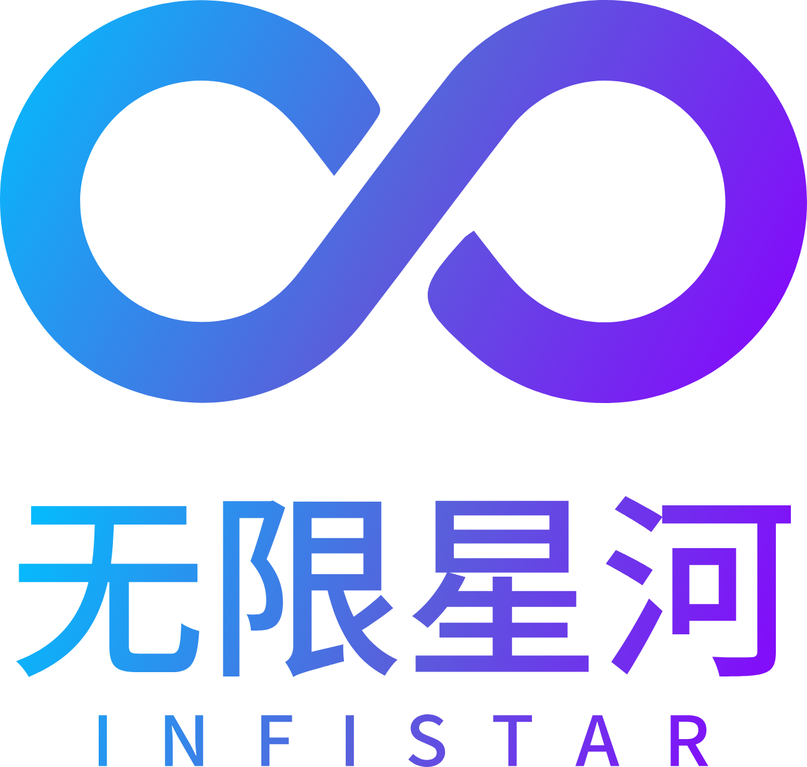
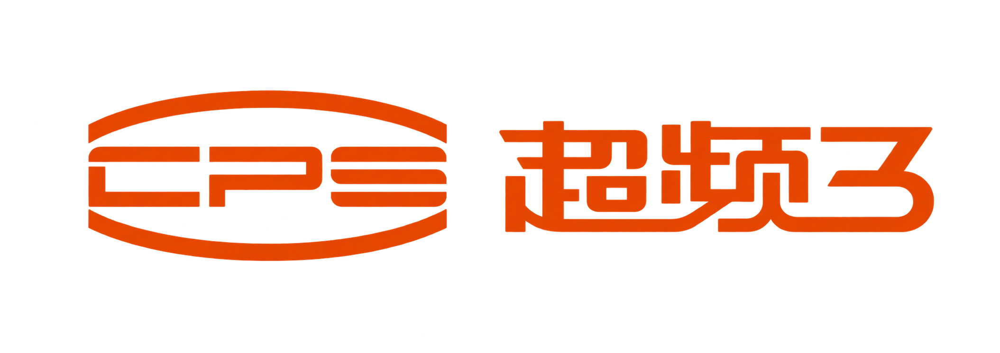
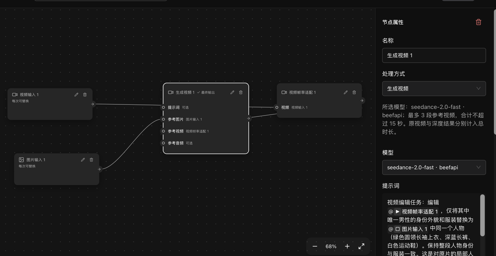
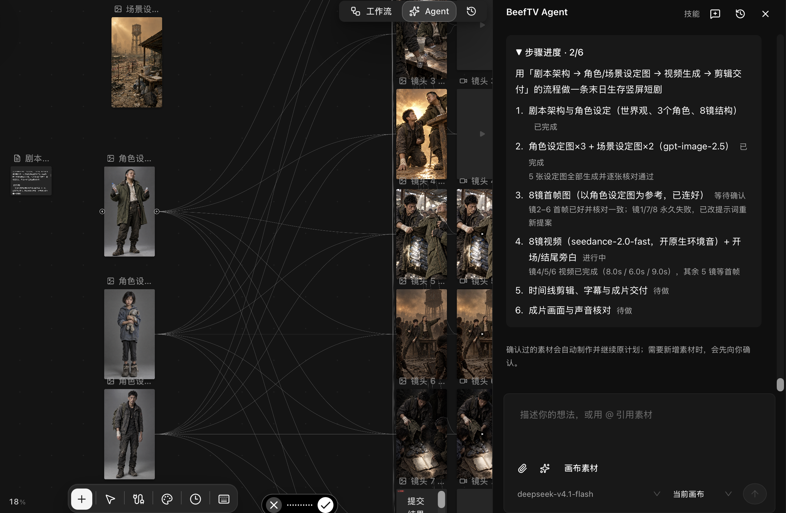
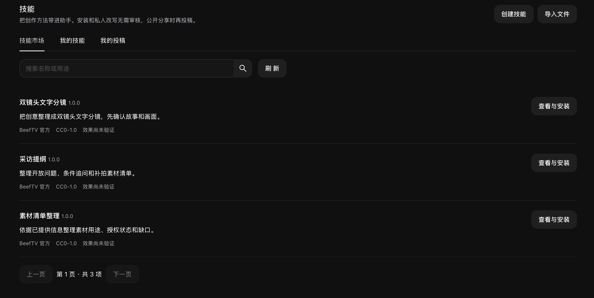
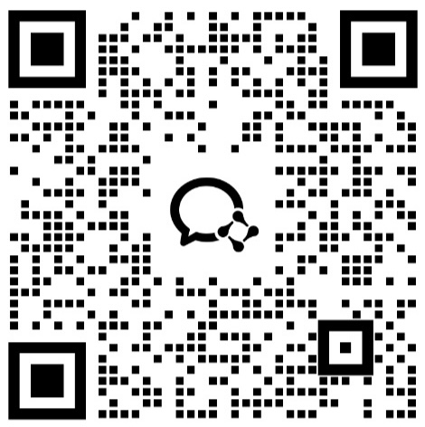

  

<strong>Yüksek Performanslı · Hafif · Yapay Zekâ Odaklı</strong>

  Video üretimi için yapay zekâ odaklı çalışma alanı. 
  Fikirleri, modelleri ve medyayı tek bir serbest tuval üzerinde birbirine bağlayın.

  BeefTV Agent ile üretin, Yetenekler (Skills) ile yöntemlerinizi genişletin ve Çalışma Akışları (Workflows) ile süreçlerinizi yeniden kullanın. 
  Storyboard'lardan ve medyadan bitmiş videolara kadar çalışmanızı her zaman düzenlenebilir ve geliştirilebilir tutun.

  
  
  
  
  

  
  
  
  

  <a href="README.md">简体中文</a> ·
  <a href="README.en.md">English</a> ·
  <a href="#son-güncellemeler">Son güncellemeler</a> ·
  <a href="#ürün-demosu">Ürün demosu</a> ·
  <a href="#çalışma-akışları">Çalışma akışları</a> ·
  <a href="#beeftv-agent">Agent</a> ·
  <a href="#yetenekler">Yetenekler</a> ·
  <a href="docs/content/docs/overview/features.mdx">Özellik listesi</a> ·
  <a href="QUICKSTART.md">Başlarken</a> ·
  <a href="CONTRIBUTING.md">Katkıda bulunma</a>

## Son güncellemeler

- **[v2.5.1](https://github.com/glanderness/BeefTV/releases/tag/v2.5.1)** — 1K/2K ön ayarları ve istem boyutu eşitlemesiyle Midjourney v8.2 stil kontrolleri eklendi; 4K faturalandırmasından kaçınmak için varsayılan 2K boyutları ayarlandı; maske düzenleme, akış kaydırma, storyboard bağlama ve proje/asistan/Windows güncelleme kararlılığı iyileştirildi.
- **[v2.5.0](https://github.com/glanderness/BeefTV/releases/tag/v2.5.0)** — Yerleşik asistan belge/taranmış PDF okuma, dosya dışa aktarma, Creative Bible, oturum çatallama, çoklu model onayı ve harici MCP desteğiyle yeniden tasarlandı; otomatik yerel proje indirmeleri, uygulama içi proxy ve yeni model protokolleri eklendi.
- **[v2.4.5](https://github.com/glanderness/BeefTV/releases/tag/v2.4.5)** — Yerleşik asistan güvenilirliği artırıldı; resmi işlem gücü için otomatik model ve fiyatlandırma eşitlemesi, referans ses bağlantıları ve doğrudan yükleme ile sesi olup görüntüsü olmayan videolar için otomatik yedek oynatma eklendi.
- **[v2.4.4](https://github.com/glanderness/BeefTV/releases/tag/v2.4.4)** — Büyük yerel çalışma alanlarındaki yavaş açılış giderildi, 2 GB'a kadar dosya kaydetme desteğiyle büyük video yüklemeleri hızlandırıldı ve video ölçek yükseltme maliyet tahminleri hızlandırıldı.
- **[v2.4.3](https://github.com/glanderness/BeefTV/releases/tag/v2.4.3)** — İç boyama (inpainting), ifade ve açı düzenlemelerinde seçili görsel modeliniz korundu; tuvale sağ tıkla Görseli Kopyala ve Videoyu Kopyala eklendi; eski macOS sürümlerindeki açılış sorunları giderildi.

[Tüm sürümler ve ayrıntılı notlar](https://github.com/glanderness/BeefTV/releases)

## Özel teşekkürler

BeefTV'nin sürekli gelişimini destekleyen iş ortaklarına, sponsorlara ve müşterilere teşekkür ederiz.

BeefTV açık kaynak projesine sponsor olmak ve AIGC açık kaynak topluluğuna katkıda bulunmak isterseniz [Ticari lisanslama ve sponsorluk](#ticari-lisanslama-ve-sponsorluk) bölümüne bakın.

<table>
  <tr><th width="26%" align="center">Teşekkürler</th><th align="center">Hakkında</th></tr>
  <tr>
    <td align="center" valign="middle"> <strong>ll2.cn</strong></td>
    <td><a href="https://hub.ll2.cn?p=rw6t">ll2.cn</a> | Kendi işlettiği hesaplama altyapısı · Toptan fiyatlarla doğrudan resmi sözleşmeler. MiniMax-H3 saniyede 0,05 CNY (kendi barındırması, tam yetenekli 768P); deepseek-v4.1-flash resmi fiyatın %40'ına; Seedance serisinde %30'dan başlayan indirimler; süper çözünürlük saniyede 0,018 CNY; Vega serisinde %40'tan başlayan indirimler.</td>
  </tr>
  <tr>
    <td align="center" valign="middle"> <strong>银盛·云枢壹算</strong></td>
    <td><a href="https://www.ysdui.cn/">Yinsheng Yunshu Yisuan</a>, Yinsheng Communications Co., Ltd. bünyesinde işletmeler için hesaplama kaynakları ve yapay zekâ ürün çözümleri sunan tek duraklı bir kurumsal yapay zekâ hizmetleri platformudur. Bu projeye sağladığı hesaplama kaynakları ve ekosistem desteği için Yinsheng Yunshu Yisuan'a özel teşekkürler.</td>
  </tr>
  <tr>
    <td align="center" valign="middle"> <strong>Infistar.cc 无限星河</strong></td>
    <td>
      BeefTV'ye sponsor olduğu için <a href="https://www.infistar.cc/register?aff=KBR9PG8Z&amp;ref_source=link">Infistar.cc Infinite Star</a>'a teşekkürler! Çoklu model API hizmeti; yapay zekâ görsel, video, kısa drama ve çoklu ortam üretim akışlarını destekler. 
      <strong>⚙ Tek tıkla kurulum:</strong> BeefTV Ayarlar → Model Hizmetleri → Model Hizmetinizi Bağlayın → İş Ortakları altında <strong>Infistar AI (无限星河 AI)</strong> seçeneğini seçip API anahtarınızı girerek 38 yerleşik metin, görsel ve video ön ayarını kullanabilirsiniz. 
      <strong>✨ Model seçimi:</strong> Senaryolar, storyboard'lar, varlıklar ve bitmiş yapımlar için Claude, GPT, Gemini, DeepSeek ve çeşitli görsel/video üretim modellerine erişin. 
      <strong>🏷 Fiyatlandırma ve hizmet:</strong> Bazı modeller CNY ödeme ve teknik destekle resmi fiyatın %1'ine varan oranlarda sunulur. Mevcut modeller ve güncel fiyatlandırma için platforma bakın. 
      <strong>🎁 BeefTV'ye özel fırsat:</strong> Kampanya uygunluk koşullarına tabi olarak 5 CNY deneme kredisi almak için <a href="https://www.infistar.cc/register?aff=KBR9PG8Z&amp;ref_source=link">özel yönlendirme bağlantısından kaydolun</a>.
    </td>
  </tr>
  <tr>
    <td align="center" valign="middle"> <strong>Tencent Cloud</strong></td>
    <td><a href="https://cloud.tencent.com/">Tencent Cloud</a>, geliştiriciler ve kurumlar için medya depolama, işleme ve dağıtım dahil bulut bilişim, yapay zekâ ve ses/video hizmetleri sunar. Bu projeye sağladığı hesaplama kaynakları ve ekosistem desteği için Tencent Cloud'a özel teşekkürler.</td>
  </tr>
  <tr>
    <td align="center" valign="middle"> <strong>BytePlus</strong></td>
    <td><a href="https://www.byteplus.com/en">BytePlus</a>, ByteDance teknolojisinden güç alarak dünya genelindeki işletmelere üretken yapay zekâ, bulut altyapısı ve ses/video çözümleri sunar. Bu projeye sağladığı hesaplama kaynakları ve ekosistem desteği için BytePlus Overseas Incubator'a özel teşekkürler.</td>
  </tr>
  <tr>
    <td align="center" valign="middle"> <strong>PCCOOLER</strong></td>
    <td><a href="https://www.cpspccooler.cn/">PCCOOLER</a>, modüler yapay zekâ bilgisayarları ve yapay zekâ iş istasyonları dahil yüksek performanslı bilgi işlem donanımı ve soğutma sistemlerinde uzmanlaşmış halka açık bir şirkettir. PCCOOLER'ın donanım Ar-Ge yeteneklerini BeefTV'nin AIGC yazılım ekosistemiyle birleştiren iki ekip, yerel yapay zekâ üretimi için bütünleşik donanım ve yazılım çözümleri geliştirecektir.</td>
  </tr>
</table>

## Ürün demosu

  <video src="https://github.com/user-attachments/assets/da4081e0-26bc-424e-b20c-124f92ce6538" controls preload="metadata" playsinline></video>

## Çalışma akışları

**İşe yarayan adımları bir sonraki üretiminiz için kaydedin.**

Medyayı, yerel işlemeyi ve yapay zekâ üretimini düzenlenebilir bir çalışma akışında birleştirin. **Tek karakter değiştirme akışı**, bir hareket videosu ve bir karakter referans görseli alır, video kare hızını uyarlar, ardından her iki referansı Seedance 2.0 Fast modeline iletir.

<table>
  <tr><th width="50%">Kaynak video</th><th width="50%">Tamamlanmış karakter değiştirme</th></tr>
  <tr>
    <td><video src="https://github.com/user-attachments/assets/1d8e5c42-d6be-40f5-be55-504b7381bf90" controls preload="metadata" playsinline></video></td>
    <td><video src="https://github.com/user-attachments/assets/cadf1e3b-e1fa-4a45-83a0-c8cdacc4d1b1" controls preload="metadata" playsinline></video></td>
  </tr>
</table>

[Üretim kaydı](docs/content/docs/overview/examples.mdx#工作流单人物替换) (Çince)

- **İşleme ve üretimi bağlayın:** Kare hızını yerelde uyarlayın; videoyu ve karakter görselini ayrı üretim referansları olarak kullanın.
- **Yapılandırmayı düzenlenebilir tutun:** Düğümleri, bağlantıları, modelleri, istemleri ve çıktı ayarlarını düzenleyip yeni bir şablon revizyonu kaydedin.
- **Yapıyı yeni girdilerle yeniden kullanın:** Farklı bir hareket videosu veya karakter görseli bağlayın; kısıtları ve parametreleri yeni sahnelere uyarlayın.

13 ve 14 numaralı şablon revizyonları yerel 2.0.1 uygulamasında başarıyla çalıştırılmıştır. Bitmiş örnek ayrıca çekim bazlı düzeltmeler, birleştirme ve özgün sesin geri yüklenmesini içerir. Bu adımların tümü şablona gömülü değildir; herhangi bir medya için tek tıkla tamamlanma veya kare bazında birebir koruma garantisi vermez. Model üretimi seçtiğiniz sağlayıcı tarafından ücretlendirilir.

## BeefTV Agent

**Bir sohbeti düzenlenebilir bir yaratıcı projeye dönüştürün.**

> "Bana viral olacak kıyamet sonrası bir kısa drama yapmama yardım et."

Yerel **The Last Bottle of Water** örneğinde kullanıcı üretim sırasını belirledi ve üretim planlarını onayladı. Agent; hikâye taslağını, sekiz çekimlik storyboard'u, karakterleri, sahneleri, ilk kareleri, videoyu ve Mandarin seslendirmeyi kapsayan **25 düğüm ve 48 bağlantı** oluşturdu. Süreç ve tüm varlıklar tuval üzerinde kalır.

<table>
  <tr><th width="25%">Karakter tasarımı · Shenmo</th><th width="25%">Sahne tasarımı · Su dağıtım noktası</th><th width="25%">Üretilen çekim 1</th><th width="25%">Üretilen çekim 2</th></tr>
  <tr>
    <td></td>
    <td></td>
    <td><video src="https://github.com/user-attachments/assets/0c0e1174-479d-4394-a4b2-7c64a3367e0a" controls preload="metadata" playsinline></video></td>
    <td><video src="https://github.com/user-attachments/assets/b304bdd1-5a3f-4e96-929b-46a9cbff29bf" controls preload="metadata" playsinline></video></td>
  </tr>
</table>

- **Planla:** Çekim süresi, görseller, hareket ve ses dahil olmak üzere dünyayı, karakterleri ve storyboard'u tanımlayın.
- **Yürüt:** Düğümleri ve referans bağlantılarını oluşturun; ardından onay sonrasında karakterleri, sahneleri, çekimleri ve seslendirmeyi üretin.
- **İncele ve devam et:** Gerçek çıktıları inceleyin, tasarımları ve ilk kareleri kontrol edin, başarılı varlıkları ve hata durumlarını koruyarak iyileştirmeye devam edin.
- **MCP ile harici Ajanları bağla:** Kenar çubuğundaki "BeefTV MCP" sayfasından Claude Code veya Codex'i tuval kullanım yeteneğiyle birlikte tek tıkla yerel tuvale bağlayın; Claude Desktop, Cursor ve diğer istemciler de bağlantı yapılandırması oluşturabilir. Bkz. [Harici Ajan Entegrasyonu](docs/content/docs/backend/external-agents.mdx) (Çince).

## Yetenekler

**Yaratıcı yöntemlerinizi her an kullanıma hazır tutun.**

Yaratıcı asistana belirli görevler için yöntemler, adımlar ve gereksinimler verin. Yetenek pazarını inceleyin, gereksinimlere ve dosyalara göz atın, ardından belirli bir sürümü kurun.

| Resmi yetenek | Bu oturumdaki gerçek çıktı |
| --- | --- |
| İki çekimlik metin storyboard | Kahve kısa filmi: görseller, ses ve onaylanacak maddelerle birlikte iki adet 4 saniyelik çekim. |
| Röportaj taslağı | Mahalle kitabevi: üç açık uçlu soru, takip soruları, destekleyici görüntüler ve izinler. |
| Medya envanteri | Kahve videosu + şafak fotoğrafı: kullanım amaçları, belirtilen izinler ile süre ve ses eksikleri. |

- **İhtiyacınız olanı kullanın:** Kütüphanenizdeki kurulu yetenekleri etkinleştirin veya devre dışı bırakın.
- **Sürümleri yönetin:** Güncellemeleri kontrol edin veya daha önce kurulu bir sürüme geri dönün.
- **Kendinize uyarlayın:** Özel bir uyarlama oluşturun. Yazarlar yükleme ve genel inceleme için ayrı onaylarla gönderim hazırlayabilir.

Yalnızca metin tabanlı yetenekler çok modlu (multimodal) bir model gerektirmez. Görsel, video veya ses içeren yetenekler ise gereksinimlerinde listelenen model özelliklerine ihtiyaç duyar.

## Tek tuval, eksiksiz bir yaratıcı akış

- **Üret:** İstemlerden veya referans medyadan metin, görsel, video ve ses oluşturun.
- **Düzenle:** Varlıklar, yaratıcı bağlam ve üretim adımları arasında ilişkiler kurmak için düğümleri bağlayın.
- **İyileştir:** Sonuçları kırpın, işaretleyin, iç boyama yapın, bölün, referans alın ve birleştirin.
- **Yinele:** Sürecinizi koruyun ve varlıkları yeniden kullanarak tek bir üretimi gelişen bir çalışma akışına dönüştürün.

BeefTV ayrıca proje ve kişisel varlık kütüphaneleri, eşzamansız görevler, model sağlayıcıları ve yaratıcı araçlar da içerir.

## Neden BeefTV

| Yüksek Performans | Hafif | Yapay Zekâ Odaklı |
| --- | --- | --- |
| Karmaşık tuvaller için optimize edilmiş işleme, medya ön izlemeleri ve görev yönetimi. | Yerel öncelikli; başlamak için tek masaüstü çalışma alanı ve ihtiyaç duyuldukça yüklenen yetenekler. | İşinizi ilerleten bir Agent, ona rehberlik eden Yetenekler ve adımları yeniden kullandıran Çalışma Akışları. |

## Kaynak kodu erişilebilir, özelleştirilebilir ve genişletilebilir

- Tek bir sağlayıcıya bağlı kalmadan metin, görsel, video ve ses model sağlayıcılarını özgürce yapılandırın.
- Projeleri, tuvalleri, varlıkları ve görevleri yerelde kaydedilip taşınabilen verilerle tek bir çalışma alanında yönetin.
- Genişletilebilir model protokolleri ve çalışma alanı yetenekleriyle React, Go ve Wails kullanılarak masaüstü için geliştirildi.

## Başlarken

1. [Masaüstü uygulamasını indirin](https://github.com/glanderness/BeefTV/releases/latest) ve [ilk açılış yönergelerini](QUICKSTART.md#下载与首次打开) izleyin. Kayıt olmadan yerel çalışma alanınıza girin.
2. Model ayarlarından BeefTV hesabınızı bağlayın veya kendi model sağlayıcınızı ekleyin.
3. Bir tuval oluşturun, referans medya ekleyin ve hedefinizi yaratıcı asistana anlatın. Doğrudan düğümlerle üretime de başlayabilirsiniz.

Model kurulumu ve kaynak koddan derleme için [Hızlı Başlangıç](QUICKSTART.md) rehberine, paketleme gereksinimleri için [masaüstü sürüm kılavuzuna](docs/desktop-release.md) bakın.

## Ticari lisanslama ve sponsorluk

BeefTV tabanlı ticari kullanım veya türev geliştirme için lütfen BeefTV ekibinden resmi yetki alın. Ticari lisanslama seçenekleri hakkında bilgi almak için aşağıdaki QR kodu tarayarak beni WeCom'da ekleyin ve iletişim isteğinize **"BeefTV 授权"** ifadesini yazın.

BeefTV ayrıca sponsorluğa da açıktır. Daha fazla kişinin BeefTV üzerinden hesaplama hizmetinizi veya ürününüzü keşfedip kullanmasını istiyorsanız aşağıdaki WeCom QR kodunu tarayın ve iletişim isteğinize "BeefTV 赞助" ifadesini yazın.

BeefTV 2.500'ün üzerinde yıldıza, 480 çatala (fork) ve 2.000'den fazla üyeli bir topluluğa ulaştı. Ekip ayrıca birçok sponsorla yakın iş birlikleri kurdu.

  

## Katkıda bulunma ve lisans

Issue ve pull request'ler memnuniyetle karşılanır. Geliştirme akışı ve test gereksinimleri için [`CONTRIBUTING.md`](CONTRIBUTING.md) dosyasına bakın.

Depo farklı kapsamlara sahip lisanslar kullanır. Yeni lisans altında eklenen özgün içerikler, ilk eklendikleri commit'ten başlamak üzere ve koşullarına tabi olarak [`BeefTV Source Available License 1.0`](LICENSE) kapsamındadır. Daha önce MIT altında yayınlanan geçmiş içerikler, aynı dosyada korunan MIT koşullarına tabi olmaya devam eder. Üst kaynak ve üçüncü taraf materyaller kendi lisanslarını korur.

Yeni lisans; kendi sunucunuzda barındırmaya, kurum içi özelleştirmeye ve BeefTV ile eser üretip satmaya izin verir. Kapsam dahilindeki yazılımın ticari olarak yeniden satışı, yeniden markalanarak satışı, ücretli dağıtımı veya özel teslimi ile ücretsiz ya da ücretli olarak üçüncü taraflara barındırılan özellikler sunulması için yazılı yetki gerekir. Bağımsız eğitimler, dersler ve genel teknik danışmanlık ücretli olabilir ancak yazılım sistemini dolaylı olarak teslim etmek için kullanılamaz.

Yeni kısıtlamalar geçmiş MIT içeriklerine geriye dönük uygulanmaz ve bağımsız lisanslı üçüncü taraf materyalleri geçersiz kılmaz. Bu bir kaynak kodu erişilebilir (source-available) lisanstır; deponun tamamı standart MIT veya OSI tanımına göre açık kaynak bir proje olarak değerlendirilmemelidir. Kapsanan senaryolar ve sınırlar için [lisans kılavuzuna](docs/content/docs/overview/licensing.mdx), üst kaynaklar ve üçüncü taraf atıfları için [`NOTICE`](NOTICE) dosyasına bakın.

## Açık kaynak teşekkürleri

BeefTV aşağıdaki açık kaynak projeler ve teknolojiler üzerine inşa edilmiştir ve bunlardan esinlenmiştir:

- **[影策 Open AI Canvas (Yingce Open AI Canvas)](https://github.com/ddcat-ai/open-ai-canvas)**: Yapay zekâ film yapımı ve kısa drama üretimi için bir çalışma alanı. BeefTV bu projenin üzerine geliştirilmiştir. Tuval düğüm akışları, model sağlayıcı entegrasyonu, görev ve varlık yönetimi ile topluluk katkılı yerleşik eklentiler gibi temel yetenekler bu projeden gelir ve yerel bir masaüstü uygulamasına dönüştürülerek iyileştirilmeye devam edilmektedir. Açık kaynak AIGC topluluğuna katkıları için [ddcat](https://github.com/ddcat-ai) ve tüm Open AI Canvas katkıcılarına tekrar teşekkürler.
- **[basketikun's infinite-canvas](https://github.com/basketikun/infinite-canvas)**: Sonsuz bir tuvali yapay zekâ görsel üretimiyle birleştiren açık kaynak bir çalışma alanı. BeefTV genel sonsuz tuval mimarisinden yararlanır; düğüm sürükleme ve yakınlaştırma, bağlantılar, geri al/yinele ve tuval içe/dışa aktarma dahil tuval kodunun ve yeteneklerinin bir kısmını yeniden kullanır. [basketikun](https://github.com/basketikun) ve tüm katkıcılara teşekkürler.
- **[Pi (Pi Agent)](https://github.com/earendil-works/pi)**: Ajan yürütme döngüsü, araç çağırma ve oturum yönetimi sağlayan hafif ve genişletilebilir bir ajan çatısı. BeefTV'nin yerleşik Agent'ı, tuval işlemleri, yaratıcı planlama ve yetenek yönetimi dahil video üretimine yönelik uyarlamalar ve uzantılarla Pi üzerine kuruludur. Pi'nin yazarlarına, [bakımcılarına](https://github.com/earendil-works) ve tüm katkıcılara teşekkürler.

Temelleri ve ilhamları için bu projelerin yazarlarına, bakımcılarına ve katkıcılarına teşekkür ederiz. BeefTV bu çalışmaların üzerinde bağımsız geliştirme ve kapsamlı optimizasyonlarla yoluna devam etmektedir. Üst kaynak ve üçüncü taraf kodları, telif hakkı bildirimleri ve lisansları kendi koşullarını korur. Atıf ve lisans kapsamı için [`NOTICE`](NOTICE), [`THIRD_PARTY_NOTICES.md`](THIRD_PARTY_NOTICES.md) ve [`LICENSE`](LICENSE) dosyalarına bakın.

## ⭐ Yıldız Geçmişi

<a href="https://www.star-history.com/?repos=glanderness%2FBeefTV&amp;type=date&amp;legend=bottom-right">
  <picture>
    <source media="(prefers-color-scheme: dark)" srcset="https://api.star-history.com/chart?repos=glanderness/BeefTV&amp;type=date&amp;theme=dark&amp;legend=bottom-right" />
    <source media="(prefers-color-scheme: light)" srcset="https://api.star-history.com/chart?repos=glanderness/BeefTV&amp;type=date&amp;legend=bottom-right" />
    
  </picture>
</a>
