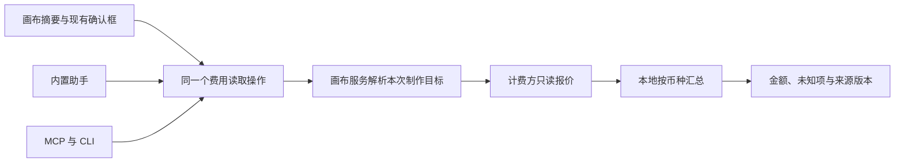

# 画布级费用估算方案

## 1. 建议与已确认方向

**把“本画布还要制作的图片、视频、音频和超分”交给同一个后端服务估算。界面和助手读取同一份结果，分开显示预计费用、提交时先扣金额；缺价格的项目明确列出，不能按零元算进总额。**

用户在本任务中转达总管答复，并认可：后端统一估算、自带 Key 无价格时显示未知、预计费用与先扣金额分列、UI／助手／MCP／CLI 共用结果。跨项目价格接口、版本与有效期目前没有约定，以下提出具体建议并标成**待定，实施前由两侧确认**。这不是要求用户重新确认上述四项方向。

本文件面向实施者和评审者，交付设计与分步工作量，不修改业务代码。既有目录和计费函数优先复用；不新增预算设置页、充值入口、预算按钮、计费数据库或助手执行循环。预算暂指“完成所列媒体制作的费用估算”，不表示系统已承诺自动把花费限制在某个金额以内。

最小可用版必须同时覆盖四类项目、已有批量确认、画布摘要、助手和外部只读工具。未知费用可以存在，但不能漏项或把已知部分叫作完整总预算。仅给视频加一个合计不算完成本需求。

## 2. 核查结果与证据

### 2.1 本地与关联任务

核查日期为 2026-10-27。源码是实现证据，公开接口读回是当时在线数据；关联报告是历史运行证据，不等于本轮重新检查生产账务。

| 对象 | 已核实事实 | 对方案的影响 |
| --- | --- | --- |
| BeefTV 基线 `444854306d8cf4e801b26a07a282dbb39e3537c9` | `image-models.ts`、后端目录 DTO 接收 `video_pricing`；`model.catalog` 对助手返回已保存的视频报价 | 目录负责发现模型；目前不是四类费用查询接口。[B1] [B2] |
| 现有视频估算 | `estimateVideoTargetPrice` 对部分按秒计费返回金额；Token 模式返回单价且 `amount=null`，参考账单模式也不返回实际金额 | 修正任务补充说明：“视频可汇总”只对可算的子集成立，不能理解为全部视频都已有估价。[B3] |
| 分镜确认 | 非本地模式写“当前没有可用价格数据”；本地模式只写提交本地任务队列，两者都没有完整估算 | 本地排队仍可能调用收费模型；费用展示不能由 `workspaceCapabilities().local` 决定。[B4] |
| 超分 | 后端返回 `reservation`，前端把当前输入逐项相加；不是最终费用 | 作为先扣金额接入，实际费用保持未知。[B5] |
| 超分“估价”副作用 | `EstimateUpscale → PrepareUpscale → PrepareBeefAPIVideoReferences` 会读取、准备并上传素材；HTTP estimate 还要求受信任桌面写身份 | **不能把现有 estimate 原样挂成 MCP 只读工具，不能在画布自动刷新时反复调用。** 新费用读取必须走无上传路径。[B5] [B6] |
| 已有制作计划 | `GenerationTargets` 固定节点、模型、参数和参考关系；目前仅支持图片／视频／音频，至多 24 项，并会拒绝部分组图和缺参数节点 | 复用解析规则，不直接用它当整画布扫描器；超分、未物化分镜和大画布需补只读解析。[B7] |
| [#56 的修改](https://github.com/glanderness/BeefTV/commit/1a3c57c)，分支 `1a3c57c` | 已读取分支与对话；超分文案改为“先扣…账单核对完成后…” | 本工作树仍有旧文案；实施时沿用 #56 的修订，不恢复无条件退款说法。不能从工作树判断该任务是否已交付。 |
| 上游价格源码 `e49bfcf325a1e5aa020b450828e04a6d066b1a36` | 企业目录包含图片价表、音频价格、视频价格；#666 已为 Topaz 输出 `invoice_billing` 和 `display_kind=upscale` | 已有数据应复用，但展示价表不能代替按本次输入报价。[P1] |
| [计费核查 #15][P2] | 报告记录 7 单已成功生成、先扣费用，却未完成账单结算；回执只有 `billing_status=pending` | **结算尚未恢复是已知风险。** 不把生成成功写成已结算，也不依赖退款已恢复；本任务不修密钥或退款。用户转达的总管答复确认仍须按此风险设计。 |

### 2.2 图片与音频确实有可用数字，但还缺明确单位合同

本轮于 **2026-10-27 10:48 UTC** 无登录读取 [公开企业模型价格接口][P3]，HTTP 200，共 52 条，币种 CNY。以下仅为取样证据，**不复制成客户端内置价格、不承诺长期有效、不证明模型实际可调用**。

| 取样 | 在线字段／数值 | 可以和不能推导的事 |
| --- | --- | --- |
| `gpt-image-2` | `image_price_table.output.low.1K=0.35`、`reference=0.15`；`per_request_cny=0.35` | 有质量／尺寸价表。不能把默认单价用于所有规格，参考图、输出数及批次规则必须由计费函数解释。 |
| `dola-seedream-5-0-pro-260628` | standard 1K `0.0915489`、2K `0.1830978`，参考项 `0.00610326` | 文字说明按实际像素分档、首张参考免费、图层单独计费；不能只按“1 个节点”计算一次。 |
| `minimax-speech-2.8-turbo`／`-hd` | `mode=tokens`，`input_cny=200`／`350` | 源码明确该路径把 `usage_characters` 放入 usage，对应每百万计费字符 ¥200／¥350，即每万 ¥2／¥3.5；**字段名 tokens 不代表这里真按语言模型 Token 计费**。[P4] |
| `minimax-music-v3.0` | `mode=per_request`、`per_request_cny=1` | 该模型有按次价格，不能推广成全部音频按次。 |
| 四款 Topaz | 线上仍为 `per_request_cny=27.1256`、`display_kind=image` | #666 源码与线上数据不同。不能通过通用 per-request 分支把这些值算成实际费用；应识别账单计费能力，先扣数需正确报价来源。 |

因此，“图片、音频没有估价”应精确改为：**BeefTV 尚未接入；上游已有部分价格数字，但没有适合四类统一计算的完整合同。** 字符统计规则、输出数、参考图费用、像素档位、账号价格范围和时效，不能靠助手猜测。

### 2.3 上游与同类工具：哪些能直接借用

比较问题限定为“从哪里显示本次费用、如何跟随参数、助手怎样先报预算”。检索预算限定为 Infinite Canvas 源码及两家同类产品官方说明；找到可复用方式后停止扩展。不登录或付费试用，以下不算交互验收。

| 来源 | 阅读证据 | 采用与不采用 |
| --- | --- | --- |
| Infinite Canvas，固定 `9cd3deacbcc598361807afc16c059a80dd18b6f9` | 检查 `web/src`、`canvas-agent/src` 中 pricing／budget／费用等关键词，并读 `use-config-store.ts` 的模型结构、`agent-chat-message.tsx` 的计划卡和工具定义；该范围未发现价格字段、四类汇总或预算工具。[U1] [U2] | 保留现有节点、参数面板和计划卡的展示位置；没有找到可以直接搬来的估价模块。该结论限于所读版本与范围。 |
| Figma Weave（原 Weavy） | 官方说明节点费用随秒数、分辨率等参数变化，可在节点选中状态及模型工具箱查看。[U3] | 借用“参数变，费用变”和原位置展示；不搬会员积分体系、充值流程，也不声称它已提供所需整画布预算 API。 |
| Runway Workflows／Agent | 工作流按实际模型步骤计价；开启生成前询问时，Agent 显示模型、提示词和本次预计积分后等待同意。[U4] [U5] | 借用“先确定本次执行清单，再合计，再在现有确认处显示”。不复制自动生成设置，不把它的退款规则套用到本项目。 |

取舍：**交互方式直接借鉴，金额统一走现有计费方，新写的只是画布目标解析、价格适配和聚合。** 不引入第三方画布框架、工作流引擎或积分系统。

## 3. 总预算到底计算什么

### 3.1 默认计算“待制作”，不累计所有节点的历史价格

同一服务支持三种明确范围，不新增三个界面开关：

- `remaining`：默认。当前画布中已表达制作意图、尚未接纳执行的媒体目标，包括依赖前置生成的后续视频／配音／超分。返回标题“本画布待制作”。
- `selection`：已有批量操作准备提交的目标。显式再生成算一次新的制作；查询估价本身不触发再生成。
- `proposal`：已有助手制作方案的全部目标，而非只算当前已就绪的第一批。依赖材料完成后，实际规格变化要重新估算。

导入素材、已完成且准备复用的结果、便签和纯本地排版不产生新模型费。运行中、待取回、提交结果未知的任务列为 `inFlight` 或 `needsAttention`，不重复算成下一次新提交；也不能借此说“整个项目没有欠费”。历史实扣与待结算不并入本次制作估算。

空白无制作意图的节点排除；已有提示词／台词／已选分镜制作目标但缺模型、时长、尺寸或依赖的项目保留，标 `unresolved`。不为凑完整总额自动选模型、补时长或丢掉失败项。能力未知的收费插件也保留为未知；不能因不认识节点而默认为免费。

### 3.2 计数按收费动作，而非视觉节点个数

一条 line 表示一次有明确输入的制作目标，必须携带 `requestCount`、`outputCount` 及实际计价需要的用量。示例：一个图片节点生成 4 张，可能是 1 次请求出 4 张，也可能发 4 次请求；同一参考图的费用可能按请求只收一次，必须跟实际提交展开方式一致。

复用提交前的参数解析和任务展开，先抽出不写数据的“生成输入描述”；估价和执行各自消费它。分镜行使用稳定的 `scriptNodeId + rowId + kind`，已绑定子节点则解析成同一个目标，只计一次。未生成的行按现有批量动作的参数展开，不能为了估价调用 `PrepareUserCanvasStoryboard` 创建节点。[B8]

共享参考图本身只在生成一次时计费；被引用产生的附加费按计费规则计入各请求。视频内含声音不能再算一次配音；只有独立音频生成目标才另计。循环依赖、未知输出数量、缺失媒体尺寸都单列原因，不静默截到 8／24 个目标。若超过实现容量，明确返回范围过大且不给伪完整总数。

## 4. 只有一个价格来源

“一个来源”指**同一购买对象的售价只由实际计费方确定**，不是把所有供应商价格搬进一张本地手填表。

| 购买路径 | 价格权威 | BeefTV 的职责 |
| --- | --- | --- |
| 官方算力 | BeefAPI 的实际售卖价表、计费函数及本次报价 | 读取账号适用的售价与单位，汇总；不复制成本、汇率或加价公式 |
| 自带 Key／自定义服务 | 本次实际使用的服务提供的报价或明确单位的官方目录 | 按具体服务配置和模型取值；同名模型不能套官方算力价格 |
| 无报价或单位不完整 | 无可信价格 | 返回未知、原因及项目数量；不当成 ¥0，不自动上网找类似售价 |

首版不增加用户手填价格功能。以后真有需求，可单独增加“用户参考估价”，但必须和服务报价分开、不能用于承诺扣费或自动限额。官方账号下自动选择的内部渠道，不作为画布展示或预算缓存的公开身份。

### 4.1 跨项目接口建议（待定）

建议在计费方提供一个**不创建任务、不扣费、不上传素材**的批量读取接口，暂名 `POST /v1/media/estimate`。POST 只是承载参数，不表示支付；不能仅靠 HTTP 动词推导工具读写权限。

请求携带 `clientItemId`、模型、生成操作类型、规范化参数、请求／输出数量及 `mediaFacts`（宽高、时长、参考数量、需要时的计费文本长度）。不上传源文件，不传素材 URL、完整提示词或用户标识；认证由原有服务连接提供。字符数先按双方约定规则计算；规则不明确时返回未知，不能用 JS 字符串长度冒充真实计费用量。

返回每项的 `expected`、`debitOnSubmit`、`finalChargeLimit`、`priceVersion`、`observedAt`、`expiresAt`、计价单位与未知原因，金额均为十进制字符串；建议原子读取同一份价表快照，批量报价失败可按项说明。`priceVersion` 应是本次售价规则和计费单位的版本摘要，不能只用 `pricebook_id=enterprise_cny_v1` 或某类任务的固定 `pricing_version=1` 充当所有价格变更版本。

四类实现复用同一处实际计费代码：图片沿用档位、参考图和多输出规则；视频沿用秒数／Token 预估／参考素材规则；配音沿用计费字符规则，音乐按本模型规则；超分沿用当前预扣配置，但把“纯计算预扣金额”从需要 URL 校验、上传准备的链条中分离。**不是再造一份只给估价用的价格算法。**

目录 `/v1/models` 继续做发现；企业价格页继续做展示。它们可以由同一价格源投影，客户端不并行信任三个不同来源。在新接口到位前，适配器可返回经验证的目录参考价，标 `catalog_reference`；缺单位、过期或 Topaz 旧固定价则未知。此过渡态能开发和演示，不是官方四类报价已完成。

待定事项有具体默认建议和负责人，不用空占位替代设计：

| 待定合同 | 本文建议 | 实施前需确认的证据 |
| --- | --- | --- |
| 接口路径与鉴权 | 上述批量接口，沿用现有账号认证和售卖范围；内部限流，不开放任意上游 URL | 计费方负责人给出样例，确认不会生成、上传或收费 |
| 用量单位 | 显式 `image`／`request`／`second`／`character`／`token`／`invoice`，可包含多种计费项 | 对照实际计费函数，至少图片、配音、音乐、视频、超分各一例 |
| 版本与时效 | 报价带不可变版本；建议最长 60 秒供显示复用；实际有效期由计费方给出 | 改价测试；若服务未承诺有效期，`expiresAt=null` 且 `advisory=true`，本地缓存时长不是锁价 |
| 提交一致性 | 真正执行前使用相同有效输入重新核价；不一致时更新现有确认 | 两侧验证并发改价。若上游没有承诺按该报价计费，保持 `advisory=true`，不能显示硬上限 |

### 4.2 本地实现放在哪里

建议新增窄的 `backend/internal/costestimate` 包，负责金额类型、未知原因和合计；画布服务负责解析所属画布与实际制作目标。`operations` 注册一项 `canvas.cost.estimate`，通过窄端口调用画布解析和费用服务；`app` 只做组合，不再把图遍历、价表换算和文本拼接一起加进巨型 service。

计费方适配放在现有 `backend/internal/beefapi` 或供应商适配处。首版官方适配加“未知”返回足够，不先造插件 SDK、适配器注册中心或报价微服务。等第二个服务真接价时再补其适配。



前端通过现有 `http` 解包业务信封，只负责显示与格式化，不再执行视频或超分金额累加。原 `videoPricing` 可以保留模型单价展示，但制作预算只能来自上述服务。[B1] [B3]

## 5. 三种金额不能混加

| 字段 | 面向用户的名字 | 含义 |
| --- | --- | --- |
| `expected` | 预计费用 | 按本次输入预计最终花费；可为确定计价、用量估算、区间或未知，始终不是已结算金额 |
| `debitOnSubmit` | 提交时先扣 | 此次接纳执行时计费方会收取／占用的金额；超分当前是真实钱包扣款，不能改写成“仅冻结、不扣钱” |
| `finalChargeLimit` | 最高费用 | 只有计费方能强制保证最终收费不超过此值时才有值；没有保证就是 null |

先扣额和预计费用描述同一笔制作的不同阶段，**不能相加**。预计区间上沿也不自动成为最高费用。超分已有先扣数，但最终账单未知，`expected=null`、`finalChargeLimit=null`；不从一次历史账单推导平均单价。部分参考视频也按账单结算，不能把账单模式硬编码成只有超分才有。

每种货币分别汇总；CNY 和 USD 不自动换算。积分还必须附对应发行方／计费账户范围，不把两个服务的 credits 当成同一种钱。即使同为 CNY，也按付款来源保留 `fundingGroups`：总估算可以相加，余额够不够仍须逐账户判断，不声称一个账户余额能支付其他服务。

每组返回 `knownSubtotal`、`total`、`coverage`：

- 全部目标在该指标上可算，`total` 才有值；任何未知或过期使它为 null。区间用上下界分别求和，并明确假设。
- `knownSubtotal` 只加有完整费用依据的目标，旁边始终显示“已知部分”。未知目标即使某一组成项已知，也不能冒充完整该项；必要的组成项明细留在 line。
- 显式免费且计费方能证明才允许数值 `"0"`；没返回价格用 null。没有任何待制作目标才显示“当前没有待制作项目”。
- 内部用十进制精确计算，保持上游精度与计费舍入规则；不能把界面四舍五入后的 ¥0.04、¥27.13 再相加。当前公开价存在 7—8 位小数，不能只用“分”存价格。

示例：图片预计 ¥1.40，视频预计 ¥12，配音预计 ¥0.20，超分先扣 ¥27.1256、实际未知。**已知预计费用 ¥13.60，超分未计入；不能报总费用 ¥40.73。** 若计费方另外证实前三项提交即扣且合计 ¥13.60，才能报“提交时先扣合计约 ¥40.73”；只有预计费、没有扣款规则时，先扣总数也应未知。

## 6. 助手、MCP、CLI 的统一返回

### 6.1 一项读取能力

建议操作名 `canvas.cost.estimate`，`ReadOnly=true`、`ScopeCanvas`、`AssistantCanvas=true`，沿用 `/api/ops/:op`。这是**拟新增接口，不是当前可调用能力**。无需新 MCP server，无需 CLI 子命令，也不另外写助手算价函数。

请求示例：

```json
{
  "canvasId": "canvas_demo",
  "scope": "remaining",
  "expectedRevision": 42
}
```

`scope=selection` 加 `nodeIds` 或现有分镜行选择；`scope=proposal` 加 `proposalId`，由服务端读已保存目标，不能相信助手上传的价格。三种选择互斥，不默认将其并集。HTTP 外层沿用 `{ "params": ... }`；成功仍为 `{code:0,data:...,msg:...}`。CLI 和 MCP 输出解包后的同一 data。

以下为**合成示例，不是线上报价**；为压缩示例，只列每类一项，其他明细字段遵循后表：

```json
{
  "schemaVersion": 1,
  "estimateId": "estimate_demo",
  "scope": {"kind": "remaining", "canvasId": "canvas_demo"},
  "source": {"canvasRevision": 42, "modelConfigRevision": 7, "inputFingerprint": "sha256:demo"},
  "observedAt": "2026-10-27T10:00:00Z",
  "expiresAt": null,
  "advisory": true,
  "generationSubmitted": false,
  "coverage": {"targets": 4, "expectedKnown": 3, "debitKnown": 4, "unresolved": 0},
  "totals": [{
    "currency": "CNY",
    "expected": {"knownSubtotal": "13.60", "total": null, "coverage": "partial"},
    "debitOnSubmit": {"knownSubtotal": "40.7256", "total": "40.7256", "coverage": "complete"},
    "finalChargeLimit": null
  }],
  "fundingGroups": [{"label": "官方算力", "currency": "CNY", "debitOnSubmit": "40.7256"}],
  "lines": [
    {"targetId": "image_1", "kind": "image", "currency": "CNY", "requestCount": 1, "outputCount": 4, "expected": "1.40", "debitOnSubmit": "1.40", "basis": "fixed_rate"},
    {"targetId": "video_1", "kind": "video", "currency": "CNY", "requestCount": 1, "outputCount": 1, "expected": "12.00", "debitOnSubmit": "12.00", "basis": "usage_estimate"},
    {"targetId": "audio_1", "kind": "audio", "currency": "CNY", "requestCount": 1, "outputCount": 1, "expected": "0.20", "debitOnSubmit": "0.20", "basis": "usage_estimate"},
    {"targetId": "upscale_1", "kind": "upscale", "currency": "CNY", "requestCount": 1, "outputCount": 1, "expected": null, "debitOnSubmit": "27.1256", "basis": "invoice", "reason": "invoice_required"}
  ],
  "excluded": {"completed": 2, "inFlight": 1, "nonGenerating": 3},
  "needsAttention": [],
  "warnings": [{"reason": "settlement_pending", "message": "超分费用仍需核对账单，最终金额尚未确定"}]
}
```

实际 DTO 每项还要返回 `modelDisplayName`、有效用量、`assumptions`、`priceSource`（`service_quote`／`catalog_reference`／`unavailable`）、`priceVersion`、`expiresAt`、`finalChargeLimit` 和准备状态。区间以 `{min,max}` 代替金额字符串，null 表示未知；必须在 Schema 中明确三种类型。合成例假定已获得前三项先扣规则，不能据此给现有模型默认补这个字段。

未知币种的 line 不塞进 CNY 汇总，`unresolved` 增加，整体不能宣称完整。缺模型／输入是 `unresolved`，缺价格是有目标但金额未知，两者都保留；用户无读取权限、画布不存在或版本不一致按真实业务错误返回，不转换成空画布／零元。

建议原因码：`price_unavailable`、`unit_unsupported`、`missing_input`、`dependency_unresolved`、`invoice_required`、`price_stale`、`provider_unavailable`。短说明应能告诉用户缺的是什么，不输出内部渠道 ID、密钥、URL 或供应商原始错误。

CLI 使用现有调用方式，实施后示例为：

```bash
beeftv ops call canvas.cost.estimate \
  --params '{"canvasId":"canvas_demo","scope":"remaining","expectedRevision":42}' \
  --json
```

MCP 工具名保持 `canvas.cost.estimate`。现有 CLI 的 MCP 包装把 JSON 放在文本内容中；首版沿用此方式即可，不能声称当前已有 `structuredContent`。[B9] 后续若加结构化结果，必须从同一 DTO 序列化，不能两套字段。

### 6.2 助手只解释结果，不负责补价格

用户问“这个画布做完要多少钱”，助手调用 `remaining`；用户正确认制作方案，则调用 `proposal`。有完整费用时报告总额及假设；部分已知时必须同句说明哪些没算：

> 图片、视频和配音预计 ¥13.60，另有 1 项超分的实际费用尚未确定。提交时预计先扣合计 ¥40.73，超分要等账单核对后结算；目前还不能给出完整总预算。

只有示例数据确实给出完整先扣数时，才能说这句话。自带 Key 无价格时说“另有 2 段音频暂无报价，未计入总额”。所有用户可见文案和助手摘要只用用户认识的模型名、服务名称、数量与金额，不出现 BeefAPI 或内部渠道 ID；技术文档与内部适配器名不受此展示限制。

助手被问“¥100 够不够”时，有未知项或无可保证上限只能回答已知部分与不确定项，不能作保证。不得擅自加重试次数、换低价模型或把预算查询当成付费同意。助手对话模型 Token、人工、存储、本地机器电费和未来尚未规划的制作不在本媒体预算内，摘要注明“媒体制作”，不能称整个账号的全部花费。

## 7. 刷新、确认和运行状态

1. **保存成功后估算。** 复用 `saveCanvasForAssistant` 的画布保存检查；未保存完成时摘要显示“正在保存，费用稍后更新”，旧报价不得冒充当前画布。外部工具带版本，冲突返回 `revision_conflict`。[B10]
2. **只在影响费用的输入变化时失效。** 模型、有效参数、输出数量、参考关系与媒体尺寸／时长、计费台词、付款来源、价表版本会失效；单纯拖动节点不重取价格。缓存只放内存，以用户范围、付款来源、有效输入和价格版本隔离；切账号／画布取消请求，旧响应不得覆盖新结果。
3. **整画布用快照，逐项失败保留。** 解析后固定目标和模型配置版本；发现配置中途改变就拒绝返回混合版本。请求按服务批量发出、取消可传递、短时缓存；建议本地缓存响应 100ms 内，远程报价给 5 秒总期限，超时项返回未知，不阻塞画布。数值是首版验收目标，待真实服务量测，不是现有性能事实。
4. **报价不等于授权。** `estimateId` 是定位一份估算的标识，不是付款令牌，也不是新的任务状态。现有 `proposalId`／目标快照、原操作 ID 和付费许可仍负责授权。原有任务状态与付费防重方案继续适用。[B11]
5. **开始生成前核对。** 现有确认框／方案卡展示对应选择的费用；按同一有效输入刷新报价。模型、数量、费用或未知范围变化导致旧确认失效；返回新费用供原入口确认，不在后台悄悄重提。仅缓存到期但内容完全相同，不重复询问。查询超时不能把曾经已知的价格偷偷降为未知后继续执行。
6. **本次估算不实现硬限额。** 首版显示 `advisory=true`，所有执行仍需原有许可。只有计费方能在提交和最终结算强制兑现上限，未来才可实现“最多花 ¥100 自动做完”；本文没有授权该功能。
7. **交付与结算分开。** 有结果但 `billing_status=pending`，仍写“待账单核对”；既不把先扣额记作实际费用，也不减掉预计退款。首版不建项目实扣总账，不轮询生产账单修复；历史账务查原有回执。

读操作必须证明没有素材外传、资源创建、任务创建、钱包写入或提案登记。缺媒体元数据时返回缺失，不能通过 `EnsureResourceMediaMetadata` 或上传链条悄悄补齐。已有非纯读的超分提交预检可以继续服务用户明确发起的动作，但不纳入自动预算刷新。

## 8. 展示位置：不加新的操作入口

画布现有顶部信息区放一行非按钮摘要：“待制作 8 项 · 已知预计 ¥13.60 · 2 项暂无报价”。全部可算时才写“媒体制作预计 ¥…”。未结算的历史项目用一句数量提示，和待制作总数分开；按类别的明细放现有助手方案卡／批量确认中，避免再建常驻侧栏。

节点已有费用位置继续显示该节点；没有该位置的节点只在已有参数区增加一行文本。分镜批量确认、超分确认、助手制作方案卡都取同一个结果对应的选择范围。按钮仍叫“确认生成”或原操作名，不把金额塞进按钮引发宽度跳动。

原 #56 的“账单核对完成后”条件保留。通用说明用“最终按账单结算，多退少补”，不把“先扣”写成“最高总价”。未取得当前报价时保留数量和原因；价格刷新期间显示“正在估算”，不能短暂显示 ¥0。对本地运行但调用外部模型的制作同样显示费用。

## 9. 最小交付与工作量

以下按一名熟悉两仓代码的开发者估算**有效开发日**，包含定向测试，不含排队评审、供应商变动、发布和真实付费验收。不是排期承诺；上游接口未确认前不能承诺完整数字覆盖率。

| 步骤 | 大致规模 | 可交付结果与完成证据 |
| --- | --- | --- |
| A：先贯通一个真实读取链 | 2—3 人日，中 | 确认上游待定合同，复用图片计价函数提供只读报价；本地服务、操作、CLI／助手和现有确认框显示同一图片金额。其他三类保留目标并明确未知。使用真实只读目录／报价读回和无付费 fixture；这是可评审的第一步，**还不是本任务 MVP**。 |
| B：覆盖四类与整画布 | 3—5 人日，中到大 | 接入视频、配音、音乐、超分无上传报价；处理多输出、分镜去重、依赖未就绪、未知价、币种和先扣；画布摘要与所有原确认入口统一。四类混合例返回一致金额，零上传／零创建断言通过。 |
| C：失效与交付检查 | 1—2 人日，中 | 保存／版本／缓存／账号隔离、提交前重核价，替换旧前端计算；实际 UI 检查摘要、原确认框和助手，CLI／MCP 读回一致；更新 API 和 CLI 开发文档。 |

**A+B+C 合计约 6—10 人日，完成后才称最小可用版。** 四类都进入清单不等于四类最终实费都能事先确定；账单计费保持未知是正确结果。如果上游只读报价接口无法交付，可先交 A 的部分查询，但必须叫阶段交付，不能把未知全填上就称完整估价完成。

后续按需求再做“计划估算与实际结算对比”，约 2—4 人日，前提是上游结算恢复且回执能对应每次执行；不在本次 MVP。自动预算上限、免确认执行、自动选最便宜模型和本地手填价均不安排，避免把费用展示扩成资金管理产品。

迁移无需修改历史任务或重算旧账：新 DTO 是读取投影。完整切换前保留原提交链路，使用同一组参数对照新旧显示；对照只读取，不能双提交。启用后只保留一个预算权威；失败时降为“当前无法估算”并沿用既有明确确认，不恢复硬编码旧价格。若核价发生在已展示确认之后，失败就取消本次接纳并回到原确认处。回退只撤展示／新读取入口，不影响已接纳任务恢复，不删除历史授权记录。

## 10. 验收矩阵

下列是实施验收要求，当前状态全部为**未执行**；本轮仅完成源码、文档和公开接口核查，不把该核查写成产品已通过测试。

| 标准 | 证据级别／证明位置 | 状态 |
| --- | --- | --- |
| 四类混合，总预计和先扣分别算；部分未知时无完整 total | fixture：`costestimate` 聚合；使用第 5、6 节合成例，核对 13.60、40.7256 与 null | 未执行 |
| 一次出 4 图、4 次单图、Seedream 图层／像素档位、参考图附加费不同 | fixture：与真实提交展开及上游计费函数对照，不只重复前端公式 | 未执行 |
| 音频 1,000 个计费字符按 ¥200／百万得 ¥0.20；不是 1,000 个 Token | fixture：汉字、英文、emoji、换行和计费字符规则；混合音乐按次例 | 未执行 |
| Token 视频、未知依赖、缺价 BYOK、过期／离线都不变 ¥0 | fixture：单项原因、覆盖数、计价类型与摘要断言 | 未执行 |
| 已有图片／共享依赖只计一次，分镜行和已绑定子节点不重复 | fixture：解析实际画布结构，覆盖未物化行、组图、超分多输入 | 未执行 |
| 大于 24 个待制作目标不被悄悄截断；运行中／取回不列为新购买 | fixture：大小画布、任务状态与明确再生成选择 | 未执行 |
| 自动刷新与 MCP 只读查询不会上传、生成、创建资源或改钱包 | local：实际 handler→服务→适配器；拦截上传和创建端点，断言调用次数为 0；只读身份可查费用且不能生成 | 未执行 |
| CNY／USD／不同发行方积分不混加；同币种不同账户不能共用余额 | fixture：分组总数与 fundingGroups；null 币种不落入 CNY | 未执行 |
| 保存失败、改参数、改价、切账号、旧响应晚到不展示为当前价格 | local：版本冲突与前端生命周期用例；涨价后原确认不派发 | 未执行 |
| 相同快照在 UI、内置助手、MCP、CLI 返回一致费用和未知项 | local：经真实 operations 返回，比较 DTO；助手不得靠 model.catalog 自算 | 未执行 |
| 超分 pending 不能显示已结算／已退款；先扣不是最终上限 | fixture + UI：模拟账单待结算与无上限；沿用 #56 条件文案 | 未执行 |
| 摘要／原有确认框可读，无新增按钮设置，文案无内部供应商和渠道 ID | local：明暗主题、窄窗、长模型名、金额小数、加载及失败；浏览器截图只查看，不点收费确认 | 未执行 |
| 官方四类价格来自真实只读接口，价格样例与该账号计费规则一致 | real-smoke（只读）：记录版本、时间与脱敏样例；外部创建请求为 0；不等同真实支付验收 | 未执行 |

文档交付检查：只修改本文件；检查本地相对链接、JSON 示例可解析、示例合计、固定提交引用和文档结构。未运行应用构建或业务测试，因为本次没有代码变更。未检查生产数据库、未提交付费任务、未恢复结算、未发布。

## 11. 后续读取与记忆

本文是规范建议，不是已批准实施合同；用户已认可的四项方向见第 1 节。总管已收到跨项目协调消息，用户随后转达“现无价格接口约定，由架构师提出并标待定”。不把这条答复写成两侧接口已经开发或承诺上线。

后续实施先读本文，再复核当时源码和上游报价样例；尤其检查现有超分估价的素材上传、音频计费单位与报价时效。已有任务恢复和付费确认设计仍以 [generation-task-state.md](generation-task-state.md) 及其当次实施证据为准。本文件不恢复其他任务已推迟的功能。

记忆仅保存发现入口和避免误算的事实；全文仍是准稿。完整验收合同被用户批准后再更新为 `owner-confirmed` 并保存对应合同记忆。本轮不生成 `/goal`，因为还没有实现授权。

## 来源

[B1]: ../../web/src/services/api/image-models.ts
[B2]: ../../backend/internal/operations/model_catalog.go
[B3]: ../../web/src/lib/seedance-portrait.ts
[B4]: ../../web/src/pages/canvas/use-canvas-storyboard.ts
[B5]: ../../backend/internal/app/media_upscale.go
[B6]: ../../backend/internal/generation/upscale.go
[B7]: ../../backend/internal/operations/generation_submit.go
[B8]: ../../backend/internal/canvas/storyboard_prepare.go
[B9]: ../../backend/cmd/beeftv/main.go
[B10]: ../../web/src/services/assistant-canvas-save.ts
[B11]: generation-task-state.md
[P1]: https://github.com/Sunnyender-org/beefapi/blob/e49bfcf325a1e5aa020b450828e04a6d066b1a36/controller/enterprise_prices.go
[P2]: https://github.com/Sunnyender-org/beefapi/blob/e49bfcf325a1e5aa020b450828e04a6d066b1a36/docs/investigations/topaz-upscale-billing-2026-10-27.md
[P3]: https://beeftv.app/api/enterprise/catalog
[P4]: https://github.com/Sunnyender-org/beefapi/blob/e49bfcf325a1e5aa020b450828e04a6d066b1a36/relay/channel/tencent/tokenhub_media.go#L258
[U1]: https://github.com/basketikun/infinite-canvas/blob/9cd3deacbcc598361807afc16c059a80dd18b6f9/web/src/stores/use-config-store.ts
[U2]: https://github.com/basketikun/infinite-canvas/blob/9cd3deacbcc598361807afc16c059a80dd18b6f9/web/src/components/agent/agent-chat-message.tsx
[U3]: https://help.weavy.ai/en/articles/12267166-figma-weave-credit-system
[U4]: https://help.runwayml.com/hc/en-us/articles/53645211363475-Building-and-running-Workflows-with-Agent
[U5]: https://dev.runwayml.com/workflows
