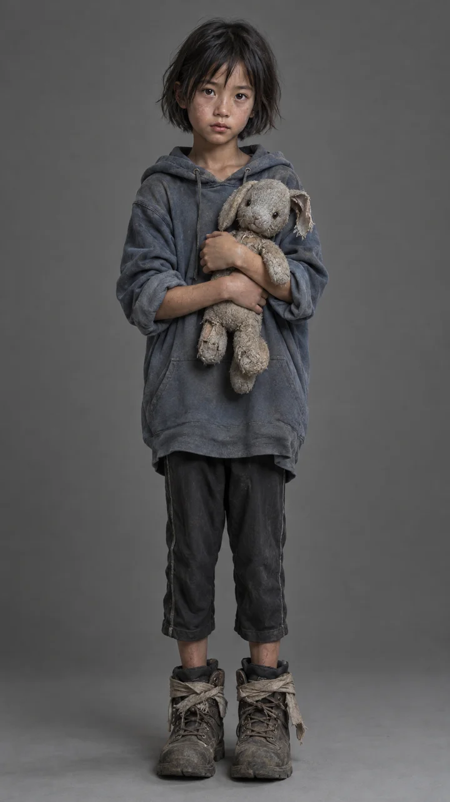
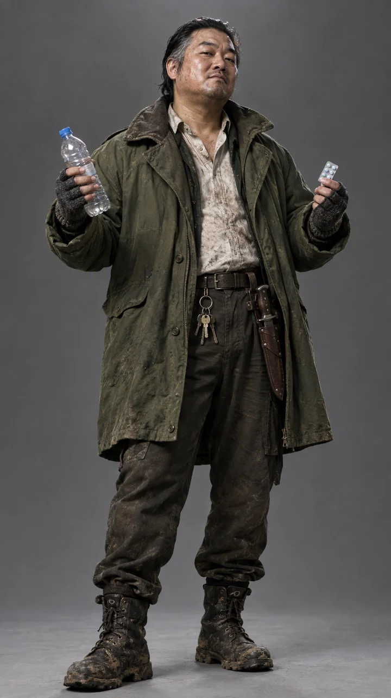
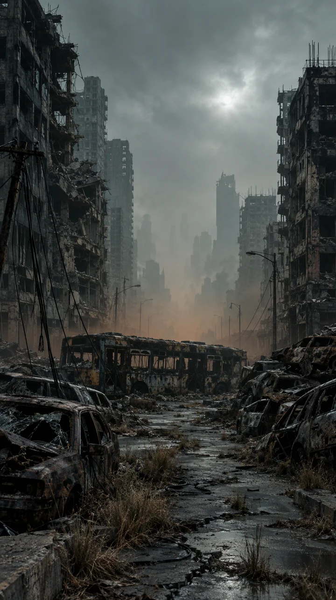
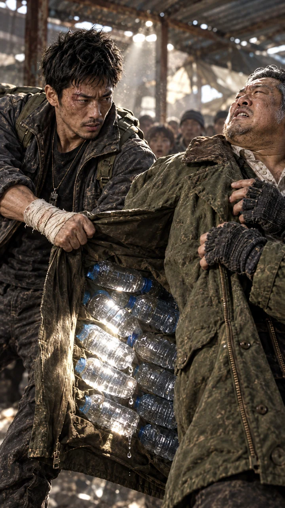
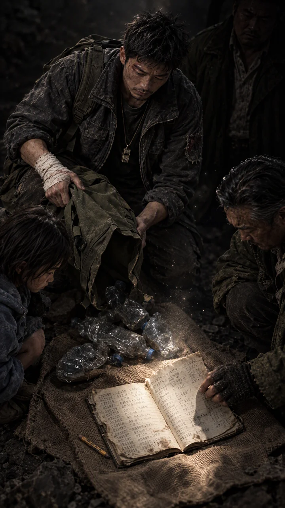
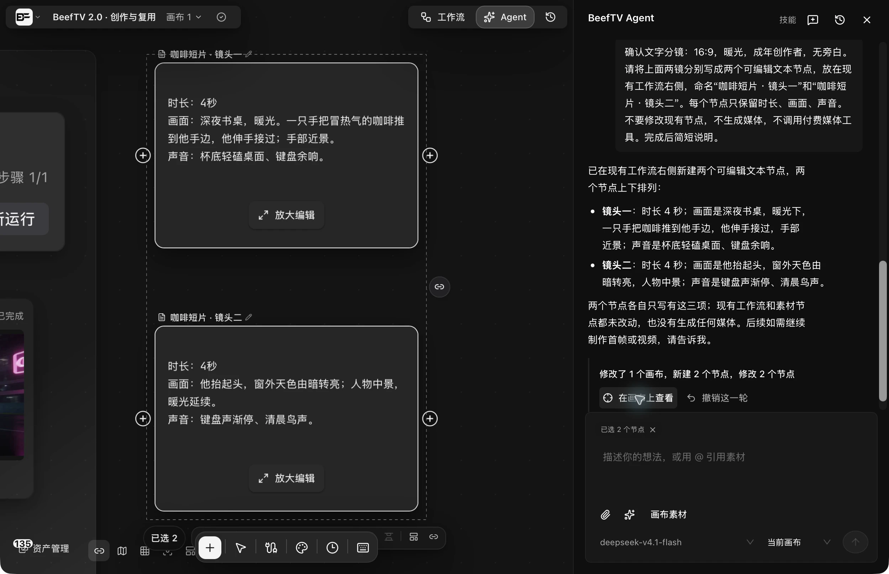
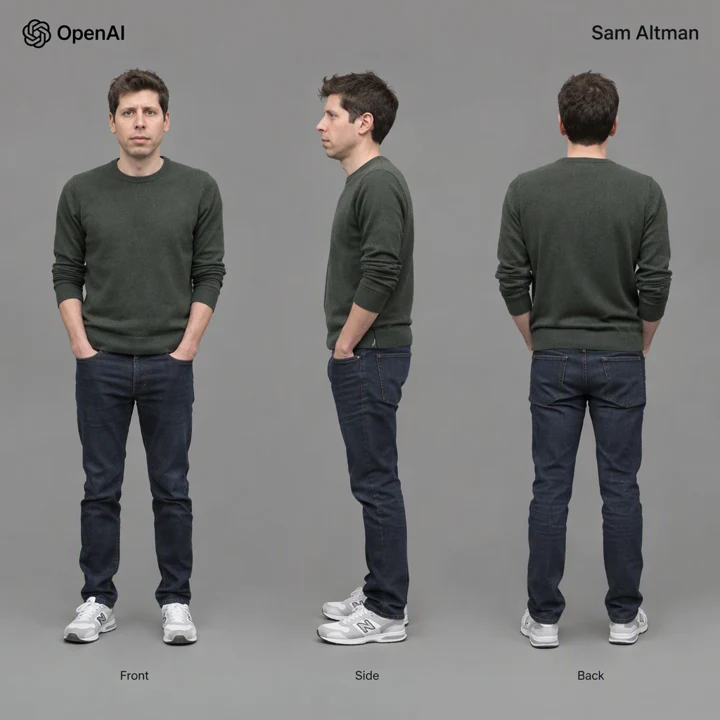
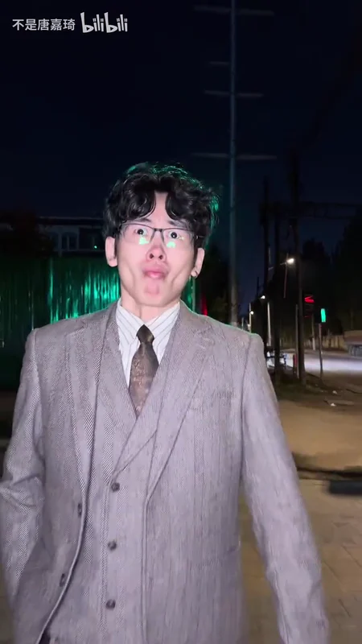
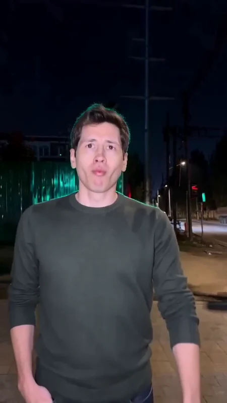

# 创作与复用案例

以下案例基于 BeefTV 2.0.1 macOS 安装版：Agent 用聊天推进短剧的剧本、分镜、图像、视频与旁白制作；三个技能提供具体创作方法；单人物替换工作流连接媒体处理与 AI 生成。各案例分别说明已完成的范围。

## Agent：聊天驱动的短剧制作

**案例：《最后一瓶水》**。用户提出「帮我做一个末日生存题材的爆款短剧」，并要求先定剧本，再做角色与场景设定，最后生成视频。Agent 将讨论结果直接落实到画布，建立 **25 个节点、48 条连线**，保留分镜、参考素材、生成任务与后续编辑入口。

### 制作链路与当前产物

| 环节 | Agent 已执行的内容 | 当前结果 |
| --- | --- | --- |
| 故事与剧本 | 确定世界观、三位角色、两次反转与结尾悬念 | 剧本架构文本节点。 |
| 分镜规划 | 创建 8 镜分镜表，逐镜写入时长、画面、动作、对白、声音与提示词 | 约 59 秒为计划时长，并非已完成成片。 |
| 角色与场景 | 创建独立设定图节点，调用图像模型 | 3 张角色图、2 张场景图已生成。 |
| 镜头制作 | 连接角色参考、分镜首帧与视频节点，确认方案后生成 | 5 张首帧、镜头 4 / 5 / 6 的视频已完成。 |
| 旁白 | 编写开场钩子与结尾悬念，创建并生成声音节点 | 两段中文男声旁白，约 3.8 秒与 4.6 秒。 |
| 素材检查 | 读取并核对设定图、已生成首帧，检查原任务与失败状态 | 静态素材检查有记录；最终连续影音验收尚未完成。 |

本例图像使用 `gpt-image-2.5`，视频使用 Seedance 2.0 Fast，独立旁白使用 MiniMax Speech 2.8 HD。实际生成需要用户确认方案及所用渠道的模型费用。

### 实际使用画面

下图由用户提供，原样展示复杂画布中的素材引用连线，以及 Agent 对话中的制作计划与执行进度。

### 角色与场景设定

| 沈默 | 小满 | 老刀 |
| --- | --- | --- |
|  |  |  |

| 水塔广场配给点 | 末日街区 |
| --- | --- |
|  |  |

### 八镜分镜如何进入画布

| 镜头 | 计划时长 | 剧情任务 | 已生成产物 |
| --- | --- | --- | --- |
| 1 | 6 秒 | 排队领水，建立末日规则与压力。 | 首帧失败，视频尚未生成。 |
| 2 | 7 秒 | 请求多换净水药，被管事拒绝。 | 首帧。 |
| 3 | 6 秒 | 单膝跪地仍被推开，冲突升级。 | 首帧。 |
| 4 | 8 秒 | 拉开大衣，暴露私藏水瓶。 | 首帧、视频。 |
| 5 | 6 秒 | 管事反咬偷水，人群逼近。 | 首帧、视频。 |
| 6 | 9 秒 | 倒出空瓶与编号册子，揭开第二次反转。 | 首帧、视频。 |
| 7 | 8 秒 | 藏水被翻出，小满喝到水。 | 首帧失败，视频尚未生成。 |
| 8 | 9 秒 | 人物回头，远处水塔出现新的威胁。 | 首帧失败，视频尚未生成。 |

分镜表逐行连接镜头首帧和视频节点，角色图作为首帧参考，首帧继续作为视频参考。素材与任务状态可以分别查看，成功结果仍可编辑和复用。

| 镜头 4 · 分镜首帧 | 镜头 6 · 分镜首帧 |
| --- | --- |
|  |  |

### 实际视频与旁白

下方可直接播放三个已生成镜头。网页版为 720 × 1280、24 fps，保留原有声音与完整镜头内容；原片仍保存在仓库中，未拼接成完整短剧。

<table>
  <tr><th width="33%">镜头 4 · 藏水暴露</th><th width="33%">镜头 5 · 反咬偷水</th><th width="34%">镜头 6 · 编号册子</th></tr>
  <tr>
    <td><video src="https://github.com/user-attachments/assets/0c0e1174-479d-4394-a4b2-7c64a3367e0a" controls preload="metadata" playsinline></video></td>
    <td><video src="https://github.com/user-attachments/assets/6d7174f0-ba77-4726-965e-765db79c2e80" controls preload="metadata" playsinline></video></td>
    <td><video src="https://github.com/user-attachments/assets/b304bdd1-5a3f-4e96-929b-46a9cbff29bf" controls preload="metadata" playsinline></video></td>
  </tr>
  <tr><td>约 8 秒</td><td>约 6 秒</td><td>约 9 秒</td></tr>
</table>

- [开场旁白试听](../../../../assets/readme/beeftv-agent-drama-narration-opening.mp3)：旁白稿为「末日的第三十七天，水，比命贵。」
- [结尾旁白试听](../../../../assets/readme/beeftv-agent-drama-narration-ending.mp3)：旁白稿为「水有了。可真正的末日，才刚刚开始。」

**本例展示的是已经发生的跨模态制作过程。** 当前尚有三张首帧失败、五段视频未生成；整片时间线、字幕、导出与最终影音验收未完成。因此不将三个镜头拼接冒充完整交付，也不宣称整片已形成自动验收闭环。过程依据见[素材记录](https://github.com/glanderness/BeefTV/blob/main/assets/readme/CAPTURE.md)。

## Skills：三个文字任务

本次使用三个官方 1.0.0 技能的 `SKILL.md` 原文，导入为本地私人技能后，在 Agent 输入框中选择使用。市场详情加载曾超时，因此本例验证的是「导入后选择技能并执行」，不代表市场安装流程验收。文件哈希与官方版本一致，来源见[素材记录](https://github.com/glanderness/BeefTV/blob/main/assets/readme/CAPTURE.md)。市场当前仍标注「效果尚未验证」。

### 双镜头文字分镜

**目标：** 为独立创作者规划一支 8 秒咖啡短片，从深夜伏案过渡到清晨。

#### 1. 描述创意

选中双镜头文字分镜技能，发送：

> 用选中的分镜技能，规划一支8秒横屏咖啡短片，面向独立创作者：夜晚伏案的人接过咖啡，抬头迎来清晨。请只输出两镜分镜表和待确认项，总计不超过300字，不创建画布节点，不调用图片、视频或音频生成。

助手返回两镜各 4 秒的分镜表，并列出画幅、人物、配音和道具等待确认项。

#### 2. 确认并交付到画布

> 确认文字分镜：16:9，暖光，成年创作者，无旁白。请将上面两镜分别写成两个可编辑文本节点，放在现有工作流右侧，命名“咖啡短片 · 镜头一”和“咖啡短片 · 镜头二”。每个节点只保留时长、画面、声音。不要修改现有节点，不生成媒体，不调用付费媒体工具。完成后简短说明。

助手在画布中创建两个文本节点，实机内容如下：

| 节点 | 时长 | 画面 | 声音 |
| --- | --- | --- | --- |
| 咖啡短片 · 镜头一 | 4 秒 | 深夜书桌，暖光。一只手把冒热气的咖啡推到他手边，他伸手接过；手部近景。 | 杯底轻磕桌面、键盘余响。 |
| 咖啡短片 · 镜头二 | 4 秒 | 他抬起头，窗外天色由暗转亮；人物中景，暖光延续。 | 键盘声渐停、清晨鸟声。 |

**本例完成的是文字分镜交付。** 两个节点可继续编辑、连接后续创作步骤；没有生成图片、视频、音频或成片。

### 采访提纲

**实际输入：**

> 使用选中的采访提纲技能：采访一家社区书店的店主，观众是附近居民，制作3分钟短片。只提供采访提纲，不编造店主经历，不创建节点、不录音、不生成媒体。请包含核心问题、开场、3个开放问题及各2个条件追问、补拍清单和授权待确认项，总计尽量不超过350字。

**实际输出摘要：**

| 交付项 | 返回内容 |
| --- | --- |
| 核心问题 | 这家书店在附近居民的日常里占着什么位置？ |
| 开场 | 你今天来店里，第一件事通常是做什么？ |
| 三个开放问题 | 决定把店开下去的具体时刻；书店被邻居使用的场景；十年后的书店。 |
| 条件追问 | 每题两条，根据读者互动、经营压力、活动、常客、计划或担心继续追问。 |
| 补拍 | 门头、开门、书架与推荐卡、收银台交谈、活动区、街景。 |
| 待确认 | 姓名店名、引用和剪辑授权、读者身份、儿童出镜及经营数据。 |

**如何使用：** 带到采访现场，按回答选择追问；提纲中的问题不代表店主已经有这些经历。

### 素材清单整理

**实际输入：**

> 使用选中的素材清单整理技能。以下仅为我提供的描述，不是附件：A，咖啡杯近景视频4秒，自摄，允许公开；B，窗外清晨照片，自摄，允许公开。目标是8秒治愈短片。请按用途、授权和最少缺口整理一份清单，200字以内。不声称已看过或听过素材，不修改文件、不创建节点、不生成媒体。

**实际输出摘要：**

| 素材 | 建议用途 | 授权记录 | 缺口与下一步 |
| --- | --- | --- | --- |
| A：咖啡杯近景，4 秒视频 | 主体动作候选 | 用户描述为自摄、允许公开 | 还需安排约 4 秒画面。 |
| B：窗外清晨照片 | 环境、结尾候选 | 用户描述为自摄、允许公开 | 确认能否作为结尾静帧补足时长。 |
| 声音 | 尚未提供 | 尚未提供 | 补充环境音或音乐。 |

助手明确说明仅依据用户描述，未读取画面或声音。授权信息来自输入，未经独立核验；本次没有修改素材文件。

## 工作流：单人物替换

**目标：** 用一段动作视频与人物参考图，完成外貌和服装替换；将重复的素材绑定、媒体适配和生成配置保留为可编辑模板。

### 当前模板：处理与生成分工

本地保存的「单人物替换工作流」最新为版本 14。下表按节点列出输入、处理与生成的实际配置。

| 环节 | 当前配置 | 作用 |
| --- | --- | --- |
| 视频输入 | 可替换的动作视频 | 提供动作、运镜与场景参考。 |
| 视频帧率适配 | 本地处理，24 fps | 将本例原视频适配到生成渠道接受的帧率，保留原件。 |
| 图片输入 | 可替换的人物三视图 | 提供目标外貌与服装参考。 |
| 视频生成 | Seedance 2.0 Fast，9:16，时长跟随适配视频 | 同时使用视频与人物图，按提示词执行人物替换。 |

旧版本曾使用深度提取；当前版本 14 已调整为适配视频直接进入生成，不应照搬旧版编辑器截图理解这套模板。24 fps 是本例配置，并不表示所有视频模型都要求这一帧率。

### 输入与实际结果

本例人物参考图：

下面两组图均从完整原片与当前最终文件的**相同时间点**提取，未重绘或修饰画面：

| 原片 · 4.5 秒 | 完整版 · 4.5 秒 |
| --- | --- |
|  |  |

| 原片 · 12.0 秒 | 完整版 · 12.0 秒 |
| --- | --- |
|  |  |

<table>
  <tr><th width="50%">原片</th><th width="50%">人物替换完整版</th></tr>
  <tr>
    <td><video src="https://github.com/user-attachments/assets/1d8e5c42-d6be-40f5-be55-504b7381bf90" controls preload="metadata" playsinline></video></td>
    <td><video src="https://github.com/user-attachments/assets/cadf1e3b-e1fa-4a45-83a0-c8cdacc4d1b1" controls preload="metadata" playsinline></video></td>
  </tr>
</table>

当前完整版为 20.34 秒，720 × 1280，24 fps，带原声。部分片段由较低分辨率生成后放大，不是全片原生 720p。静帧可以说明外观变化，动作连续性和接缝应结合视频查看。

### 从模板运行到完整作品

1. 在画布的「工作流」中选择「单人物替换工作流」，绑定动作视频和人物图。
2. 查看适配帧率、生成模型、画幅、时长来源与提示词；确认费用后运行。
3. 检查处理和生成结果，重点查看近景、远景、转身、跳跃与遮挡。
4. 不满意的片段继续调整。更换素材时复用节点和连线，并按新镜头修改约束。

本地模板版本 13、14 均有成功运行记录，但其中一个后半段结果已被标为「初稿（未采用）」。**执行成功说明链路完成，不等于生成质量通过。**

当前 20 秒完整版还包含逐镜局部修正、特效恢复、时间轴拼接与原声回填，并已作为独立成片节点回到画布。它展示这套流程可以继续迭代到完整作品；这些额外处理尚未全部固化为模板中的自动步骤，不能将该文件当作版本 14 单次运行的直接输出。

### 复用范围

- 可复用：输入槽位、本地帧率适配、参考连线、模型配置与参数组织方式。
- 需随素材调整：人物描述、动作约束、镜头长度、画幅与参考图；当前提示词含针对这段街景的动作说明。
- 需逐镜检查：脸部与手部、快速动作、服装残留、背景变化和接缝。本例仍有生成及重构差异，不承诺逐帧保真或任意视频一键成功。

素材及版本依据见[素材记录](https://github.com/glanderness/BeefTV/blob/main/assets/readme/CAPTURE.md)。早期截帧工作流的两组运行仅作为本地媒体处理验证保留，不再作为首页的主要工作流案例。

## 复现条件

- Agent 和文字技能需要可用的文本模型渠道，结果可能随模型变化，模型调用由所用渠道计费。
- 本地媒体处理需要安装包包含可用的媒体处理工具；生成还需要所选渠道、模型及符合要求的参考素材。
- Agent、技能图片为安装版真实界面；人物对照图来自已有视频的实际帧；工作流编辑器截图由用户提供，原样保留。详情见[素材记录](https://github.com/glanderness/BeefTV/blob/main/assets/readme/CAPTURE.md)。
