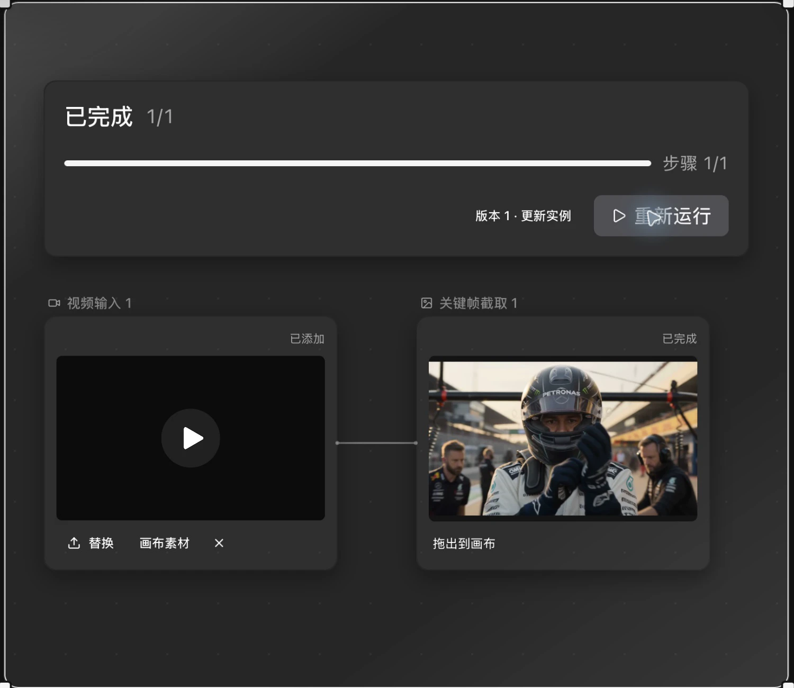
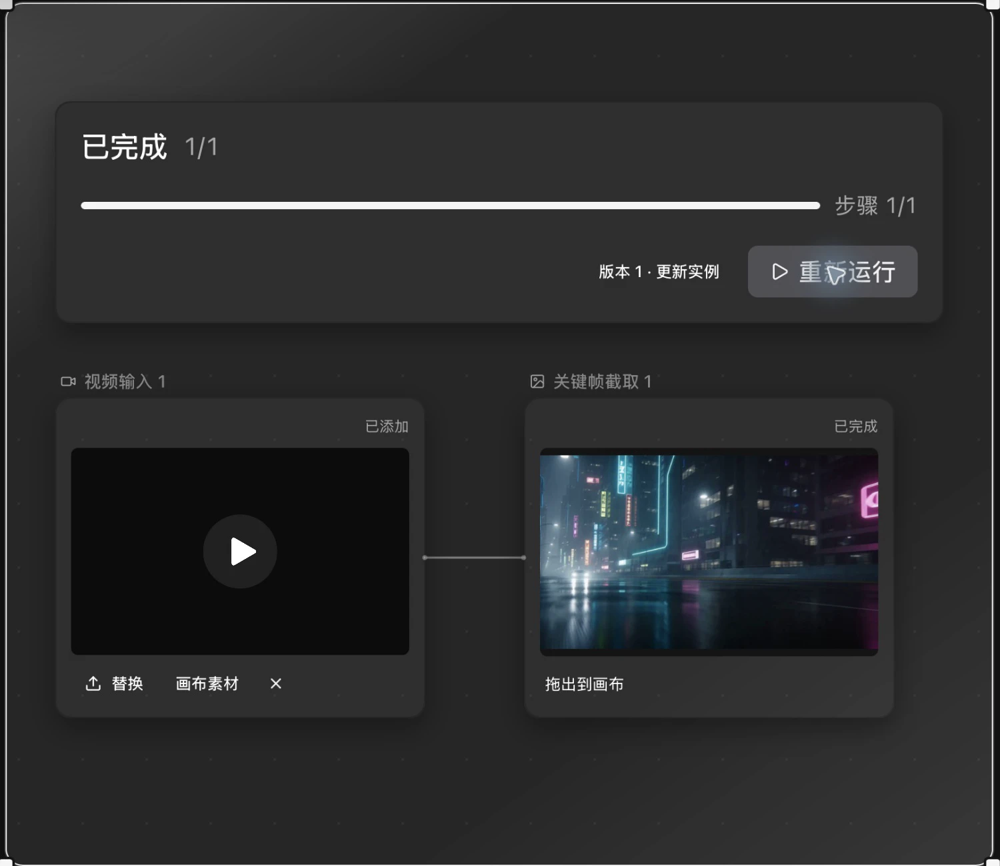

# 创作与复用案例

以下案例在 BeefTV 2.0.1 macOS 安装版中完成：Agent 交付可编辑文字分镜，三个技能提供具体创作方法，工作流更换输入后复用原有步骤。文字任务使用 `deepseek-v4.1-flash`；工作流为本地媒体处理。

## Agent：从创意到两个可编辑分镜

**目标：** 为独立创作者规划一支 8 秒咖啡短片，从深夜伏案过渡到清晨。

### 1. 描述创意

选中双镜头文字分镜技能，发送：

> 用选中的分镜技能，规划一支8秒横屏咖啡短片，面向独立创作者：夜晚伏案的人接过咖啡，抬头迎来清晨。请只输出两镜分镜表和待确认项，总计不超过300字，不创建画布节点，不调用图片、视频或音频生成。

助手返回两镜各 4 秒的分镜表，并列出画幅、人物、配音和道具等待确认项。

### 2. 确认并交付到画布

> 确认文字分镜：16:9，暖光，成年创作者，无旁白。请将上面两镜分别写成两个可编辑文本节点，放在现有工作流右侧，命名“咖啡短片 · 镜头一”和“咖啡短片 · 镜头二”。每个节点只保留时长、画面、声音。不要修改现有节点，不生成媒体，不调用付费媒体工具。完成后简短说明。

助手在画布中创建两个文本节点，实机内容如下：

| 节点 | 时长 | 画面 | 声音 |
| --- | --- | --- | --- |
| 咖啡短片 · 镜头一 | 4 秒 | 深夜书桌，暖光。一只手把冒热气的咖啡推到他手边，他伸手接过；手部近景。 | 杯底轻磕桌面、键盘余响。 |
| 咖啡短片 · 镜头二 | 4 秒 | 他抬起头，窗外天色由暗转亮；人物中景，暖光延续。 | 键盘声渐停、清晨鸟声。 |

**本例完成的是文字分镜交付。** 两个节点可继续编辑、连接后续创作步骤；没有生成图片、视频、音频或成片。

## Skills：三个文字任务

本次使用三个官方 1.0.0 技能的 `SKILL.md` 原文，导入为本地私人技能后，在 Agent 输入框中选择使用。市场详情加载曾超时，因此本例验证的是「导入后选择技能并执行」，不代表市场安装流程验收。文件哈希与官方版本一致，来源见[素材记录](../../../../assets/readme/CAPTURE.md)。市场当前仍标注「效果尚未验证」。

### 双镜头文字分镜

- **输入：** 上述 8 秒咖啡短片创意。
- **实际输出：** 两镜分镜表，包含时长、画面、景别、声音和所需素材；另外列出待确认项。
- **如何继续：** 确认画幅与风格后，让 Agent 交付到画布，见上方完整案例。

### 采访提纲

**实际输入：**

> 使用选中的采访提纲技能：采访一家社区书店的店主，观众是附近居民，制作3分钟短片。只提供采访提纲，不编造店主经历，不创建节点、不录音、不生成媒体。请包含核心问题、开场、3个开放问题及各2个条件追问、补拍清单和授权待确认项，总计尽量不超过350字。

**实际输出摘要：**

| 交付项 | 返回内容 |
| --- | --- |
| 核心问题 | 这家书店在附近居民的日常里占着什么位置？ |
| 开场 | 你今天来店里，第一件事通常是做什么？ |
| 三个开放问题 | 决定把店开下去的具体时刻；书店被邻居使用的场景；十年后的书店。 |
| 条件追问 | 每题两条，根据读者互动、经营压力、活动、常客、计划或担心继续追问。 |
| 补拍 | 门头、开门、书架与推荐卡、收银台交谈、活动区、街景。 |
| 待确认 | 姓名店名、引用和剪辑授权、读者身份、儿童出镜及经营数据。 |

**如何使用：** 带到采访现场，按回答选择追问；提纲中的问题不代表店主已经有这些经历。

### 素材清单整理

**实际输入：**

> 使用选中的素材清单整理技能。以下仅为我提供的描述，不是附件：A，咖啡杯近景视频4秒，自摄，允许公开；B，窗外清晨照片，自摄，允许公开。目标是8秒治愈短片。请按用途、授权和最少缺口整理一份清单，200字以内。不声称已看过或听过素材，不修改文件、不创建节点、不生成媒体。

**实际输出摘要：**

| 素材 | 建议用途 | 授权记录 | 缺口与下一步 |
| --- | --- | --- | --- |
| A：咖啡杯近景，4 秒视频 | 主体动作候选 | 用户描述为自摄、允许公开 | 还需安排约 4 秒画面。 |
| B：窗外清晨照片 | 环境、结尾候选 | 用户描述为自摄、允许公开 | 确认能否作为结尾静帧补足时长。 |
| 声音 | 尚未提供 | 尚未提供 | 补充环境音或音乐。 |

助手明确说明仅依据用户描述，未读取画面或声音。授权信息来自输入，未经独立核验；本次没有修改素材文件。

## Workflows：同一模板，两组素材

**目标：** 保存一次截帧配置，下次替换视频即可复用。

1. 创建「关键帧提取 · 本地处理」，连接视频输入与关键帧截取，截取时间设为 0 秒，保存为版本 1。
2. 添加到演示画布，导入已有赛车视频并运行。
3. 在同一实例中点击「替换」，选择已有霓虹街景视频，再点击「重新运行」。

两次运行均保持模板版本与截帧参数不变，显示「已完成 1 / 1」，分别输出对应视频的首帧：

| 赛车视频：车手画面 | 霓虹街景视频：街景画面 |
| --- | --- |
|  |  |

**复用的是步骤与参数。** 本例在本地执行截帧，没有调用生成模型；不代表单人物替换或其他生成模板的效果验证。

## 复现条件

- Agent 和文字技能需要可用的文本模型渠道，结果可能随模型变化，模型调用由所用渠道计费。
- 本地截帧需要安装包包含可用的媒体处理工具；若提示编码器不可用，应先检查安装包。
- 图片为安装版真实界面的裁切压缩图，没有重绘界面或替换结果文字；详情见[素材记录](../../../../assets/readme/CAPTURE.md)。
