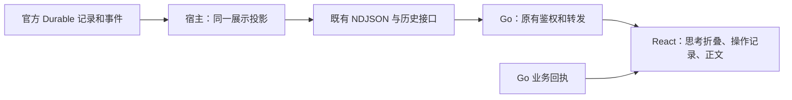

# 助手如何显示思考与工具：调研和最小改造方案

## 1. 结论

**应该复用 Pi 的事件和成熟展示方式，但不建议把整套旧 Pi Web UI 搬进 BeefTV。** Pi 确实有过官方 `@earendil-works/pi-web-ui`，其中 `ThinkingBlock` 就是默认折叠；它采用 Lit Web Components，发布版本停在 `0.75.3`，且已从官方主仓移除。BeefTV 使用的是 `pi-durable@1.3.0`，官方事件已经包含思考增量，缺的是产品展示投影及 React 接入。[P1][P2][P3][P4]

推荐交付一个完整小改动：**有可读思考时显示“正在思考／思考过程”的折叠区域；工具显示正在做什么及可信结果；正文继续逐段显示；结束与重开历史保持一致。** 复用现有 `MessageReasoning` 的界面外壳，增加受控折叠能力；沿现有宿主、Go NDJSON、React 链路传递展示数据。不加模型循环、不另调模型写“思考摘要”、不加用户设置。[B1][B2][B3] 这是工程建议；“显示思考，默认折叠”是本任务中用户已确定的要求。

建议由 **#57 的实施负责人统一完成宿主与前端改动**，前端协作者做界面复核，架构师核对事件身份与历史一致性。估算 **3–4 个工程人日**，含免费替身、恢复及界面验证；不是只接一个组件的半天工作，也不需要等待 #38 的全部重构。估算依据和拆分见第 7 节，尚未派工或授权实施。

## 2. 核实了什么，哪些旧说法需要更新

研究问题是“什么能直接用，什么只需小幅适配”。资料限定为 BeefTV 当前相关模块、#57/#38 输入分支、Pi 固定版本源码、Infinite Canvas 固定源码和 Claude／ChatGPT／Cursor 官方资料。到这些材料足以决定复用方式后停止扩展比较；没有为调研安装整套新框架或运行用户会话。

| 材料 | 本轮证据与限制 |
| --- | --- |
| BeefTV 工作树 | 基线 `47aa5905acc4541216db7de6db688b05003abc20`；开始时无未提交改动。`agent-host/package.json` 和 `bun.lock` 均钉选 Pi 1.3.0。这里只代表本任务基线，不据此判断当前客户端安装版本或 main 的合并状态。[B1] |
| #57／PR #281 输入 | 读取任务分支的报告和新增测试，固定 `2ce663b`。报告记录慢速替身贯穿宿主、Go、React 和原生客户端时逐段显示；另记录一次误发真实模型消息。**本轮没有重跑这些实验，也没有核验用户当前渠道是否仍逐段返回。** [R57] |
| #38 输入 | 固定 `775938b548e6b6c22456e787f797b5553c7da2ec` 的 `docs/plans/assistant-refactor.md`；其 §4.2 要求流、结束、历史共用投影。它是建议稿，不是已实施功能。[R38] |
| Pi 运行时 | 官方 tag `v1.3.0` 对应 `71023aec1546d6d677a65669c5665c0927ce0dd0`。本轮读取官方 npm 1.3.0 归档，校验 SHA-512 与 registry／本地锁文件相符。未安装依赖、未执行 SDK。[P1][P2] |
| Pi Web UI | 官方 npm 最新标签为 `0.75.3`，该包没有 1.3.0；归档源码对应 `a7d8dd3d5db7d66aa5cc6886e32768b1196ce91f`。官方于 `b141e1fa…`（2026-05-20）删除 `packages/web-ui`。核对时官方主仓 `973b74c55fcf096ad5976f8d8850c147ee2e62d4` 的 packages 目录也无 web-ui。[P3][P4] |
| Infinite Canvas | `9cd3deacbcc598361807afc16c059a80dd18b6f9` 的 `web/src/components/agent/agent-chat-message.tsx` 与 LICENSE。[I1][I2] |
| 闭源助手 | 官方文档／版本记录，读取于 2026-10-27；不是登录后的实机截图，也不能覆盖所有账号、模型和平台的 UI 差异。[C1][O1][O2][U1] |

对任务补充说明作四项澄清：

1. “思考不进界面”在本基线得到源码确认：`durable-stream-text.mjs` 只取 `text`；`assistantVisibleReply` 继续剥离正文中的 `think/thinking` 标签；历史公开字段没有思考内容。`MessageReasoning` 的产品调用点只有创作页。[B1][B2][B3]
2. #57 报告中的“需要产品确认后再显示”已被本任务用户的“显示，默认折叠”取代。无需再问是否显示；具体实现仍是本文件提出的方案。
3. #38 的“思考不作为正文”仍成立，但不再解释成“思考永远不能进入任何 UI”。它应进入单独区域。[R38]
4. “上游用 details”不等于所有内容默认折叠：Infinite Canvas 的思考和命令组默认折叠，计划卡却 `useState(true)` 默认展开。不能借上游名义把用户待确认方案、错误或所有计划一起藏起来。[I1]

## 3. 官方组件和主流产品怎么做

### 3.1 Pi：先区分运行时、终端和 Web

| 对象及固定来源 | 正文、思考、工具和进度 | BeefTV 的复用决定 |
| --- | --- | --- |
| `pi-coding-agent@1.3.0` 的 `src/modes/interactive/components/assistant-message.ts`、`tool-execution.ts`，`docs/settings.md` [P1] | 正文与思考分别渲染；`hideThinkingBlock` 默认 `false`，即思考默认可见，能切换显示。工具组件 `expanded=false`，默认有限预览，具体工具可自定义 renderer；有执行中、部分结果和终态显示。 | 是终端 `pi-tui` 组件，不能作为 React DOM 组件导入。借用分块和工具状态规则，不照搬其思考默认值。 |
| `pi-web-ui@0.75.3` 的 `src/components/ThinkingBlock.ts` [P3] | `isExpanded=false`；只有用户点击才切换。流式状态只让标题有动态效果，不自动展开。展开后显示 Markdown。没有本地二次摘要模型。 | **最贴近用户要求的官方参考。** 用现有 React 组件实现同样的默认折叠及用户控制；不用重新造一套设计。 |
| 同包 `Messages.ts`、`MessageList.ts`、`StreamingMessageContainer.ts` [P3] | 按 assistant content 顺序区分 `text`、非空 `thinking`、`toolCall`；工具结果按 `toolCallId` 关联；流式消息与稳定消息分开防重复。 | 采用内容分离、按调用 ID 关联和不重复展示的规则。第一版不重写 BeefTV 整个聊天列表为上游结构。 |
| 同包 `tools/renderers/DefaultRenderer.ts` [P3] | 默认工具 renderer 能直接展示输入 JSON 与结果，并非所有工具一律折叠。`Messages.ts` 也可直接显示上游错误文本。 | 不照搬原始参数、结果和错误外露；使用 BeefTV 已有工具中文标签、业务结果和错误分类。 |
| 同包 `AgentInterface.ts`、`ChatPanel.ts`、README [P3] | `AgentInterface` 订阅 `Agent` 的 `state` 与 `subscribe`，能发 prompt、abort；高层面板还带附件、模型选择、存储及 artifacts。 | 这些不是 Durable 远端聊天的即插即用壳。不得为使用它而在浏览器再启动 Agent。 |
| `pi-durable@1.3.0` 的 `src/harness/events.ts` [P2] | `watchEvents` 提供 snapshot、`message_start/update/end`；update 有 `thinking_start/delta`、整块／整条替换。工具有 start/update/end、`toolCallId`，snapshot 可恢复进行中工具。 | 直接复用已接入的官方流；在现有投影里加入思考和工具身份，不解析供应商 SSE、不增加订阅运行时。 |

**React 技术上可以包一层来使用 Lit custom element，不能说完全用不了。** 但这不等于适配成本为零：旧包只有包根及 `app.css` 两个 exports，peer dependencies 包含 Lit／mini-lit，依赖还带旧 Pi AI、PDF、Office 等能力；高层接口与当前 Durable 不同。为一个折叠区域整包引入，得不偿失。仅复制几十行展示行为到既有 React 外壳，改动和维护范围更小。这是根据包清单和接口作出的架构判断，**未做打包体积或运行兼容性实验**。[P3]

Pi 与 Infinite Canvas 上述固定版本均附 MIT 许可。可复用其代码，但若实际复制组件实现，要保留对应版权及许可文字、记来源版本，并补本项目第三方声明；不能把复制的第三方实现改标为 BeefTV 自有许可。本轮仅调研，没有引入第三方实现。[P5][I2]

### 3.2 Infinite Canvas、Claude、ChatGPT、Cursor

| 产品与证据版本 | 已核实的展示方式 | 本方案采用及未核实处 |
| --- | --- | --- |
| Infinite Canvas `9cd3deac…` [I1] | `AgentReasoningSummary` 用无 `open` 的原生 details，运行时显示转圈及思考标题；`AgentCommandGroup` 也默认折叠，头部有运行／失败数量；`AgentPlanCard` 默认展开并显示已完成数量。正文使用 Streamdown。 | 优先借用它的思考、工具区域布局。它依赖自身 store、主题、翻译、Codex 事件及确认回调，整文件不能直接替换 BeefTV 助手。 |
| Claude 官方帮助，读取于 2026-10-27 [C1] | 回答上方有带计时的 Thinking 提示和可展开区，点击看思考摘要。 | 采用“过程与答案分开、主动展开”。帮助页没有逐端定义所有自动折叠时机；本轮未登录复现。 |
| ChatGPT：官方 Responses 公告 2025-05-21、o1 System Card 与当前 API 文档 [O1][O2][O3] | 官方明确 ChatGPT 展示思考摘要；API 的可读 summary 与不透明 reasoning 数据分开，不能取得原始内部思维链。 | 采用“如实展示供应商给出的可读内容”。**当前 ChatGPT 各端的默认折叠、实时标题和工具卡展开细节未核实**，不把 API 形态冒充客户端 UI 合同。 |
| Cursor 3.0（2026-04-02）官方更新 [U1] | 明确修复“流式中不能展开／折叠 thinking blocks”，证明它允许生成中查看思考。 | 采用“用户展开后新分片不能强行折回”。该条不证明默认展开状态；当前各端默认值未核实。 |
| Cursor IDE 3.19（2026-09-02）官方 Release notes [U2] | 折叠的子代理卡片也显示待批准的文件修改和 MCP 工具调用入口，不必先展开卡片。 | 借用“重要操作不藏在折叠里面”。这页滚动更新，无可钉选源码，本轮未核实全部工具的默认行为。 |

能从这些来源推出的共同方向是：**思考、执行动作、最终回答各有用途；过程允许按需查看，重要操作结果不能只埋在思考里。** 不能推出“所有主流助手在所有状态下默认折叠”。BeefTV 的默认折叠由用户要求决定，Pi 旧 Web 与 Infinite Canvas 提供了直接可用的参考。[P3][I1][C1][U1]

## 4. 内容从哪里来，哪些不应显示

### 4.1 “思考过程”不是完整内部思维链

以下供应商事实以当前官方文档为准，不据此自动升级 BeefTV 依赖或修改模型预算：

- Anthropic 当前 `thinking` 文档说明可读内容是摘要；`display: summarized` 请求摘要，`omitted` 可能只有空文本及签名，`redacted_thinking` 只有不透明加密数据。回放工具对话需保留原块，不能改写签名或尝试解码。[C2]
- OpenAI 的可读内容来自 reasoning summary，需模型支持及请求开启；原始 reasoning token 不公开，encrypted content 不能拿来显示。summary 为空不等于模型没有思考。[O2]
- Pi AI 1.3.0 已把 Anthropic thinking 和 OpenAI summary 增量转成统一 thinking 块；Anthropic 默认请求 `summarized`，redacted 块会带 `redacted:true` 和占位文本。OpenAI Responses 相关路径可请求 `summary:auto`。**但 BeefTV 的 `providerRegistration` 只把 Anthropic 协议标为 reasoning；不能据 Pi 的通用能力声称当前所有 BeefTV 渠道已支持思考。** [P6][B4]

第一版只展示既有官方流实际返回的可读 thinking。优先沿用供应商原有摘要，不让模型额外生成、翻译或补写过程，不要求模型把私有推理写进正文。没返回文本就正常显示等待／工具进度；不伪造“正在分析你的画面”等具体心理活动。确实收到空或 redacted 思考块时可提示“模型未提供可查看的思考内容”，但没有块时不生成空抽屉。[P2][P6；方案建议]

### 4.2 风险与控制

| 风险及依据 | 建议处理 |
| --- | --- |
| 思考文本可能复述系统指令、画布或工具上下文；摘要也不等于事实或安全保证。Pi 展示组件只负责渲染，没有替应用保证保密；OpenAI 也单独讨论了可见摘要的内容风险。[P3][O3；前半为架构风险判断] | 把它当模型提供的参考文本，不当成功回执、用户授权或业务计划。允许显示本用户可读的过程，不声称能保证系统提示永不被模型复述。 |
| 把完整 message 或 SDK block 序列化进浏览器，会顺带暴露签名、不透明载荷、工具输入及上游错误。[P2][P6] | 宿主显式挑选可展示字段，只送普通文本、块身份和阶段。签名、redacted data、headers、原始请求／工具 JSON、完整系统提示不加入新展示字段。官方存储与模型回放保持原样。 |
| 默认折叠只是视觉状态，不提供保密；文本即使未展开也可能已在网络和内存中。[方案判断] | 在宿主构造公开数据时过滤，不把隐藏 DOM 当隔离。现有诊断脱敏不等于思考出口已经安全；新出口须清理已知宿主／模型凭据与明确的凭据格式。对已知秘密的未完整前缀暂缓输出，避免跨分片先泄漏、后替换。真实密钥仍不得进入模型上下文；不能承诺正则识别任意散文中的秘密。[B5] |
| Markdown 中的远程图片、链接或 HTML 可能带出内容，重复流式渲染也可能产生额外请求。[B3；风险判断] | 第一版思考正文使用现有外壳内的纯文本、保留换行；不自动加载图片、执行 HTML 或生成可操作链接。正文现有渲染不因本任务改变。若以后要给思考加 Markdown，单独验证渲染策略。 |
| 工具说“成功”、模型说“已完成”不等于文件已保存或付费已批准。[B1][B2][R38] | 工具状态按准确 `toolCallId` 与官方结果关联；生成进度、素材保存及确认仍读现有 Go 业务回执。没有结果时显示未知／中断，不能默认打勾。 |
| 新展示字段可能被复制回复、诊断或日志自动带走。[B2；待实施核查] | 默认复制仍只复制正文；不新增“复制完整思考”按钮。对诊断、日志、localStorage 的字段选择加负向断言，确保新字段不被整对象展开后顺带导出。 |

用户已经决定显示思考，这些要求用于实现时控制数据传递，不另设一个“是否允许看思考”的产品确认。

## 5. 推荐的最小界面

以下为**设计示意，不是实机截图**。第一版沿用现有回复和业务卡片，不重做完整聊天时间线。

```text
▸ 正在思考…                 ← 收到 thinking 时出现，默认折叠
▸ 正在读取画布…             ← 真实工具状态，展开看安全操作记录

助手正文逐段显示在这里。

待确认的生成方案／失败提示／已保存结果
```

采用规则：

1. **思考默认折叠。** 生成中、完成后、首次打开历史都如此；用户手动展开后，增量、工具切换和结束事件不自动关闭。当前挂载期间按 `sessionId + turnId` 保留展开状态，切换会话不串用；不新增持久偏好或设置。[用户要求；P3][I1]
2. **标题如实表达阶段。** 收到 thinking 才写“正在思考…”，进入正文／工具后写“思考过程”。结束后保留可查看内容；停止保留已收到内容并沿用已有停止提示。观察中断沿用断连恢复提示，不能把 UI 断流写成模型失败。第一版不增加“已思考 N 秒”：本地组件挂载时长并非模型真实思考时长。[B3；方案建议]
3. **工具收成一处操作记录，默认折叠。** 运行中在头部显示“正在读取画布…”等既有中文标签；展开后看工具动作、目标名称和已核实结果。失败原因和用户必须处理的事项在折叠外可见。原始参数与响应 JSON 不给普通用户。[I1][B2；方案建议]
4. **正文继续直接流式显示。** 不用打字动画制造速度。现有正文剥离 thinking 标签的保护保留；不靠解析正文标签来补一个供应商思考通道，防止代码示例、未闭合标签和重放互相污染。[B1][B2][R57]
5. **计划、确认、结果保持各自用途。** 用户要确认的方案及操作按钮不藏在思考里；既有生成任务／素材进度保持真实来源，不按“思考完成”推进。第一版不顺手修改所有计划默认值。[I1][R38；方案建议]

这比直接复制上游整文件少改 store、主题、权限和确认流程；与 Pi 旧 Web 的“默认折叠、用户决定展开”一致。相比原组件，唯一必要的展示能力变化是明确控制展开状态及单独表达思考阶段。[P3][B3]

## 6. 数据与代码怎么改

以下均为**待实施建议**。保留现有传输及业务字段，仅新增思考展示和工具关联所必需的数据；不建立第二份对话数据库。



### 6.1 单一投影，实时和历史共用

当前 `createDurableTextProjection` 已解决初始块、delta、整块／整消息替换、最终尾部和 snapshot 去重，**扩展它，不再写一套只会拼字符串的 reasoning reducer**。[B1]

- 投影输入仍是官方 `watchEvents` 与确切回合记录。补齐 `thinking_start/thinking_delta`、`block/message` 替换、snapshot 和 message_end；输出正文与思考两份只读视图。`text_snapshot.text` 继续只含正文，新增 `reasoning_snapshot` 承载当前轮的完整可替换思考数组。两种流行都来自同一个投影实例，不各存一份事实。[P2][B1；方案建议]
- 每个可读思考片段只需 `id`、`text`、`status`（生成中／已结束／已中断）。已提交片段用本轮、entry 身份和 `contentIndex` 定位。Pi 1.3.0 的进行中 message 没有可直接照搬的 entry ID：沿用投影中单个 current-message 槽，使用轮次内临时键，message_end 时以对应 entry 替换该槽。不要把 generation attempt 当全会话唯一 ID，也不要用文字内容跨消息去重。重连 snapshot 整体替换；展开状态属于轮次，不绑定临时片段键。[P2；方案建议]
- `turn_end` 和历史 `AssistantTurn` 增加同形 `reasoning`；活动历史增加同形字段。正文 `reply` 也使用该投影的确定结果，删除靠 `end.reply || streamed` 决定最终显示的分叉。这落实 #38 §4.2 所需的一小部分，不承接它的授权和接续重构。[R38][B1][B2；方案建议]
- 取数范围由原 `submissionId`、已接受补充输入及本轮起止条目限定，不能只取“会话最后一条 assistant”，也不能仅用下限扫到整份会话尾部。重开旧轮时不得混进后续输入。已有 snapshot 的 `afterEntry` 是宿主补充的过滤信息，不是 Pi 消息自带的用户授权。[B1][P2；方案建议]
- 活动期使用可丢弃内存投影；终态时把公开展示结果作为既有 `beeftv.host` 轮次记录的派生快照保存，和 `active.result` 一起保留到 Go 完成确认。官方 transcript 仍是原始事实；不逐 token 写另一个表、不改模型历史、不重跑模型补摘要。重启从官方记录重建，字段缺失的旧轮不自动补写。[B1；方案建议]
- 公开文本清理使用同一纯函数，实时、终态和历史都经过它。可从已有 eval 脱敏逻辑提取必要规则，但生产模块不能依赖整个 `eval/run-eval.mjs`；还必须补流式未完整前缀的处理。含 `redacted:true` 的块只显示不可查看状态，不把其占位文本、签名或 payload 当思考正文。[B5][P6；方案建议]
- “没有观测到”与“官方返回空快照”保持区别。重连先恢复 snapshot，再接后续增量；停止／失败保留已有可读内容，终态不能把它清空。重复 `requestId` 只观察或回放原轮，不新增模型请求。[B1][R38；方案建议]

### 6.2 工具与 React

- 现有 `lifecycle` 已转发工具开始、结束和业务阶段，但会丢掉官方 `toolCallId`。补传该 ID，以它关联进行中工具及最终 `AgentToolCall`；后者已经有 `toolCallId`，操作桥日志也在写它。相同工具名的两次调用不能互相覆盖；无结果的结束不算成功。[B1][B2][B4][P2]
- 运行中记录只作展示缓存，重连从官方 snapshot 的工具槽及已提交结果恢复；终态操作列表沿用现有 toolCalls 和业务回执，输出字段白名单只给动作、状态、可公开目标和结果摘要。工具输出不并入 reasoning，也不加入新的重试／恢复执行器。[B1][P2；方案建议]
- `web/src/services/api/agent-assistant.ts` 解析新增思考快照并补类型；hook 用替换更新，按会话／请求隔离。实时、终态、历史渲染共用一个页面内消息区域，不能实时侧栏有思考、历史卡片没有。Go 的 `agent_proxy.go` 保持逐行 Flush；检查历史／终态是否经类型化转换而丢字段，不因本需求改成 SSE。[B1][B2；方案建议]
- `MessageReasoning` **保留并小改，不删除也不复制一份**：加可选受控 `open/onOpenChange` 和内容渲染入口；助手控制默认 false、禁止自动开关、用真实思考阶段。创作页原调用行为保持原样，本任务不顺手改它。助手禁用原挂载计时及自动延迟折叠；纯文本呈现可以由受控内容入口提供。[B3；方案建议]

### 6.3 迁移、失败与回退

新字段可选；没有字段的旧 JSONL 或旧 Durable 轮次照常显示现有正文、工具和结果，不显示虚构思考，不迁移旧记录。新字段只扩展既有记录，保持 `DURABLE_VERSION` 与官方 SQLite 格式不变。活动会话读取仍遵守已有所有权和恢复约定。[B1；方案建议]

投影取数失败应报告展示暂时不可用，仍按现有流程观察本轮结果；不能重发请求“找回思考”。运行时断开、模型取消、业务失败三者保留原有区别。回退代码时可忽略新增公开字段，官方原始记录不变；不增加长期双实现或产品开关。[B1][R38；方案建议]

## 7. 交给谁、多大、怎样验收

建议一个实施负责人连续完成这条小改动，避免宿主与页面各自定义思考字段。#57 的负责人已掌握客户端链路及免费替身，适合承接；不代表本轮已发消息、建任务或安排人员。

| 顺序 | 实施内容 | 估算与依赖 |
| --- | --- | --- |
| 1 | 宿主同一投影加入思考、工具 ID，补终态／活动历史字段及有界取数，核查 Go 转发 | 1–1.5 人日；要对照最新 `durable-session-owner.mjs`，避免与 #38 的投影调整重复 |
| 2 | React 类型、hook、共享显示区域及 `MessageReasoning` 受控折叠，沿用工具标签 | 0.5–1 人日；协议形状先由同一负责人确定，前端协作者复核键盘与侧栏 |
| 3 | 免费替身、恢复／隔离反例、原生客户端验证及文档同步 | 1–1.5 人日；保留 #57 测试及 harness；架构师核对事件和历史一致性 |

合计按 **3–4 人日**安排，属静态分析估算，不是交付承诺。若必须修供应商不返回 thinking、升级 Pi、重做完整交错时间线或让所有协议启用推理，属于新增工作，另行估算；第一版不以此为前提。正式安装和发布不包含在这些估算里。

### 7.1 已有代码与测试去留

| 现有对象 | 决定及理由 |
| --- | --- |
| `MessageReasoning` [B3] | 保留、小改后复用。当前 `useState(isStreaming)`、streaming effect 自动展开、结束后一秒自动关闭不符合本任务；不能原样接入。 |
| PR #281 的 `assistant-stream-progress.browser.test.ts` 与 `fixtures/assistant-stream-harness.tsx` [R57] | 保留并在同一套 harness 加思考场景。原测试验证 NDJSON→真实 hook→真实侧栏终态前显示正文；它绕过真实 Go／宿主，不单独证明整条链路，也不覆盖 reasoning。 |
| `agent-host/durable-stream-events.test.mjs` [B1] | 保留正文替换、尾部、去重、快照及错误不泄漏断言。原“thinking 不进 text”断言继续成立；另加“可读 thinking 只进入新字段”的测试，不能简单删除整个保护测试。 |
| `canvas-assistant-copy.ts` 的正文清理及相邻测试 [B2] | 保留；新思考通道读结构化块，不从已清理正文倒推。 |
| #57 原生客户端证据 [R57] | 作为旧行为的输入证据保留，不冒充新思考显示验收。新 UI 要重新用隔离数据及本地假模型验证。 |

### 7.2 验收矩阵

下面均是实施必须提交的证据，**本轮未执行这些产品测试**。

| 验收条件 | 证据级别 | 测试或人工证据入口 | 状态 | 备注 |
| --- | --- | --- | --- | --- |
| 两段思考先后到达；始终默认折叠；展开可见增量；正文开始及结束不强制折回 | fixture／local | #281 浏览器 harness 加慢速 thinking，再接真实 Go／宿主本地替身 | 未执行 | 同时证明终态前已有正文；保留原分段断言 |
| start、delta、block/message 替换、最终尾部、重复 message_end、溢出 snapshot 均不重字丢字 | fixture | 扩展 `durable-stream-events.test.mjs` | 未执行 | 正文和 reasoning 分开断言；重复快照不追加 |
| 思考→工具→思考→正文、多次同名工具／nested tool 正确关联，缺结果不显示成功 | fixture | 官方事件 fixture＋工具操作日志＋浏览器操作区 | 未执行 | 使用准确 toolCallId，未知工具用中性动作名 |
| 完成、停止、异常、无正文工具终结后，实时与重新打开历史内容一致 | fixture／local | `durable-proposal-yield-cases.mjs`、恢复用例及真实 hook | 未执行 | 不以最后一条 assistant 代替本轮全部可见内容 |
| 断流、进程重启、Go 完成确认失败、steer、随后发新轮，仍只显示所属轮次 | fixture／local | `durable-recovery-cases.mjs`、隔离宿主＋Go＋假模型计数 | 未执行 | 观察重连不新增提交／工具执行；恢复沿用既有去重 |
| 无 thinking、空 thinking、redacted、签名跨分片、不支持该能力均可正常回答 | fixture | Pi 1.3.0 事件及本地协议替身 | 未执行 | 不伪造过程；opaque 字段从 NDJSON 和历史均不可读 |
| 原始提示字段、工具 JSON、上游错误、合成密钥不能经新增字段进入网络／历史／诊断；恶意链接图片不自动请求 | fixture／local | 序列化负向断言＋浏览器请求拦截 | 未执行 | 不宣称能识别所有自然语言敏感内容；思考只作参考文本 |
| 键盘可展开、焦点可见、窄侧栏／明暗主题可读、长思考不挤走操作，创作页不退化 | local | 隔离窗口或页面截图、键盘操作、共享组件两个调用点 | 未执行 | 用户手动滚动时不强制跳到底；尊重减少动态效果设置 |

全部用本地假模型及隔离数据，测试服务绑定回环地址并使用合成凭据；不得发送到用户正在用的客户端或真实上游。真实客户端验证只操作专用测试实例。产品测试通过后才能称“已能显示”；真实供应商思考的可用性、延迟和摘要质量仍需另有明确授权的证据，不能由 fixture 推断。

## 8. 本轮交付与后续读取

本轮仅新增本文，完成源码、包版本、许可文本及公开资料核对；未改产品代码、依赖、用户数据、正式应用或任务看板，未发起模型请求，未进行 UI 实机或独立评审。没有复刻闭源助手界面，也不把搜索摘要当成它们所有客户端的现状。文档检查器通过；相对引用与固定上游源码链接已逐项核对，空白检查通过。这些检查只证明文档可交付，不证明方案已运行。

文档作为后续实施建议，**不是已批准的代码实施合同**。用户已确定的两项要求是显示思考、默认折叠；本文件提出的字段、分工和估算在实施前以最新代码复查。记忆只保存来源与已核实取舍，不把整份建议稿提升为已批准要求。

## 9. 来源索引

方括号来源同时标记事实与建议的推导依据；标为“方案建议／判断／未核实”的内容不是上游承诺。固定 GitHub 链接为源码定位；npm 归档中的 `dist/*.js`、`.d.ts` 与源码路径按同版本对应。

- **[B1] BeefTV 47aa590：宿主与事件。** [package.json](../../agent-host/package.json)、[bun.lock](../../agent-host/bun.lock)、[durable-stream-text.mjs](../../agent-host/durable-stream-text.mjs)、[durable-session-owner.mjs](../../agent-host/durable-session-owner.mjs) 的 `publicDurableTurn`／`observe`／`completionRecord`／`history`／`durableStreamEvents`、[server.mjs](../../agent-host/server.mjs) 的 `emitDurable`／`followDurable`、[durable-stream-events.test.mjs](../../agent-host/durable-stream-events.test.mjs)。[固定宿主源码目录](https://github.com/glanderness/BeefTV/tree/47aa5905acc4541216db7de6db688b05003abc20/agent-host)。
- **[B2] 同基线：助手页面与 API。** [agent-assistant.ts](../../web/src/services/api/agent-assistant.ts)、[use-canvas-assistant.ts](../../web/src/pages/canvas/use-canvas-assistant.ts)、[canvas-assistant-turn.tsx](../../web/src/pages/canvas/canvas-assistant-turn.tsx)、[canvas-assistant-sidebar.tsx](../../web/src/pages/canvas/canvas-assistant-sidebar.tsx)、[canvas-assistant-copy.ts](../../web/src/pages/canvas/canvas-assistant-copy.ts)、[agent_proxy.go](../../backend/internal/handler/agent_proxy.go)。
- **[B3] 同基线：共享思考组件。** [message-reasoning.tsx](../../web/src/components/ai/message-reasoning.tsx)、[ai-message-markdown.tsx](../../web/src/components/ai/ai-message-markdown.tsx)、[creation-workspace.tsx](../../web/src/pages/create/creation-workspace.tsx)。
- **[B4] 同基线：协议能力及工具回执。** [canvas-turn.mjs](../../agent-host/canvas-turn.mjs) 的 `providerRegistration`、[operation-bridge.mjs](../../agent-host/operation-bridge.mjs) 的 `toolCallId` 日志；现有约定见 [官方 Pi 复用矩阵](../refactor/pi-official-reuse.md)。
- **[B5] 同基线：现有诊断与评估脱敏。** [assistant-diagnostics.ts](../../web/src/services/diagnostics/assistant-diagnostics.ts) 的 `formatAssistantDiagnostics` 不复制模型正文；[eval/run-eval.mjs](../../agent-host/eval/run-eval.mjs) 的 `redactSecrets` 处理已知环境凭据及常见格式，但它是评估工具，不能视为生产流已有的过滤器。
- **[R57] #57，2ce663b。** [实测报告](https://github.com/glanderness/BeefTV/blob/2ce663b/docs/research/assistant-stream-progress-2026-10-27.md)、[浏览器测试](https://github.com/glanderness/BeefTV/blob/2ce663b/web/test/assistant-stream-progress.browser.test.ts)、[harness](https://github.com/glanderness/BeefTV/blob/2ce663b/web/test/fixtures/assistant-stream-harness.tsx)。读取的是任务分支文件；报告中的历史实测不等于本轮重测。
- **[R38] #38，775938b。** [assistant-refactor.md](https://github.com/glanderness/BeefTV/blob/775938b548e6b6c22456e787f797b5553c7da2ec/docs/plans/assistant-refactor.md)，特别是 §4.2、§6、§7。
- **[P1] Pi 1.3.0，71023aec。** [assistant-message.ts](https://github.com/earendil-works/pi/blob/71023aec1546d6d677a65669c5665c0927ce0dd0/packages/coding-agent/src/modes/interactive/components/assistant-message.ts)、[tool-execution.ts](https://github.com/earendil-works/pi/blob/71023aec1546d6d677a65669c5665c0927ce0dd0/packages/coding-agent/src/modes/interactive/components/tool-execution.ts)、[settings.md](https://github.com/earendil-works/pi/blob/71023aec1546d6d677a65669c5665c0927ce0dd0/packages/coding-agent/docs/settings.md)。归档读取对应 `dist/modes/interactive/components/*.js` 与 `docs/settings.md`。
- **[P2] Pi Durable 1.3.0，71023aec。** [src/harness/events.ts](https://github.com/earendil-works/pi/blob/71023aec1546d6d677a65669c5665c0927ce0dd0/packages/durable/src/harness/events.ts)，归档 `dist/harness/events.d.ts` 的 `MessageChange`／`AgentEvent`／`ToolEventCall`／`watchEvents`；该 API 标记 experimental，升级时需复查。
- **[P3] Pi Web UI 0.75.3，a7d8dd3。** [版本元数据](https://registry.npmjs.org/@earendil-works/pi-web-ui/0.75.3)、[package.json](https://github.com/earendil-works/pi/blob/a7d8dd3d5db7d66aa5cc6886e32768b1196ce91f/packages/web-ui/package.json)、[ThinkingBlock.ts](https://github.com/earendil-works/pi/blob/a7d8dd3d5db7d66aa5cc6886e32768b1196ce91f/packages/web-ui/src/components/ThinkingBlock.ts)、[Messages.ts](https://github.com/earendil-works/pi/blob/a7d8dd3d5db7d66aa5cc6886e32768b1196ce91f/packages/web-ui/src/components/Messages.ts)、[组件目录](https://github.com/earendil-works/pi/tree/a7d8dd3d5db7d66aa5cc6886e32768b1196ce91f/packages/web-ui/src/components)、[DefaultRenderer.ts](https://github.com/earendil-works/pi/blob/a7d8dd3d5db7d66aa5cc6886e32768b1196ce91f/packages/web-ui/src/tools/renderers/DefaultRenderer.ts)、[README](https://github.com/earendil-works/pi/blob/a7d8dd3d5db7d66aa5cc6886e32768b1196ce91f/packages/web-ui/README.md)。
- **[P4] Pi 官方删除与当前目录证据。** [remove web-ui workspace](https://github.com/earendil-works/pi/commit/b141e1fa2460868686ffd19c5d4ced743eee6c24)、[973b74c 的 packages](https://github.com/earendil-works/pi/tree/973b74c55fcf096ad5976f8d8850c147ee2e62d4/packages)。不能把同名社区 Web UI 项目当成这个官方包的持续维护版本。
- **[P5] Pi 许可。** [1.3.0 的 LICENSE](https://github.com/earendil-works/pi/blob/71023aec1546d6d677a65669c5665c0927ce0dd0/LICENSE)、[Web UI 发布时的 LICENSE](https://github.com/earendil-works/pi/blob/a7d8dd3d5db7d66aa5cc6886e32768b1196ce91f/LICENSE)。
- **[P6] Pi AI 1.3.0，71023aec。** [anthropic-messages.ts](https://github.com/earendil-works/pi/blob/71023aec1546d6d677a65669c5665c0927ce0dd0/packages/ai/src/api/anthropic-messages.ts)、[openai-responses.ts](https://github.com/earendil-works/pi/blob/71023aec1546d6d677a65669c5665c0927ce0dd0/packages/ai/src/api/openai-responses.ts)、[openai-responses-shared.ts](https://github.com/earendil-works/pi/blob/71023aec1546d6d677a65669c5665c0927ce0dd0/packages/ai/src/api/openai-responses-shared.ts)。本轮读取同版本归档 `dist/api/*.js`。
- **[I1] Infinite Canvas 9cd3deac。** [agent-chat-message.tsx](https://github.com/basketikun/infinite-canvas/blob/9cd3deacbcc598361807afc16c059a80dd18b6f9/web/src/components/agent/agent-chat-message.tsx) 的 `AgentReasoningSummary`、`AgentCommandGroup`、`AgentPlanCard`、`AgentPendingToolCard`。
- **[I2] 同版本 [LICENSE](https://github.com/basketikun/infinite-canvas/blob/9cd3deacbcc598361807afc16c059a80dd18b6f9/LICENSE)。**
- **[C1] Claude 官方帮助。** [Change the model, effort, and thinking settings](https://support.claude.com/en/articles/8664678-change-the-model-effort-and-thinking-settings)，`View Claude's thought process`；读取于 2026-10-27，无固定产品版本。
- **[C2] Anthropic 官方 API 文档。** [Thinking](https://platform.claude.com/docs/en/build-with-claude/thinking)，`Controlling thinking display`、`Summarized thinking`、`Thinking encryption`、`Redacted thinking blocks`；读取于 2026-10-27。供应商新行为不能直接等同于 BeefTV 固定依赖的实际请求。
- **[O1] OpenAI 官方公告。** [New tools and features in the Responses API](https://openai.com/index/new-tools-and-features-in-the-responses-api/)，2025-05-21，reasoning summaries 与 ChatGPT 的对应说明。
- **[O2] OpenAI 官方 API 文档。** [Reasoning models](https://developers.openai.com/api/docs/guides/reasoning#reasoning-summaries)，读取于 2026-10-27，`Reasoning summaries`。
- **[O3] OpenAI 官方安全说明。** [OpenAI o1 System Card](https://openai.com/index/openai-o1-system-card/)，2024-12-05，`Chain-of-thought safety`。用于风险依据，不当作当前 UI 版本证明。
- **[U1] Cursor 3.0。** [New Cursor Interface](https://cursor.com/changelog/3-0)，2026-04-02，流式思考展开／折叠修复。
- **[U2] Cursor 官方滚动版本记录。** [Release notes](https://prod.cursor.com/docs/release-notes)，Cursor IDE 3.19（2026-09-02）的 `Subagents` 条目，读取于 2026-10-27；全部工具默认值仍标未核实，不采用社区讨论作为产品合同。
