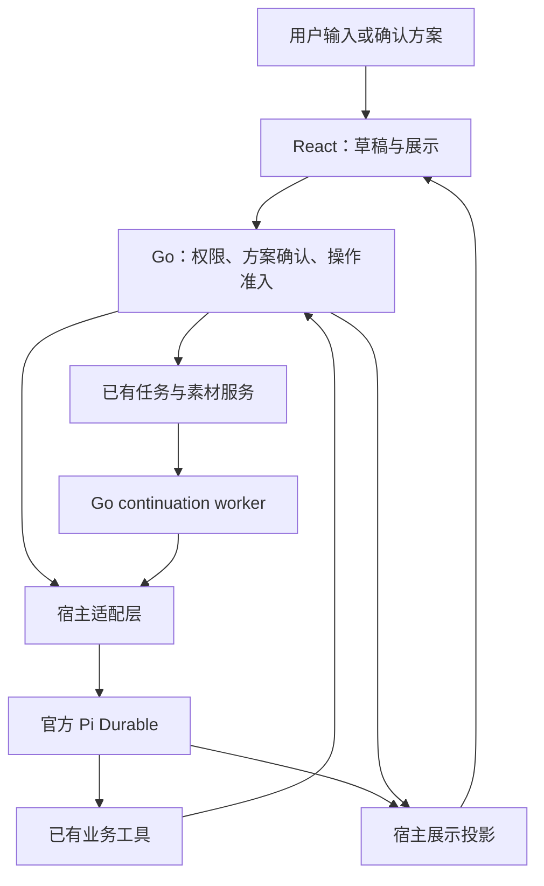

# BeefTV 内置助手重构方案

## 1. 推荐结论

**值得重构，但应保留官方 Pi Durable 与 Go 业务层，逐步消除助手内部重复的提交、接续和展示判断。无需换 Agent 框架，也无需先建一套通用工作流平台。**

用户需要的是：改方案时回复不消失；确认哪一版就执行哪一版；失败后能知道哪些素材已经保存；手动重做一个镜头后，旧制作流程不能把它改回失败；关掉面板仍能继续已确认的制作，重新打开看到同一份结果。

推荐按五步推进：

1. **先修明确问题：** 旧任务不得覆盖新任务；回复的实时显示与历史读回一致；方案明细折叠。这一步可以先交付，不等完整重构。
2. **共用后台任务结论：** 接入 #17/#25 的任务投影，助手只读取生成、保存和节点绑定事实，不再各自推断。
3. **统一方案确认：** 普通图片/视频方案与整片方案都由 Go 核对、授权和创建任务；前端只负责保存草稿、展示与确认。
4. **后台独占自动接续：** 保留现有 continuation worker，删除前端自动认领和发送接续消息的职责。
5. **缩小宿主职责：** 把消息展示转换、业务工具装配与创作方法从会话生命周期代码中分开；制作方法放 Skill，供应商差异和可选功能放既有扩展。

本文是实施者和评审者的路线图，**尚不是用户批准实施的合同**。本轮只新增本文，不修改产品代码，不合并 PR #265，不运行真实客户端或付费模型。阶段划分和接口调整是本方案的工程建议；沿用的用户决策另标来源。

## 2. 核对范围及与其他任务的关系

### 2.1 本轮证据

| 材料 | 本轮读到的版本 | 如何使用 |
| --- | --- | --- |
| 当前工作树与当次 fetch 的 `main` | `70aa2a3d5aaac6cb817f73f759f740d9a55dfc27`，相同 | 现状判断基线；不以旧远端跟踪引用判断 |
| [PR #265][pr265] | 当次 fetch 的 head 为 `a2fc7be474f5e13b97fc52e212aecc63879d9de9`；助手相关 diff 对照 `363248539ed7b59a9283e9726b3a650b916adb42` | 设计参考；不是待直接整包合入的实现 |
| [#36 评审][review36] | 任务分支 `reviews/pr265.md`；评审对象同上 | 旧失败覆盖新任务已有离线对照复现；本轮重读代码确认缺少任务身份校验，未重跑其探针 |
| [#17 原方案](../architecture/generation-task-state.md) | 当次读取任务分支；文件对象 `2516059176b25b90af8295af6147da978039ff1f` 与本工作树相同 | 采用“任务结论由后台给出、免费取回自动做、不得另建取回状态”的方向 |
| [#32 第 4 轮修订][plan32] | 当次读取任务说明与任务分支方案 | 后续用户要求优先于 #17 的旧计费建议；照读 BeefAPI 结论，第三方按已定规则确认重跑，不恢复逐渠道退款规则表 |
| [#25 实施分支][implementation25] | 本轮状态为 review；固定 `52b2a20409d00656d3ae890586a5bd7edcbbdb21`，已读差异概览、`task/outcome.go` 与实施报告 | 是任务投影与图片自动取回的实现依赖；不是全部扣费守门、前端迁移或视频恢复已完成 |
| [#35 会议方案][plan35] | 已读任务分支 `docs/plans/2026-10-26-meeting-backlog.md`，当前为 review | 复用默认模型、流式定位和插件交付的分工；本方案补助手内部实施合同，不再排第二份会议待办 |
| 上游 Infinite Canvas | `9cd3deacbcc598361807afc16c059a80dd18b6f9` | 阅读 Agent 消息、历史、画布桥源码；具体取舍见第 6 节 |
| Pi 官方 | 本地依赖钉选 `1.3.0`；官方 tag 对应 `71023aec1546d6d677a65669c5665c0927ce0dd0` | 阅读 Durable 文档、接口及 Harness 实现；不以最新版功能替代当前版本能力 |

历史记忆在显式 nmem `default` Space 检索；现场不存在单独的 BeefTV Space。旧记忆曾描述“关页面不继续”及 Pi 1.2.0，当前后台 continuation 与 1.3.0 源码优先，不能按旧记忆再实现一次。

对任务补充说明作两点更新：#35 已有建议稿，不再按“正在排待办但没有结果”处理；#17 的计费部分已经受到 #32 后续用户指令修订。其余执行约束保留。#36 对 Seedream 的三项发现是渠道/能力问题，保留在对应修复中，不扩大为助手框架重写。

### 2.2 依赖如何衔接

- **#17/#32 管所有生成入口共同遵守的规则；本方案管助手如何使用这些规则。** 助手不新增自己的 `regenerate` 判定、计费记录或供应商退款表。`regenerate = allowed` 只代表不需额外的重复收费确认，不代表模型已获得新的生成授权。
- **#25 先交付任务投影与图片取回，再接本方案第二步。** 该分支 `ComputeOutcome` 尚有 `ConfirmedUncharged`、审核失败及派发状态判断；不能仅凭字段已出现，就声称 #32 的最新计费设计已实现。计费部分由原任务负责人核对，本方案不在助手里补另一份映射。
- **#35 的逐段显示并入本方案第一步的同一组改动。** 默认模型切换可以独立做；必须分别验证模型名单、初始化默认、用户选择保护和实际路由，不能以更换模型代替流式修复。可选扩展的发行与安装沿 #35 和插件相关任务安排，不在本方案再建安装器。
- **涉及同一文件时顺序整合。** `assistant_production*.go`、`assistantturns/continuation.go`、`taskdelivery` 与生成重构由同一执行负责人整合；`durable-session-owner.mjs` 和助手卡片以确认过的 PR #265 修复为输入。按独立行为拆改动，不整包 cherry-pick #265。

## 3. 当前哪些是结构问题

下表区分“代码已经存在的分叉”“PR 引入且已有复现的退化”和“尚未通过真实运行证明的风险”。文件行号均按本轮基线；实现前重新定位函数。

| 问题与用户影响 | 代码证据 | 判断及处理 |
| --- | --- | --- |
| 旧失败回执把新任务的节点改回失败 | PR #265 `assistant_production_progress.go:85` 起按旧方案写 `taskId/status`，未检查当前关联；#36 有失败/新任务运行的对照复现 | **PR 引入的确定退化，本基线没有这段写回。** 参数相同不能证明还是同一任务。先修身份检查；不要为更新卡片再建一个写节点状态的入口 |
| 普通方案与整片方案走不同生成路径 | `use-canvas-assistant-proposal.ts:57`：`production` 调 `confirmAssistantProduction`；其余调 `executeAssistantProposal`，再调用页面生成函数 | **结构分叉。** 两处都需处理模型核对、重复点击、部分提交、断连及继续制作；应统一为后台确认和受理 |
| 回复在流、终态、历史中含义不同 | `durable-stream-text.mjs` 汇总本次已完成消息与正在生成的消息；`completionRecord` 读取最终 answer；`use-canvas-assistant.ts:479` 又用 `end.reply || current.streamed` | **结构分叉。** 无正文的工具终结会暴露差异；#265 的早先正文汇总是合理修复素材，但不应继续向多个页面添加兜底 |
| 谁自动继续有两个调用方 | `app/assistant_continuation_background.go` 在后台 claim/submit；`use-canvas-assistant-continuation.ts` 也 claim 后调用 `send` | **重复调度职责。** 已有相同 request/turn 身份与 Durable 去重，不能据此断言已重复扣费；仍增加停止、页面切换、重连的组合情况 |
| “素材是否就绪”多处推断 | `productionTargetState`、`assistantturns/continuation.go` 的任务/资源检查、`await-business-tasks.mjs`、`assistantProposalProgress` | **同一事实多套计算。** 几处都读取任务成功、资源保存、节点元数据，稍有差异就可能出现后台等待、卡片已完成或相反 |
| 前端替业务解释工具失败是否已解决 | `canvas-assistant-copy.ts` 的 `assistantUnresolvedFailures` 按工具名/参数比较；新建统一为 `create`；#265 把提案统一为 `propose` | **有误合并风险，非本轮新增复现。** B 素材成功不能证明 A 素材失败已解决；应保留工具回执身份和确切目标，无法关联时不宣称修好 |
| 提案已执行的显示依赖浏览器记忆 | `use-canvas-assistant.ts` 的 `canvas:assistant-proposals`；卡片 `started` 使用 handled 集合与节点进度 | **展示来源分散。** 已有后台授权和任务回执应成为是否受理的依据；本地存储仅保留折叠/隐藏等偏好，不充当执行凭据 |
| 宿主生命周期混入越来越多产品规则 | `durable-session-owner.mjs` 1214 行：会话锁、提交/停止、恢复、正文投影、技能工具、画布刷新、分镜缺失提醒及计划推进 | **职责聚集，长度只是定位线索。** 先按实际接口拆出纯投影和工具装配，保留会话锁与恢复的一处实现；不按行数机械分文件 |

不是框架问题的部分：方案明细默认展开是展示问题；尺寸预检和模型家族识别属于模型能力/协议；默认模型属于配置；流式停顿需要分段测量，不能单凭用户感受归因于框架。它们可以随对应阶段解决，不要求先完成全局重构。

已有能力必须保留：官方 Durable 单一模型循环、稳定请求标识、Go 操作回执、画布版本检查、可信确认后的有限生成授权、后台接续、技能版本固定、停止原请求、输出素材与工程回执。旧 JSONL 保持只读历史，不恢复旧 SDK 执行入口。

## 4. 目标结构：每种事实只有一个写入者

“一个来源”不表示把所有状态塞进一张表。对话是否结束、生成任务是否完成、文件是否保存、用户有没有确认，是不同事实。

| 事实 | 唯一负责者 | 其他层允许做什么 |
| --- | --- | --- |
| 模型输入、工具执行顺序、模型重试、上下文压缩、官方提交终态 | Pi Durable 的 SQLite 与官方运行时 | 宿主转换成产品事件；不另写模型循环 |
| 工作区权限、用户确认、画布版本、业务操作回执与撤销 | Go 的 `assistantturns` / `operations` / 领域端口 | 模型提出操作；宿主携带身份；前端展示确认 |
| 生成任务与取回、输出资源、允许的下一步 | Go 的 `task` / `taskdelivery` / 现有 recovery worker | 助手、节点和任务中心读取同一任务投影 |
| 某任务的哪个输出当前绑定到哪个节点 | Go 的既有画布提交和 `taskbinding` 路径 | 检查当前任务关联并按版本提交；UI 不重建关联 |
| 一次确认后，哪些素材还需提交、何时继续原制作 | 现有 Go `AssistantContinuation` 与授权记录 | 只推进冻结的有限目标；完成后给 Durable 原请求；不成为通用工作流调度器 |
| 回复、工具活动、方案及结果卡的展示 | 宿主从官方记录和 Go 回执生成展示数据，React 渲染 | 前端保留输入草稿、滚动、折叠、网络等待；不保存另一份业务结论 |
| 创作步骤与审片方法 | 已安装并固定版本的 Skill | 使用现有工具；不能扩大权限、创造模型能力或放宽费用确认 |

自动接续只由 C 发起。工具内部可以等待自己已经受理的任务，但不能为同一批任务另发一个自动模型轮次。应用关闭时本地工作暂停，重开后观察原任务并继续；不承诺应用退出后仍在本机执行。

### 4.1 身份与写回约定

保留现有标识，不新增万能的“助手运行 ID”：

- `canvasId + sessionId + requestId` 标识一次用户输入/自动接续输入；`submissionId` 是官方受理记录；`turnId` 是对应 Go 业务轮次，三者不能互换。
- `proposalId + sourceTurnId` 指向一个确认对象；内容变了必须形成新方案。传输超时、刷新页面、重复确认仍使用原对象。
- `operationId` 标识一次工具业务写入；沿用稳定生成键 `proposal:proposalId:nodeId`。任务身份继续包括 `taskId`；同一任务重跑的 `routeRun` 使用生成重构的已有约定，不能用相同节点、相同提示词代替。
- 输出对应 `taskId + outputIndex + nodeId`；保留现有 attach-node effect key。授权的是有限输入，不是“这个节点以后随便生成”。

所有迟到写回，包括失败、取消和成功绑定，都必须在**提交画布的同一事务或版本检查内**确认节点仍属于该任务/本次运行。读完后等网络再无条件写入不够。仅在任务 ID 尚未写入、但原提交身份可以核验且没有更晚关联时补回；身份不明则保留原任务和结果，报告无法更新节点。

当节点已关联新任务：保留新节点状态；旧任务仍有自己的结果和失败记录；停止旧制作对该目标的后续提交，给旧回执明确的目标已变化结果。不要悄悄把新任务纳入旧授权，也不要让旧 continuation 永久等待旧绑定。独立的已受理兄弟任务继续保存，不能因为一项失败丢掉其他成果。

现有 `admitProductionTargets` 已拒绝非空且不同的 `taskId`，但这项保护没有自动覆盖 PR #265 的新写回入口。成功绑定经 `operations/task_bind.go` 进入 `canvas/task_bind.go`，后者已有当前关联及空媒体目标保护。第一步沿既有任务/画布写入路径统一校验；`taskbinding.Bind` 只接受成功任务，不能直接拿它处理失败终态，应该复用现有画布提交能力和身份规则，而不是伪装一次成功绑定。

### 4.2 流式与历史只用一种回复规则

保留 `/api/assistant/chat` 的 NDJSON 和 `text_snapshot`，不换 SSE、不增加事件数据库。把 `durable-stream-text.mjs` 中对官方条目的处理提取为可用于实时快照和终态历史的同一纯投影。

约定如下：

1. 投影只读取本次提交实际涵盖的官方条目；有 steer 时覆盖它归属的原执行及已接受补充，不取“整个会话最后一条回复”。使用官方条目身份去重，并固定本轮起止范围，避免恢复后混进后续轮次。
2. 正在生成时显示本轮可见文本；收到新的快照替换旧快照。工具参数、思考正文、供应商错误原文不作为助手正文。
3. `control.terminate` 无正文结束时保留本轮此前已提交的解释，不额外调用模型写总结。正常结束、停止、失败各自保留可证明的正文和完成情况；读不到终态只算观察中断。
4. `turn_end.reply` 与重新读取历史的 `reply` 来自同一结果；React 不再用 `end.reply || current.streamed` 决定业务历史。旧历史缺正文时，可用已有 `proposal.note` 做明确的方案说明，不能冒充模型已生成的最终回复；无需迁移或重写全部旧会话。
5. `completeTurn` 的 Go 确认失败时保留 `active.result`，恢复只补确认；不重跑模型、工具或生成。这是现有正确机制，不因拆文件改变顺序。

流式性能沿 #35 的测量路径：供应商可见文本 → Durable → 宿主 → Go Flush → 代理（若有）→ React。慢速本地替身应在终态前显示至少三个分开发出的片段。原生桌面与经过 Nginx 的 Web 分别验证；仅代理路径出问题时只调整该助手流路径，不能给全部 API 改超时和缓冲。

### 4.3 普通方案与整片方案共用后台确认

现有 `GenerationTargets` 已被 propose、确认、提交复用；普通内置提案也会通过 `RecordAssistantGenerationProposal` 保存目标。以此扩展现有 `ConfirmAssistantProduction` 的业务职责，不新建“导演执行服务”。

确认流程改为：

1. 前端等画布与模型配置保存完成，提交当前显示的 `proposalId/sourceTurnId` 及版本。目标、模型、提示词、参数、参考关系以 Go 已保存的方案为准；前端传来的内容只用于比对，不能扩大授权。
2. Go 在同一事务内核对方案仍有效、目标未被新任务接管、配置与资源版本没有改变，再按任务公共准入创建有限任务并记录确认结果。新意图、撤销、停止和权限变化均在这里检查。事务只登记本地受理与授权；模型请求和上游生成仍在事务外由既有 worker 执行，不在数据库锁内等待网络或生成完成。
3. 返回已经受理的任务及原 continuation 身份。HTTP 结果未知时，只查询或重试同一方案；不能重新生成 proposalId 来“恢复”。如果任一素材尚未受理，读回逐项结果，不凭前端 `Promise.allSettled` 宣称整批成功。
4. 后台读接口给出“是否确认、已受理任务、是否还能确认、拒绝原因”的只读视图，来源仍是授权、任务回执与已有 invalidation。按钮状态和跨窗口恢复读它，不新建一张镜像状态表。
5. 若提供输入“确认”作为快捷入口，它必须解析到当前明确展示的唯一有效方案，并调用同一可信确认入口；多方案或对象不明确时引导使用现有卡片。模型说“用户已确认”不算凭据。不新增确认开关或额外设置。

`GenerationAuthorizationJSON` 目前同时容纳提案草稿与确认授权，`SourceTurnID` 为空表示未确认。先集中其解析/验证，不急于拆表。当前每个 source turn 只有一份记录；建议同轮修订只保留最后一份有效待确认方案，历史卡片仍能查看但不能继续确认。若要同时确认多个独立方案，应另行设计多方案数据合同，不能让前端数组看起来支持就默认后台也支持。

迁移不得缩减已有能力：普通提案借用的页面生成器有批量、多输出处理，但当前内置 `propose` 同样会调用 `GenerationTargets`，已受到 `count` 及 Seedream 组图限制。必须按实际入口确认哪些组合可用，不能把页面生成器的能力全部算成助手已支持。**不能简单把所有普通提案加上 `production` 字段。** 先用单图/单视频完成纵向验证；当前可用范围未对等前保留明确的旧入口，后台拒绝不支持的新路径，不静默改数量、模型或参考关系。已有可用批量的差异在公共任务准入和冻结输出映射中处理，不再复制页面生成循环；解除既有限制属于另行安排的功能扩展。

首批独立素材、后续依赖素材仍由现有授权推进；确认有限目标不等于金额硬上限，价格预估也不是实扣保证。新内容、增量数量、更换模型或失败后新的付费运行要重新走生成任务的相应准入规则。外部 MCP/CLI 的权限与确认由 #32 管，不能强迫它们创建内置助手轮次。

### 4.4 共用任务读取，分清等待与接续

复用 `taskdelivery.Project` 的输出与 #17 的 `task.outcome`，不在助手新增另一个 `phase`。任务可用还不等于特定画布节点已绑定：Go 另读取既有输出映射、资源是否 ready、节点当前任务关联和画布版本，返回该目标的绑定事实。这是只读计算，没有新的流转状态。

`productionTargetState`、continuation 的结果收集和宿主等待器依次改用这一合同：

- 上游成功但文件未保存：继续读取原任务；不提前唤醒剪辑，不让模型新买一份。
- 某项失败但同批其他项仍在保存：保留等待，先保存其他结果；不提交失败项的下游。
- 读取失败：显示观察暂不可用，保留所有原身份；不能当成没有任务或确定取不回。
- 输出已保存但目标被更晚任务替换：旧流程结束对该目标的推进并报告变化；旧素材不删除，新节点不覆盖。
- 工具内等待与整片后台接续分别服务于“当前已在执行的工具”和“先前确认后等待素材的制作”；同一批受理只选一个继续模型的入口。`awaitBusinessTasks` 可以继续观察自己拥有的任务，不负责 claim continuation 或创建新请求。

随后删除 `use-canvas-assistant-continuation.ts` 的自动 claim/send，只保留查询、展示和停止。已有后台 scanner 用持久 `requestId/turnId` 认领，刷新和两个窗口不改变任务；Stop 先撤销后续业务写权限，再停止对应的官方请求。现有 `stopping` 不能被提前显示为停止成功；已有生成是否能取消、是否计费由任务与上游事实决定，助手停止不代表退款。

### 4.5 展示、宿主和扩展的具体分工

卡片结构保持简单：助手解释 → 方案概览/模型/费用说明 → 默认折叠的逐项参数 → 原确认操作 → 已保存的结果。不再让原始工具日志成为默认主内容；失败信息按具体目标保留，不能因另一项成功整体清掉。只读查看、明暗主题、键盘展开、长内容滚动和停止后的已完成结果都要验证。

宿主按已有对象拆出三个职责即可：

- **会话拥有者：** open、submit、stop、recover、settle，以及同一画布的准入锁。继续留在 `durable-session-owner`，不把锁分散到新服务。
- **展示投影：** 正文、进度、工具回执和终态映射；复用当前 `publicDurableTurn`、`durable-stream-text`，纯转换可分别测试。工具失败匹配按 operation/target/version；无法证明属于同一步时保留记录，不猜已解决。
- **产品扩展装配：** 沿已有 `defineExtension/registry.install` 安装业务工具与 Skill section；画布摘要仍由已有 `studio-digest` 读取。Go 继续控制实际可用能力。

本体保留画布基础能力、AI Native Agent Harness 和 3D，以及它们共用的权限、任务、资源与保存能力。3D 本身由既有负责人维护，助手只通过同一业务工具操作。

制作方法、分镜写法、跨镜一致性建议和审片顺序优先迁到版本化 Skill；供应商参数解释放既有模型能力/协议配置；剪辑、配音、导出等可选能力由既有插件/领域工具按需装配。**“可装配”不等于本轮立即搬走所有现有媒体模块。** 先迁一项已能由现有工具完成的制作方法，验证普通画布操作不依赖它；卸载 Skill 后仍可读画布和查看历史，活动轮次继续使用已固定的版本。

权限检查、稳定身份、保存/绑定条件、模型能力检查和准确报告未完成事项不能仅留在 Skill 提示词里。也不为了拆宿主，直接把所有系统提示迁到插件；先逐组删掉可选创作提示做对照，结果不变才移除常驻内容。无需引入 CodeMode、多 Agent、通用 DAG 或新的依赖来完成本方案。

## 5. 分步交付、迁移和回退

每一步是独立可审查的交付单元，不是“可以任意顺序上线”。新前端只能在对应后台能力已交付后启用；不设新的用户开关。工作量按熟悉仓库者估计：S 为半天至一天，M 为一至三天，L 为三至五天；不含 review、依赖等待与发布，发现能力不对等后重新估算。

| 阶段 | 交付内容及主要文件 | 前置条件 / 可独立发布性 | 验收与停止条件 | 回退办法 |
| --- | --- | --- | --- | --- |
| 1A：旧回执不能改新任务（S–M） | 在既有任务/画布写入处检查当前关联；PR #265 失败写回只作为反例；触及 `assistant_production*.go` 与相邻测试 | 可先交付；不等待 `Outcome` 全部上线 | 旧失败/旧取消/旧成功晚到均不改变新任务；新任务关联和全部身份字段一致。任何用参数相等代替身份的路径都不能通过 | 不上线未检查的写回；已交付的保护不撤掉。出现问题可暂停旧制作对变化目标的写回，保留任务与素材 |
| 1B：回复与卡片稳定（M） | 统一正文投影和终态；保留无正文提案；复用折叠明细；涉及 host、API 类型、hook、卡片 | 可与 1A 分别发布；不带入 Seedream 修改 | 实时文本、`turn_end`、重开历史一致；停止/错误不混入旧轮；零额外总结模型请求；窄侧栏可看到概览与确认 | 回退展示改动或宿主投影实现，保留已保存历史；不删会话，不改磁盘布局标记 |
| 2：助手读取同一任务事实（M） | 接现有 `taskdelivery` 输出与 `Outcome`，集中绑定事实读取；迁 `productionTargetState`、continuation、等待器和卡片进度 | 依赖 #25 任务投影实际交付；先接读取，不以此宣告 #32 扣费实现完成。可独立于第 3 步上线 | 保存、绑定、观察失败三个场景结论一致；旧结果不覆盖新节点；读取异常不触发新任务。未证明这些条件前不删旧读取 | 字段先增后删；可恢复旧展示读取，但保留第 1A 身份保护与已有自动取回；不得回退到新增自动收费路径 |
| 3：方案统一后台确认（L） | 普通提案接已有确认服务；统一任务回执查询；删除其前端逐节点调度和业务 handled 标记；涉及 proposal hook、`assistant_production.go`、operations、数据库/HTTP 文档 | 依赖公共任务准入、一次确认一次受理和重复收费守门；#25 仅有 Outcome 不够。后端先支持，再切前端；可分单项、完整能力对等两个交付批次 | 双击、两窗口、响应丢失、进程重开均回到原任务；改模型/参数/参考须新确认；批量/输出数量不回退。不支持的情况不能偷偷走另一个新路径 | 保留此前已受理的回执并继续查询。切换期旧入口只是已有实现，必须通过同一后台守门；无法证明守门时暂停新确认，不能恢复会绕过授权的旧调用 |
| 4：后台独占自动接续（M） | 删除前端自动 claim/send；UI 仅观察、停止；后台复用既有 worker 和稳定身份 | 第 3 步所有已支持方案均有后台回执后，才能整体删除前端发送；可在第 2 步后先对已有整片路径做关闭页面验证 | 关闭面板、换画布、两窗口、Go/Node 重启都不漏接续或新建一轮；停止未确认时不接纳新意图；客户端草稿不被自动消息消耗 | 恢复旧观察 UI 即可；必要时暂停新自动接续并提供现有明确“继续处理”入口。不得把同一 receipt 复制成新任务，不能通过删回执回退 |
| 5：宿主与可选制作方法分开（M–L） | 纯投影/工具装配移出会话拥有者；一项制作方法移入既有版本化 Skill；按效果缩减常驻提示 | 1–4 的行为合同稳定后做，避免同时改变执行顺序和文件归属。可单独发布 | 官方模型/工具调用次数和回执身份无非预期变化；无 Skill 的画布操作仍可用；固定旧 Skill 的活动轮次可继续。不能以文件变短替代验收 | 恢复前一装配和 Skill 发布版本；保留历史 pin 和官方存储。不得清空会话强制升级，不更换模型运行时 |

迁移统一要求：

- **先增加读能力，再迁调用方，最后删重复逻辑。** 不先删字段迫使其他任务一起升级。桌面 Go、Node、React 按同一发行包验证，Web 部署验证前后端短暂版本错位；不为无限期旧客户端设计永久双执行器。
- **保留数据，不做业务状态回填猜测。** 本方案默认无新队列、无新数据库、无全量历史迁移。若第 3 步确需增加确认读回字段，只在既有记录追加最小结构，并同步数据库及 API 文档；不能把历史 localStorage 的“已处理”反写为用户授权。
- **旧进行中任务沿原身份完成。** 已确认方案不因更新重新创建；旧未确认卡能精确重建则继续核验，无法证明原内容则显示已失效并重新提案，绝不自动确认。
- **安全数据变更不做破坏性回滚。** 有新字段的版本回退时保留字段和回执；旧程序不能理解的授权仅暂停，不把已确认任务变成一份新订单。

不建议把以上五步合成一个大 PR。Sunny 负责助手与 Skill 方向；生成领域的实现者负责公共任务规则。需要用户可见改动的交叉 review、费用批准和正式发布授权，沿项目既有要求执行。本任务不发起发布、外部通知或 AI review。

## 6. 开源做法：哪些可以照搬

研究问题限定为“现有框架能否直接解决回复一致、后台执行、工具可装配”，只检查指定 Infinite Canvas 与已安装 Pi。两者足以作本次选择，不因列更多框架扩大研究。

### Infinite Canvas：复用展示方式，不复制其前端执行桥

固定版本的 [`agent-chat-message.tsx`][upstream-message] 已把正文、工具、计划分开显示，并使用原生 `details` 展开细节；[`codex-event-history.ts`][upstream-history] 按 thread/turn/item 身份合并事件。这能直接指导 BeefTV 的折叠卡片和按条目更新方式。**保留 React/现有设计 token 与 Markdown 组件，只移植需要的片段和测试；无需为了这些展示引入 Streamdown 或复制整套聊天 UI。**

但 [`CanvasSession`][upstream-session] 用进程内 pending Map 将画布请求发给在线客户端；断开时拒绝未完成请求，请求超时为 30 秒。[`use-agent-bridge.ts`][upstream-bridge] 在前端更新节点，并通过 `generateNodeRef` 发起生成。它不能直接满足 BeefTV 的后台持久任务与关页面接续要求。

因此不能泛称“上游没有 Agent”，也不能因为它有 Agent 就替换现有后端。复用选择为：**采用局部展示和身份合并做法；不采用依赖在线页面的任务执行方式，也不复制其补充历史 JSON 作为第二份存储。** 本轮未运行上游产品，不能比较速度或创作质量。

### Pi 1.3.0：继续采用已安装的官方机制

官方 [`Durable README`][pi-durable] 与 [`harness/types.ts`][pi-types]、[`harness.ts`][pi-harness] 表明：`submit` 可按 `requestId` 找回同一 submission；`watch/viewState/watchEvents` 提供快照及增量；慢消费者会收到新快照；扩展通过 registry 装配；官方负责执行恢复。这些正是 BeefTV 需要继续复用的能力。

采用它们处理消息与模型执行，Go 继续负责业务副作用。官方工具 `replay: safe` 只说明允许恢复执行；接口注释明确嵌套执行不等于 exactly-once，**不能据此跳过 Go 回执、任务防重或上游约束**。无需新增队列框架、另一个 Agent SDK 或新的重试调度器。

官方把 Durable 标为实验 API，所以保持当前版本钉选；拆分宿主不顺便升级 SDK。复制源码片段时保留相应 [Infinite Canvas 许可][upstream-license]、[Pi 许可][pi-license]及项目第三方声明。这里没有竞品实跑或引入新依赖的结论。

## 7. 验收：使用真实事故构造离线场景

下表是后续实现必须提交的证据，**本轮状态均为未执行**。引用的现有测试是起点，不表示已有测试覆盖所有新要求。所有故障注入使用隔离数据库、本地脚本模型/假上游；不得让真实供应商成为默认测试目标。

| 验收条件 | 证据级别 | 测试或人工证据入口 | 状态 |
| --- | --- | --- | --- |
| 旧任务失败，新任务相同参数运行；旧取消，新任务已成功；旧成功晚到：节点仍关联新任务 | fixture | #36 复现改为持久回归；`assistant_production_progress_test.go`、`assistant_production_replay_test.go`，补任务/输出绑定交错 | 未执行 |
| 工具终结无正文时，此前解释在流、终态和重开历史一致；有补充输入不混入其他轮次 | fixture | `durable-proposal-yield-cases.mjs`、`durable-stream-events.test.mjs`、`canvas-agent-assistant-stream.test.ts`、`canvas-assistant-proposal-without-summary.test.tsx` | 未执行 |
| Go 完成确认失败后重开，仅补确认，模型请求数与写操作数不增加 | fixture | `durable-recovery-cases.mjs`、`durable-proposal-yield-cases.mjs`；记录 request/submission/operation 计数 | 未执行 |
| 同一确认双击、两窗口、HTTP 回包丢失及重启，受理任务集合不变；一项失败不丢其他成功产物 | fixture | `assistant_production_test.go`、`assistant_production_replay_test.go`、`assistant-production.browser.test.ts`；使用真实 Go SQLite 与假上游 | 未执行 |
| 相同 nodeId 但模型/提示词/参数/参考资源改变，旧方案不能执行；旧方案的成功不掩盖另一目标失败 | fixture | `assistant_proposal_gate_test.go`、`assistant_proposal_invalidation_test.go`、前端 proposal invalidation 用例；补 A 失败/B 成功反例 | 未执行 |
| 读取资源失败只报告暂不能观察；部分文件仍在保存时不提前剪辑；资源 ready 但目标替换不会永久等待 | fixture | `assistant_production_progress_test.go`、`assistantturns/continuation_test.go`、`await-business-tasks.test.mjs`；检查统一任务读结果 | 未执行 |
| 普通单图、视频、实际可达的批次与整片确认行为一致；多输出的既有支持或拒绝行为、目标数量和输出映射不回退 | fixture | `generation_propose_test.go`、`generation_submit_test.go`、`taskbinding/bind_test.go`、`canvas-assistant-proposal-execution.test.ts` | 未执行 |
| 关闭面板或换画布后素材保存，后台仅接续一次；Go/Node 重启仍使用原身份 | local | `assistant_continuation_background_test.go`（app/handler 两处）、`session-lifecycle-host.test.mjs`；启动隔离应用后移除所有前端接续调用再验证 | 未执行 |
| 停止早于提交、停止与新消息交错、停止响应未知；旧停止不终止新输入，已完成操作保留 | fixture | `assistant_request_stop_test.go`、`assistant_continuation_intent_test.go`、`durable-recovery-cases.mjs`、`assistant-stop.browser.test.ts` | 未执行 |
| 只读模式、其他账号/画布、撤销和失效授权均不能提交；缺少公共付费守门时不能以 Outcome 放行 | fixture | `assistant_scope.go` 相邻测试、`assistant_admission_test.go`、`assistant_proposal_gate_test.go` 与生成任务守门测试 | 未执行 |
| 窄侧栏、长回复、多卡片、主题切换及键盘展开可用；保存后重开仍有解释和准确确认状态 | local | 现有 `assistant-production.browser.test.ts`、`assistant-outputs.browser.test.ts` 加截图；使用假模型和假任务，不操作真实付费按钮 | 未执行 |
| 直连及代理均在终态前收到并展示三个文本片段；无正文的推理阶段不伪造正文 | local | 慢速替身贯穿 host → Go → React；代理与原生桌面分别记录各段时间及画面 | 未执行 |
| 第 5 步移动 Skill/装配后，普通画布、旧活动 Skill pin、停止与恢复行为不变 | fixture | `plan-and-skills.test.mjs`、`system-prompt.test.mjs`、宿主生命周期及业务回归；对照移除常驻制作提示前后行为 | 未执行 |

阶段最小验证命令使用仓库已有工具，例如 `node --test agent-host/durable-proposal-yield-cases.mjs`、在 `backend/` 跑相关包的 `go test`、在 `web/` 跑指定 `bun test`。进入整合时按实际 diff 运行 `.github/workflows/quality.yml` 对应检查；构建或 CI 通过不替代上述交错场景。

真实效果另设验收：获得单独预算后，从一条新创作要求开始，只进行必要的费用/方向确认，记录人工介入次数、模型往返次数、各阶段耗时、实际费用、保存产物、重开历史和未完成检查。应覆盖整片制作以及原位改一个镜头。没有这份记录不能宣称连续制作可靠、性能提升或审片质量通过。当前任务禁止此类付费试跑，零费用替身只证明实现机制。

## 8. 交接与本轮完成范围

本方案可以直接用于拆分实施，但不提供已部署或已测试通过的承诺。推荐先做第 1A/1B 步；第二步在 #25 实际交付后承接；第 3 步必须核对公共付费准入；第 4、5 步依次删除重复职责。默认模型、供应商修复和插件发行仍按各自任务推进。

实施前有两项必须重新确认的事实，而不是现在让用户重讲需求：公共任务字段与扣费守门实际实现到了哪一步；普通提案的全部输出形式能否由后台受理且保留当前能力。若不能，对应阶段停在保留旧功能的版本，提交具体差异后再调整方案。

本轮完成源码及资料核对、分阶段设计和文档自检；未运行产品测试、浏览器、模型、真实生成或发布，未做独立架构评审。没有新建任务、修改看板、给协作者发消息或合入参考 PR。

文档检查：技能附带的 `check_delivery_doc.py` 通过；25 个相对引用全部存在；表内引用的测试文件已检查存在，仅证明文件可供后续使用。新文件还以 `git diff --no-index --check /dev/null docs/plans/assistant-refactor.md` 检查空白错误；未为文档运行产品构建。

记忆交接：本文是建议稿，`acceptance_contract_status` 为 `proposed`。只将资料读取顺序保存到 nmem `default`，索引为 `f6bb322c-3ae9-439d-9df3-71bad21df1fc`，不是验收合同；本轮主动保存未另写个人本地笔记。通过评审或用户确认后，实施者以本文及其修订为正式来源，再更新 nmem 的验收索引；不得把本轮研究记忆自动升级为已批准实施。

## 来源与代码导航

- 现有合同：[官方 Pi 复用矩阵](../refactor/pi-official-reuse.md)、[助手后台接续](../refactor/assistant-generation-continuation.md)、[一次确认制作](../refactor/assistant-production-delivery-20261019.md)。历史验收时间和版本不代表当前已运行验证。
- 宿主：[会话拥有者](../../agent-host/durable-session-owner.mjs)、[文本投影](../../agent-host/durable-stream-text.mjs)、[操作桥](../../agent-host/operation-bridge.mjs)、[业务任务等待](../../agent-host/await-business-tasks.mjs)、[系统提示](../../agent-host/system-prompt.mjs)、[固定依赖](../../agent-host/package.json)。
- 业务：[生成提案](../../backend/internal/operations/ops.go)、[冻结生成目标](../../backend/internal/operations/generation_submit.go)、[确认与受理](../../backend/internal/app/assistant_production.go)、[制作进度](../../backend/internal/app/assistant_production_progress.go)、[接续合同](../../backend/internal/assistantturns/continuation.go)、[后台扫描](../../backend/internal/app/assistant_continuation_background.go)、[任务投影](../../backend/internal/taskdelivery/project.go)、[输出绑定](../../backend/internal/taskbinding/bind.go)。
- 界面：[助手控制器](../../web/src/pages/canvas/use-canvas-assistant.ts)、[方案确认](../../web/src/pages/canvas/use-canvas-assistant-proposal.ts)、[普通提案执行](../../web/src/pages/canvas/canvas-assistant-proposal-execution.ts)、[前端接续](../../web/src/pages/canvas/use-canvas-assistant-continuation.ts)、[回复与方案卡](../../web/src/pages/canvas/canvas-assistant-turn.tsx)、[展示计算](../../web/src/pages/canvas/canvas-assistant-copy.ts)、[API 与流读取](../../web/src/services/api/agent-assistant.ts)。

[pr265]: https://github.com/glanderness/BeefTV/pull/265
[review36]: https://todos.dev/app/project/PXDVKNL49Xml43kpH_cph/files?ref=tds%2Fconv-01a17951-d7f6-7aa8-9fa4-65d18fe468db&path=reviews%2Fpr265.md
[plan35]: https://todos.dev/app/project/PXDVKNL49Xml43kpH_cph/files?ref=tds%2Fconv-01a17969-bd63-7920-8ab2-1e3d2e53be8d&path=docs%2Fplans%2F2026-10-26-meeting-backlog.md
[plan32]: https://todos.dev/app/project/PXDVKNL49Xml43kpH_cph/files?ref=tds%2Fconv-01a17933-f0ce-7791-b9c0-f6d7b2e7f531&path=docs%2Farchitecture%2Fgeneration-task-state.md
[implementation25]: https://todos.dev/app/project/PXDVKNL49Xml43kpH_cph/files?ref=tds%2Fconv-01a178f0-5b53-75e5-b206-645e65cbc830&path=docs%2Fimplementation%2Fgeneration-task-state-steps-1-2.md
[upstream-message]: https://github.com/basketikun/infinite-canvas/blob/9cd3deacbcc598361807afc16c059a80dd18b6f9/web/src/components/agent/agent-chat-message.tsx
[upstream-history]: https://github.com/basketikun/infinite-canvas/blob/9cd3deacbcc598361807afc16c059a80dd18b6f9/canvas-agent/src/agent/codex-event-history.ts
[upstream-session]: https://github.com/basketikun/infinite-canvas/blob/9cd3deacbcc598361807afc16c059a80dd18b6f9/canvas-agent/src/canvas/session.ts
[upstream-bridge]: https://github.com/basketikun/infinite-canvas/blob/9cd3deacbcc598361807afc16c059a80dd18b6f9/web/src/pages/canvas/hooks/use-agent-bridge.ts
[upstream-license]: https://github.com/basketikun/infinite-canvas/blob/9cd3deacbcc598361807afc16c059a80dd18b6f9/LICENSE
[pi-durable]: https://github.com/earendil-works/pi/blob/71023aec1546d6d677a65669c5665c0927ce0dd0/packages/durable/README.md
[pi-types]: https://github.com/earendil-works/pi/blob/71023aec1546d6d677a65669c5665c0927ce0dd0/packages/durable/src/harness/types.ts
[pi-harness]: https://github.com/earendil-works/pi/blob/71023aec1546d6d677a65669c5665c0927ce0dd0/packages/durable/src/harness/harness.ts
[pi-license]: https://github.com/earendil-works/pi/blob/71023aec1546d6d677a65669c5665c0927ce0dd0/LICENSE
