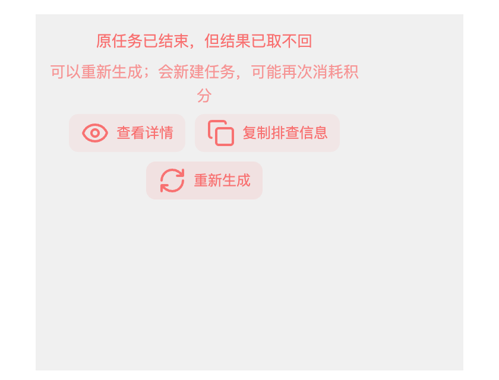

# 上游已生成、画布取不回结果：根因与修复验收

对应两行客户反馈：v2.0.1 第三方渠道的**图片**节点（上游已生成成功，画布报错后节点锁死）与 v2.0.3 的**视频**节点（页面刷新后本地生成中断，报错后节点点不动）。本文记录结果丢在哪一步、节点为什么锁死、两位客户是否同一根因，以及本次修复的范围与验证边界。

## 结论

1. 结果本身没有丢：图片任务的上游请求已经返回成功响应，后端把这份响应存成了**图片创建回执**（`ImageCreateReceipt`）。丢失的是「回执 → 下载 → 写进画布」这一段。
2. 画布拉不到成片，是因为**客户端在提交结论未确认（`submission_unknown` / `submission_uncertain`）时把节点永久锁住**：既不显示「重新生成」，也查不到可用的原任务出口；而唯一能取回已生成结果的后端入口（`POST /tasks/:id/retry` → `Service.RetryTask` → `recoverAcceptedImage`，用已存回执重建结果、不再发上游请求）没有任何前端路径会去调用它。
3. 本次修复让这一步**不需要用户操作**：原任务已在任务中心落定终态时，客户端自己按回执取回结果并写回节点；只有后端明确确认这次结果取不回（4xx）时，才把「重新生成」交回用户，并在新建任务前确认。不新增按钮和设置项。
4. 两位客户属于**同一类失败模式（失败后节点没有出路）的两个不同入口**，不是同一处判定。图片那行有完整证据链；视频那行缺少任务现场记录，只能定位到候选锁定路径，见「两位客户是否同一根因」。

## 结果丢在哪一步

以图片任务为例，正常链路是：

```
客户端提交 → 后端创建任务 → 上游 POST /images/generations|edits 返回 200 + 图片 URL
  → 回执落库 → 下载图片 → 写画布节点
```

失败场景（客户 A 的截图文案「上一次提交结果不明确，为避免重复创建上游任务已停止自动重发」）：

1. 上游请求实际已经成功，响应也到了后端，回执已落库；
2. 客户端在**提交阶段**无法确定这次请求是否成立（网络中断、超时、代理、休眠、响应体读取失败等），后端把任务标成 `stage = submission_unknown`、`status = failed`（`backend/internal/app/task_terminal.go`：`imageRecoveryError` / `providerSubmissionUnknownError` → `submission_unknown`），并停止自动重发（`imageRecoveryLifetime = 23h`、`imageRecoveryMaxSends = 12`、`imageRecoveryWait = 10min`）；
3. 结果停在第 2 步之后：**没有进入下载和画布写入**。任务中心里这条任务是「失败」的，画布节点是「报错」的，但上游其实已经生成了成片。

## 为什么节点锁死

### 后端一侧

- `POST /tasks/:id/retry` 对 `submission_unknown` 任务一律拒绝：`validateImageTaskRetry`（`image_submission.go`，派发状态为 `accepted`/`submission_unknown` 时报「图片请求可能已经生成，请保留任务记录并联系支持查询结果，不要重复提交」）和 `persistedFailureBlocksRetry`（`generation_failure.go`）→ `SubmissionUncertainRetryMessage`。这就是客户截图里的原话。
- 但在被拒绝之前，`Service.RetryTask` 会先尝试 `recoverAcceptedImage`：只要这条任务存有**完整成功的 OpenAI 图片回执**，就用回执重建结果、把任务恢复为成功并进入取回流程，**不会重新提交付费生成**（`image_result_recovery_test.go` 用 `r.Method != "GET"` 断言这一点）。所以「取回原结果」的后端能力一直存在，只是前端从不调用。
- 图片没有「查询上游任务」的入口：`POST /tasks/:id/query-provider` 只支持视频/超分，图片任务会报「该任务不是视频生成任务」。

### 前端一侧

- 恢复流程只在画布加载时对 `canvasNodeNeedsGenerationRecovery` 的节点订阅任务终态并写回结果（`use-canvas-generation.ts`），而且对终态 `failed` 任务直接抛「任务失败」——正是「上游已成功但结果没回写」被当成失败的地方；它从不尝试取回。`submission_uncertain` 也不是 kept-result 码，失败元数据不会置 `resourceReloadAvailable`，所以节点上**没有「继续取回」**。
- `canvasGenerationRetryBlocked` / `imageSubmissionUnknown` 只看 `taskStage`、`generationErrorCode`、`generationSubmissionState`，**不看任务是否已经终态**，因此永远返回「阻断」；`canvasNodeFailureExplanation` 保持 `uncertain: true`、`blockManualRetry: true`，于是：
  - 错误卡不渲染「重新生成」（`GenerationFailureNotice` 的 `showRetry` 要求 `!blockManualRetry`，`ErrorContent` 在 `submissionUncertain` 时干脆不传 `onRetry`）；
  - 悬浮工具条的「重试」也被 `canRetry` 里的 `explanation.uncertain` 挡住；
  - 提示面板的「生成」被 `canvasImageGenerationHasPendingResult` 拦下并提示「提交结果尚未确认，请查询原任务」。
- 三条入口同时关闭，剩下的只有「查看原任务/详情」，而任务详情里没有图片取回动作 → 用户看到的就是「节点锁死，只能换新画布」。

## 两位客户是否同一根因

**结论：同一类失败模式的两个入口，但锁的成因不同。**

- 图片（客户 A）：证据完整——截图文案等于后端 `SubmissionUncertainRetryMessage`，需求表补充记录了画布、节点、模型与「锁定后缺少『确认后查询原任务/解除锁定』的出口」。属于**提交结论已定（任务终态）却仍被锁**，本次修复直接覆盖。
- 视频（客户 B）：现场只记录到「页面刷新后本地生成已中断，请重新生成」这一句错误摘要，类别 `unknown`，**错误来源未记录**；诊断包（187K）留在企微会话里，需求表附件只有一张截图，因此拿不到该节点的 `taskStage`/`generationErrorCode`。按代码可以把「点不动」定位到三条候选路径：
  1. 刷新恢复时节点没有提交标识 → 节点被置为 `status: error` + 「页面刷新后本地生成已中断，请重新生成」（`use-canvas-generation.ts` 的 `INTERRUPTED_GENERATION_DETAILS`）。此时类别是 `unknown`，`blockManualRetry` 为真，错误卡**不显示**「重新生成」（悬浮工具条的重试仍然可用且能提交）。
  2. 刷新恢复时节点有 `taskClientOperationId` 但查不到任务 → 节点被置为 `generationSubmissionState: "unknown"` + `taskStage: "提交结果待确认"` + 「尚未查到上次提交的任务…暂勿重新生成」。这是**真正的死锁**：错误卡、悬浮工具条、面板生成三条入口全部关闭。本次**没有**处理这条路径（见「未覆盖的相邻问题」）。
  3. 节点停留在 `submitting` 且查不到任务 → 节点停在「生成中」，面板生成每次都只提示「暂勿重新生成」。

  这三条路径与客户 A 共享同一把锁（提交结论未定 + 没有可用出口），但成因是**提交身份查不回来**，不是「上游已成功、结果没回写」。因此本行不能判定为与客户 A 完全同因；需要客户 B 的诊断包或任务记录（画布 `q5UKZGmz1RYA5ZQzkcQvn`、节点 `video-1792931135897-0-7w5i1`）才能定性。

## 本次修复：并进已有的取回流程，不另起一套

本分支取代 PR #263。#263 要解决的问题不变，做法改为：**只在 main 已有的恢复扫描里多一步「先请后端按回执重建结果」**，之后的订阅、下载、进度（大小、速度）、失败后的「继续取回」全部用原来那套。

自动做（不花钱、不新建任务，用户不用点）：

- 画布打开、切换、后到快照恢复，或会话中途节点变成「提交结论未确认 + 原任务已终态」时，原有的恢复扫描认领这个节点，调一次 `POST /tasks/:id/retry`（后端先走 `recoverAcceptedImage`，不重新提交上游）。
- 重建成功 → 任务变成「已生成、待取回」，交回原来的 `recoverCanvasGenerationTaskNode` 下载写回，节点显示既有的「正在取回结果」进度、大小和速度。
- 后端拒绝（4xx）→ 先重读一次任务：已经成功（上次恢复的响应丢了）就照常取回；仍是失败/取消才算取不回，节点标 `resourceReloadAvailable: false`，「重新生成」交回用户。
- 网络或服务端错误 → 只试这一次，节点亮起已有的「继续取回」，原失败原因保留；用户点「继续取回」时同样先按回执重建，再照常取回。

需要用户确认（保留原有确认框）：结果确认取不回后点「重新生成」→ 弹「重新生成会新建任务，并可能再次消耗积分」→ 确认才新建任务。还没取过结果时点「重新生成」只提示正在取回，不新建任务。

### 相比 #263 删掉的重复状态

| #263 新增的 | 本分支 |
| --- | --- |
| `canvas-task-result-recovery.ts` 自己的查任务 → 重试 → 5 次 × 2 秒瞬时重试 → `waitForGenerationTask` 等待循环 | 删掉重试和等待，只剩一个函数：调一次 `POST /retry`，被拒时重读一次任务。等待交给原有的任务订阅 |
| 恢复扫描结束后的 10 秒 × 6 次复查循环（`RECOVERY_RESCAN_*`、`canvasNodeNeedsGenerationRecoveryRetry`） | 删掉。节点状态一变，原有的后到补扫（`recoverLateNodes`）就会接手 |
| `autoRecoveredRef` 去重集合 | 删掉。取回一结束节点就离开「待取回」判定（成功、`resourceReloadAvailable: true` 或 `false`），不会被反复认领 |
| 节点元数据 `generationResultUnavailableTaskId` | 删掉，改用已有字段：`resourceReloadAvailable === false` 表示取不回、`true` 表示可继续取回。新建任务时这个字段本来就会被清掉 |
| 手动「重新生成」里先取回的分支（`use-canvas-generation-retry.ts`） | 删掉。重新生成不再自己取回：还没取过就提示等待，确认取不回才弹付费确认 |
| `use-canvas-generation-executor.ts` 待确认提交分支里的取回 | 删掉（还原成 main）。这类节点已由恢复扫描处理 |
| 视频节点「提交结论已定」时的单独确认分支 | 合并进同一个确认分支，图片视频共用 |

保留的：`generationTaskVerdictSettled`、`canvasTaskProvesSubmissionUnknown`、`canvasSubmissionVerdictSettled`、`canvasNodeNeedsOriginalResultRecovery` 几个判定（挪到 `lib/canvas/canvas-node-task-state.ts`），错误卡的三态文案，以及 Codex 指出三处问题的修法与回归测试。

### Codex 在 #263 上指出的三处问题，本分支仍然守住

1. **付费确认判定不统一**：自动取回和手动「重新生成」都只用 `canvasSubmissionVerdictSettled`（stage 或错误码都算）。回归：`test/canvas-settled-retry-confirmation.test.ts`（只有错误码、只有 stage 两种节点，取不回后都必须先确认）。
2. **后到快照重复认领**：`recoverLateNodes` 先按节点 id 去重再认领。回归：`test/canvas-late-generation-recovery.browser.test.ts`「a settled submission-uncertain node in a later remote copy takes its original result back」。
3. **恢复响应丢失被误判取不回**：被拒后先重读任务。回归：`test/canvas-task-result-recovery.test.ts`「a lost recovery response is consumed as the existing result」。

### 第二轮检查（Codex）指出的三处问题与修法

1. **客户端错误码会触发自动重试**：`canvasTaskProvesSubmissionUnknown` 不再认客户端写入的 `generationErrorCode`，只认从任务同步来的 `taskStage` / `taskErrorCode`；节点正在提交或新提交结论未知（`generationSubmissionState` 为 `submitting` / `unknown`）时也不算，因为挂着的任务号可能是普通失败的旧任务。回归：`test/canvas-generation-failure.test.ts`（`clientCodeOnStaleTask`、`resubmissionUnknown`）。
2. **提示词面板绕过付费确认**：`canvasGenerationRetryBlocked` 改为只有确认取不回（`resourceReloadAvailable === false`）才解锁；新增 `canvasGenerationNeedsPaidRetryConfirmation`，提示词面板的「生成」（`use-canvas-generation-executor.ts`）和「重新生成」都先弹同一个确认框，「重新生成」确认过的批次重生成不再重复弹。回归：`test/fixtures/generation-preflight.fixture.ts`（取消不提交、确认后提交 1 次）。
3. **临时拒绝被当成取不回**：只按文案判断不够——读回执时数据库临时失败，后端返回的也是同一句「图片结果尚未确认…」。改为后端在确认取不回的拒绝上带机器原因 `reason: "result_unrecoverable"`（`backend/internal/task/errors.go` 的 `ResultUnrecoverable`），前端只认这个原因：
   - 带原因的：`lifecycle.go` 的提交结论未确认拦截、`validateImageTaskRetry` 的两处拦截、`recoverAcceptedImage` 里回执已确认不能用（多条已接受/未知回执、状态或格式不符、正文解析失败、缺少完整图片）。
   - 不带原因的：读回执的数据库错误、恢复锁冲突（400）、存储配额（403）等，前端原样抛出，节点保留「继续取回」。
   - 回归：后端 `TestImageReceiptRecoveryReasonSeparatesUnrecoverableFromTemporaryFailure`（回执不完整带原因、读回执失败不带）、`TestRetryUnknownAcceptanceAndImageReceiptStayOnOriginalTask`（提交结论未确认拦截带原因）；前端 `test/canvas-task-result-recovery.test.ts`「temporary refusals ...」（含同文案、不带原因的读库失败）。

## 上游 Infinite Canvas 对照

`github.com/basketikun/infinite-canvas` **没有**任务中心、异步任务、结果回写或恢复层，也没有 `submission_unknown` 这类提交不确定状态，没有同类逻辑可照搬，只能按 BeefTV 自身已有的任务/回执模式修。

## 自动调用为什么安全

- 只对 `canvasNodeNeedsOriginalResultRecovery` 为真的节点自动调用：有 `taskId`、节点报错、原任务自己证明提交结论未确认（`taskStage = submission_unknown` 或错误码 `submission_uncertain`）、任务已终态、`resourceReloadAvailable` 还没设过。其他失败状态下 `POST /retry` 可能真的重新提交上游并扣费，仍只能由用户发起。
- 不认只来自客户端的 `generationSubmissionState`：那种任务在服务端可能只是普通失败，重试会真的重新提交。
- 后端对这类任务：有完整成功回执就重建结果；没有就因 `BlocksRetry` 返回 4xx。所以自动路径的效果只有「取回」或「被拒」，不会静默新建付费任务。
- 每个节点只自动试一次，之后的重试都要用户点「继续取回」或「重新生成」。

## 已验证

- `cd backend && go build ./... && go test ./internal/task ./internal/repository` 通过；`go test ./internal/app ./internal/handler` 有 51 项失败，与不含本改动的 main 完全一致（本机未安装渠道插件等环境原因），本改动没有新增失败。
- `cd web && bun run typecheck` 通过。
- `cd web && bun run build` 通过。
- `cd web && bun run test`：3340 通过、1 跳过、1 失败。失败的是 `video-api-contracts.test.ts`「时长未知时在网络提交之前拒绝参考素材」，在不含本改动的 main（7b0dc27）上单独运行同样失败，是 main 上视频时长提示改文案后测试没跟上，与本改动无关。
- 相关测试：`canvas-task-result-recovery`、`canvas-generation-failure`、`canvas-settled-retry-confirmation`、`canvas-late-generation-recovery.browser`（新增「服务端出错时交给继续取回、只试一次」）、`canvas-uncertain-recovery.browser`。

## 验证限制

- 浏览器验证用确定性夹具驱动真实 `useCanvasGeneration` 和节点错误卡，不是已发布的桌面客户端；没有在真实客户端点击任何会付费的按钮，也没有触发真实上游请求。
- 后端 `recoverAcceptedImage` 只恢复完整成功的 OpenAI 图片回执；其他渠道或没有回执时后端拒绝，前端按「取不回」处理——这条只做了单元测试与代码核对。
- 去掉 10 秒 × 6 次复查后，「提交身份还没查回来（没有任务号）」的节点不会自己再查，和 main 行为一致，需要重新打开画布或用户操作。

## 未覆盖的相邻问题

1. 「查不到原任务」的死锁（客户 B 的候选路径 2/3）：待确认提交分支查不到任务时只提示「暂勿重新生成」，节点停在锁定状态。安全修法需要复用节点已存的 `taskClientOperationId` 重新提交（后端 `admitExisting` 按标识去重），属于提交身份语义的改动，未纳入本次范围。
2. 错误卡与悬浮工具条对「能否重试」的判断来源不同（错误卡看 `blockManualRetry`，工具条看 `uncertain`），本次只把批次子节点的按钮统一到节点失败说明。
3. `POST /tasks/by-operation/:operationId` 带画布过滤，画布身份不一致时会把已存在的任务误判为不存在，可能是第 1 条的诱因之一。

## 截图

由 `test/canvas-uncertain-recovery.browser.test.ts` 渲染真实节点错误卡生成，界面与 #263 相同。





