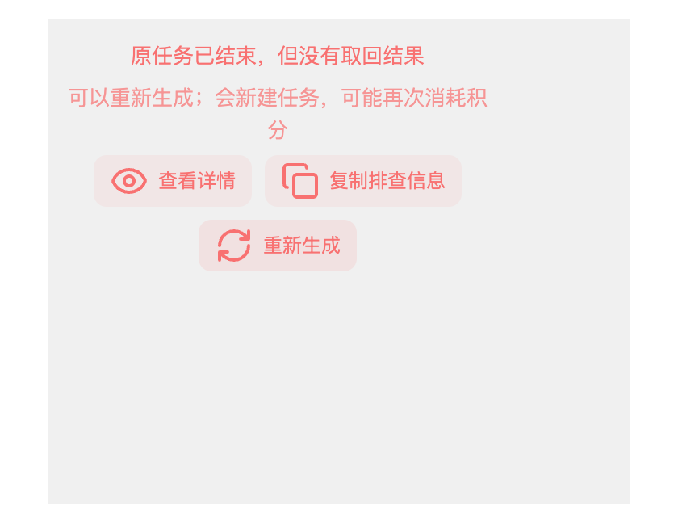
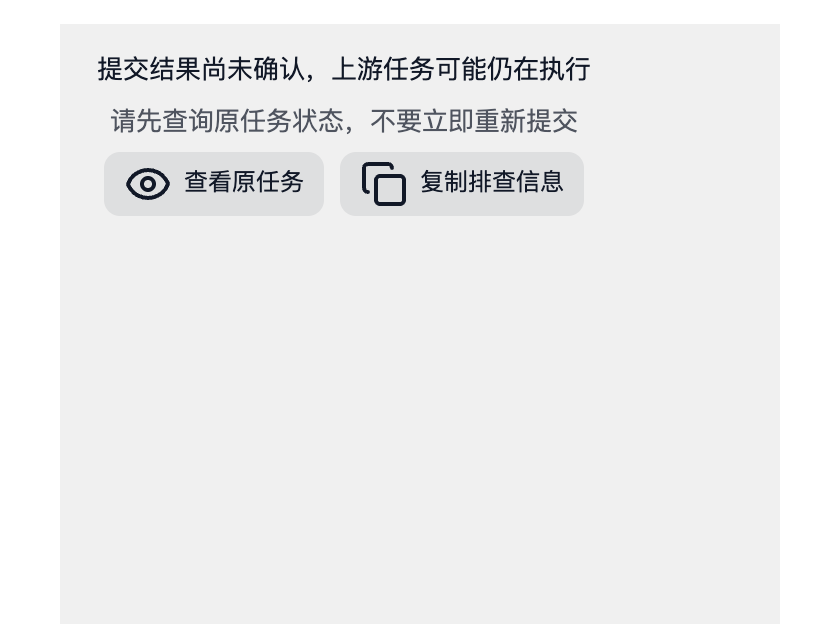

# 上游已生成、画布取不回结果：根因与修复验收

对应两行客户反馈：v2.0.1 第三方渠道的**图片**节点（上游已生成成功，画布报错后节点锁死）与 v2.0.3 的**视频**节点（页面刷新后本地生成中断，报错后节点点不动）。本文记录结果丢在哪一步、节点为什么锁死、两位客户是否同一根因，以及本次修复的范围与验证边界。

## 结论

1. 结果本身没有丢：图片任务的上游请求已经返回成功响应，后端把这份响应存成了**图片创建回执**（`ImageCreateReceipt`）。丢失的是「回执 → 下载 → 写进画布」这一段。
2. 画布拉不到成片，是因为**客户端在提交结论未确认（`submission_unknown` / `submission_uncertain`）时把节点永久锁住**：既不显示「重新生成」，也查不到可用的原任务出口；而唯一能取回已生成结果的后端入口（`POST /tasks/:id/retry` → `Service.RetryTask` → `recoverAcceptedImage`，用已存回执重建结果、不再发上游请求）没有任何前端路径会去调用它。
3. 本次修复把锁的成立条件收紧到「提交结论确实未定」：原任务已在任务中心落定终态时解除锁定，并让「重新生成」先尝试取回原结果，取不回再让用户确认后新建任务。不新增按钮和设置项。
4. 两位客户属于**同一类失败模式（失败后节点没有出路）的两个不同入口**，不是同一处判定。图片那行有完整证据链；视频那行缺少任务现场记录，只能定位到候选锁定路径，见「两位客户是否同一根因」。

## 结果丢在哪一步

以图片任务为例，正常链路是：

```
客户端提交 → 后端创建任务 → 上游 POST /images/generations|edits 返回 200 + 图片 URL
  → 回执落库 → 下载图片 → 写画布节点
```

失败场景（客户 A 的截图文案「上一次提交结果不明确，为避免重复创建上游任务已停止自动重发」）：

1. 上游请求实际已经成功，响应也到了后端，回执已落库；
2. 客户端在**提交阶段**无法确定这次请求是否成立（网络中断、超时、代理、休眠、响应体读取失败等），后端把任务标成 `stage = submission_unknown`、`status = failed`（`backend/internal/app/task_terminal.go`：`imageRecoveryError` / `providerSubmissionUnknownError` → `submission_unknown`），并停止自动重发（`imageRecoveryLifetime = 23h`、`imageRecoveryMaxSends = 12`、`imageRecoveryWait = 10min`）；
3. 结果停在第 2 步之后：**没有进入下载和画布写入**。任务中心里这条任务是「失败」的，画布节点是「报错」的，但上游其实已经生成了成片。

## 为什么节点锁死

### 后端一侧

- `POST /tasks/:id/retry` 对 `submission_unknown` 任务一律拒绝：`validateImageTaskRetry`（`image_submission.go`，派发状态为 `accepted`/`submission_unknown` 时报「图片请求可能已经生成，请保留任务记录并联系支持查询结果，不要重复提交」）和 `persistedFailureBlocksRetry`（`generation_failure.go`）→ `SubmissionUncertainRetryMessage`。这就是客户截图里的原话。
- 但在被拒绝之前，`Service.RetryTask` 会先尝试 `recoverAcceptedImage`：只要这条任务存有**完整成功的 OpenAI 图片回执**，就用回执重建结果、把任务恢复为成功并进入取回流程，**不会重新提交付费生成**（`image_result_recovery_test.go` 用 `r.Method != "GET"` 断言这一点）。所以「取回原结果」的后端能力一直存在，只是前端从不调用。
- 图片没有「查询上游任务」的入口：`POST /tasks/:id/query-provider` 只支持视频/超分，图片任务会报「该任务不是视频生成任务」。

### 前端一侧

- 恢复流程只在画布加载时对 `canvasNodeNeedsGenerationRecovery` 的节点订阅任务终态并写回结果（`use-canvas-generation.ts`）。`submission_uncertain` 不是 kept-result 码，失败元数据不会置 `resourceReloadAvailable`，所以节点上**没有「继续取回」**。
- `canvasGenerationRetryBlocked` / `imageSubmissionUnknown` 只看 `taskStage`、`generationErrorCode`、`generationSubmissionState`，**不看任务是否已经终态**，因此永远返回「阻断」；`canvasNodeFailureExplanation` 保持 `uncertain: true`、`blockManualRetry: true`，于是：
  - 错误卡不渲染「重新生成」（`GenerationFailureNotice` 的 `showRetry` 要求 `!blockManualRetry`，`ErrorContent` 在 `submissionUncertain` 时干脆不传 `onRetry`）；
  - 悬浮工具条的「重试」也被 `canRetry` 里的 `explanation.uncertain` 挡住；
  - 提示面板的「生成」被 `canvasImageGenerationHasPendingResult` 拦下并提示「提交结果尚未确认，请查询原任务」。
- 三条入口同时关闭，剩下的只有「查看原任务/详情」，而任务详情里没有图片取回动作 → 用户看到的就是「节点锁死，只能换新画布」。

## 两位客户是否同一根因

**结论：同一类失败模式的两个入口，但锁的成因不同。**

- 图片（客户 A）：证据完整——截图文案等于后端 `SubmissionUncertainRetryMessage`，需求表补充记录了画布、节点、模型与「锁定后缺少『确认后查询原任务/解除锁定』的出口」。属于**提交结论已定（任务终态）却仍被锁**，本次修复直接覆盖。
- 视频（客户 B）：现场只记录到「页面刷新后本地生成已中断，请重新生成」这一句错误摘要，类别 `unknown`，**错误来源未记录**；诊断包（187K）留在企微会话里，需求表附件只有一张截图，因此拿不到该节点的 `taskStage`/`generationErrorCode`。按代码可以把「点不动」定位到三条候选路径：
  1. 刷新恢复时节点没有提交标识 → 节点被置为 `status: error` + 「页面刷新后本地生成已中断，请重新生成」（`use-canvas-generation.ts` 的 `INTERRUPTED_GENERATION_DETAILS`）。此时类别是 `unknown`，`blockManualRetry` 为真，错误卡**不显示**「重新生成」（悬浮工具条的重试仍然可用且能提交）。
  2. 刷新恢复时节点有 `taskClientOperationId` 但查不到任务 → 节点被置为 `generationSubmissionState: "unknown"` + `taskStage: "提交结果待确认"` + 「尚未查到上次提交的任务…暂勿重新生成」。这是**真正的死锁**：错误卡、悬浮工具条、面板生成三条入口全部关闭，且没有任何兜底出口，本次修复**不覆盖**（没有任务号，也就谈不上「任务已终态」）。
  3. 节点停留在 `submitting` 且查不到任务 → 节点停在「生成中」，面板生成每次都只提示「暂勿重新生成」。

  这三条路径与客户 A 共享同一把锁（提交结论未定 + 没有可用出口），但成因是**提交身份查不回来**，不是「上游已成功、结果没回写」。因此本行不能判定为与客户 A 完全同因；需要客户 B 的诊断包或任务记录（画布 `q5UKZGmz1RYA5ZQzkcQvn`、节点 `video-1792931135897-0-7w5i1`）才能定性。

## 本次修复

不新增按钮和设置项，只把已有的「重新生成」在正确的时候重新交回给用户：

| 文件 | 改动 |
| --- | --- |
| `src/lib/generation-task-display.ts` | 新增 `generationTaskVerdictSettled`：原任务已终态（failed/cancelled）即「提交是否成立已有结论」 |
| `src/pages/canvas/canvas-generation-failure.ts` | `canvasGenerationRetryBlocked` 的「提交结果未确认」分支改为 `!generationTaskVerdictSettled`；待取回结果的提示区分「结论未定」与「任务已结束但结果没取回」 |
| `src/lib/canvas/canvas-depth-capture.ts` | 节点失败说明：提交结论未确认但任务已终态时，文案改为「原任务已结束，但没有取回结果 / 可以重新生成；会新建任务，可能再次消耗积分」，`uncertain` 置否、`blockManualRetry` 放开，`blockAutomaticRetry` 保持禁止（不会后台自动重发） |
| `src/components/canvas/canvas-node-content.tsx` | 错误卡据此重新显示「重新生成」 |
| `src/components/canvas/canvas-node.tsx` | 批次子节点的「重新生成」改用同一份节点失败说明，避免两处判断不一致 |
| `src/services/canvas-task-result-recovery.ts`（新增） | 取回原结果：先查任务；还在跑就等；已终态就请后端按回执恢复（`POST /tasks/:id/retry`，不重新付费）；后端明确拒绝（4xx）才返回「取不回」，网络/服务端错误向上抛出，调用方不得据此重复提交 |
| `src/pages/canvas/use-canvas-generation-retry.ts` | 图片节点：结果可能已生成时先取回原结果，取不回再弹确认后新建任务；视频节点在「提交结论未确认但任务已终态」时不再发一次注定被拒的存储任务重试，改为确认后重新生成 |
| `src/pages/canvas/use-canvas-generation-executor.ts` | 待确认提交优先按已有任务号查任务（原先只按提交标识回读，且用非空断言） |

修复后的行为：节点报错但原任务已终态 → 错误卡重新给出「重新生成」→ 点击后先查原任务并尝试取回已生成的结果（不花钱）；取不回时弹「重新生成会新建任务，并可能再次消耗积分」确认框，取消则保留原任务记录、不新建任务。面板「生成」仍然拦住「可能还留着结果」的节点，把用户指向这条取回路径，避免静默重复付费。

## 上游 Infinite Canvas 对照

`github.com/basketikun/infinite-canvas`（`/tmp/ic-upstream` 浅克隆）**没有**任务中心、异步任务、结果回写或恢复层：它直接同步调用 provider，没有 `submission_unknown` 这类提交不确定状态，也没有「任务已成功但结果未回写」的中间态。因此本次缺陷在上游没有同类逻辑可照搬，只能按 BeefTV 自身已有的任务/回执模式修。

## 已验证

- 前端类型检查：`cd web && bun run typecheck` 通过。
- 前端构建：`cd web && bun run build` 通过。
- 单元/组件测试：改动涉及模块的 32 个既有测试文件（318 项）通过，含 `canvas-generation-failure`、`canvas-image-save-barrier`、`canvas-binding-conflict-actions`、`canvas-task-binding-recovery`、`canvas-generation-orchestration`、`generation-task-display`、`vod-image-errors`、`vod-moderation` 等；`bun run test:canvas` 36 项通过。
- 新增单元测试：`test/canvas-task-result-recovery.test.ts` 覆盖「已终态任务按回执取回而不重新提交」「仍在执行的任务只等待」「后端拒绝即取不回且不新建任务」「基础设施错误必须上抛而不是被当成拒绝」「已取消的请求不触达后端」。
- 新增浏览器测试：`test/canvas-uncertain-recovery.browser.test.ts` 用真实 Chrome 渲染画布节点错误卡，断言：任务终态时出现「重新生成」且可点击、文案为「原任务已结束，但没有取回结果」；结论未定时**没有**「重新生成」且保留「查看原任务」；结果已保留时**没有**「重新生成」但保留「继续取回」并可用。
- 既有浏览器测试：`canvas-node-screen-controls`、`canvas-delivery-control`、`canvas-image-recovery`、`canvas-video-recovery` 通过（1 项按条件跳过）。

## 验证限制

- 浏览器验证使用确定性夹具渲染节点错误卡，不是已发布的桌面客户端；没有在真实客户端里点击任何会付费的生成按钮，也没有触发真实上游请求。
- 「取回原结果」依赖后端 `recoverAcceptedImage`：它只恢复**完整成功的 OpenAI 图片回执**。非 OpenAI 协议渠道、回执不完整或确实没有回执时，后端会拒绝重试，前端按「取不回」处理并转入用户确认后重新生成——这条分支只做了单元测试与代码核对，没有真实渠道现场验证。
- 客户 B 的节点状态未取得（见「两位客户是否同一根因」），因此本行只完成了根因定位与候选路径分析，**没有**在本改动内修复「提交身份查不回来」的死锁。

## 未覆盖的相邻问题

1. 「查不到原任务」的死锁（客户 B 的候选路径 2/3）：`use-canvas-generation-executor.ts` 的待确认提交分支查不到任务时只提示「暂勿重新生成」，节点永久停在锁定状态。安全修法需要复用节点已存的 `taskClientOperationId` 重新提交：后端按该标识去重（`admitExisting`：输入指纹一致则返回原任务，不一致返回 409 冲突），因此既不会重复付费，也不会把改动过的输入错当成原任务。这需要把已存的提交标识接进提交流程，属于提交身份语义的改动，未纳入本次范围。
2. 错误卡与悬浮工具条对「能否重试」的判断来源不同（错误卡看 `blockManualRetry`，工具条看 `uncertain`），本次只把批次子节点的按钮统一到节点失败说明，其余保持原状。
3. `POST /tasks/by-operation/:operationId` 带画布过滤（`internal/task/reads.go` 中 `task.ProjectID != projectID` 即 404），画布身份不一致时会把「已存在的任务」误判为不存在，是上面第 1 条死锁的可能诱因之一。

## 截图




