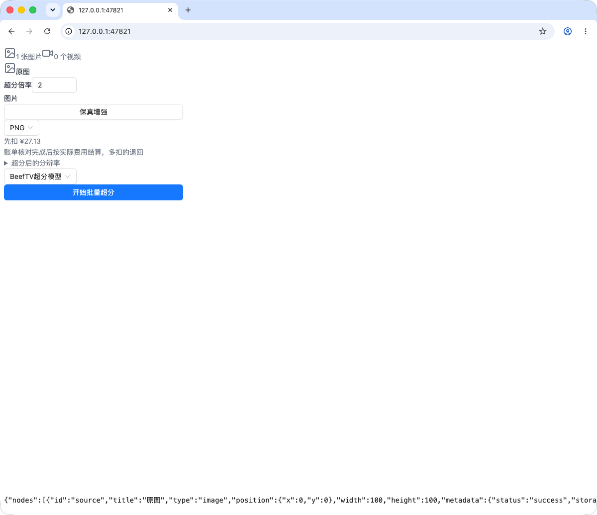
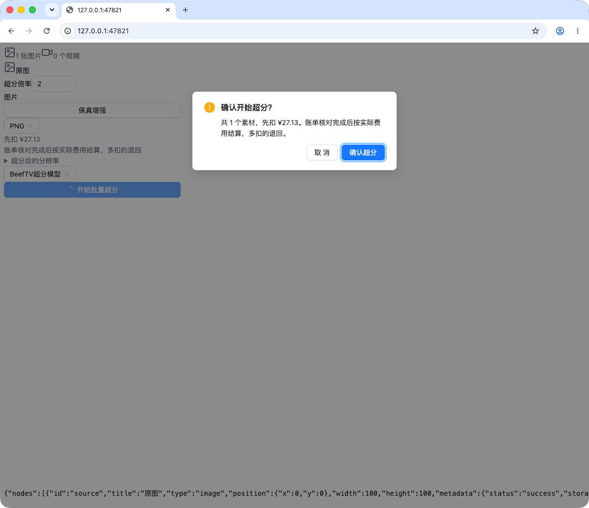

# 超分费用文案验收

对应本 PR。截图来自本地渲染的真实 `UpscaleNodeContent` 组件和真实 AntD 确认弹窗，报价接口返回 27.13；不是已发布桌面版本，也不是客户数据，全程没有提交付费任务（弹窗看完点「取消」）。

改动前节点只写「预计预留 ¥27.13」、确认框写「共 1 个素材，预计预留 ¥27.13。完成后按实际费用结算。」，容易被读成每张固定 ¥27.13。现在拆成「先扣 ¥27.13」和结算规则两行，并把退款条件写清楚是账单核对完成后。

生产上超分的账单结算目前还没有成功过一次，任务只扣预扣额、没有退过差额；这两张图验证的是文案显示，不代表结算已经恢复。